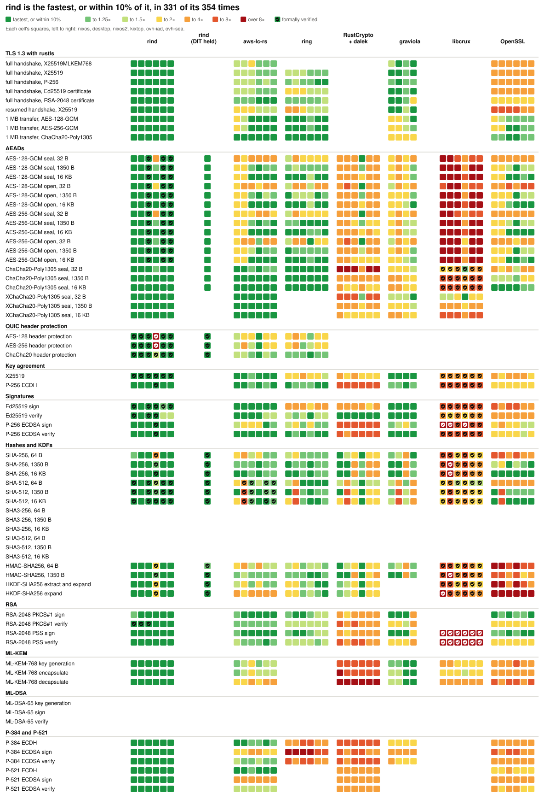
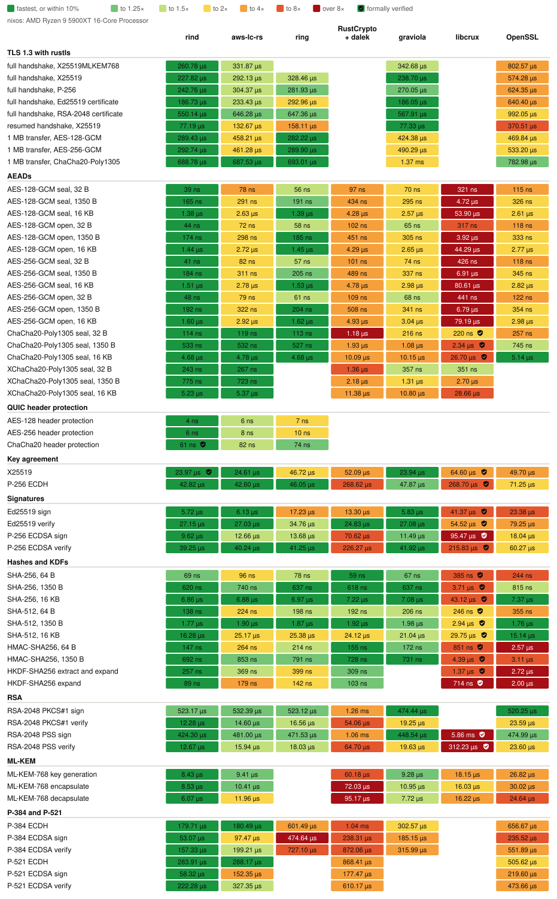
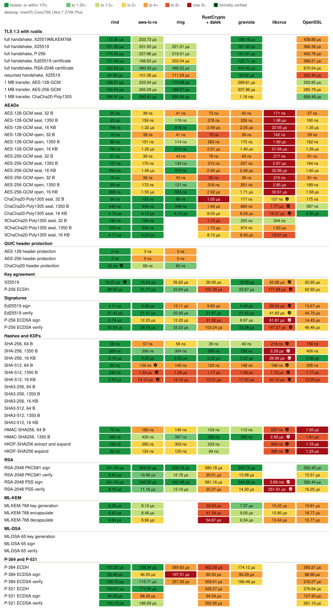
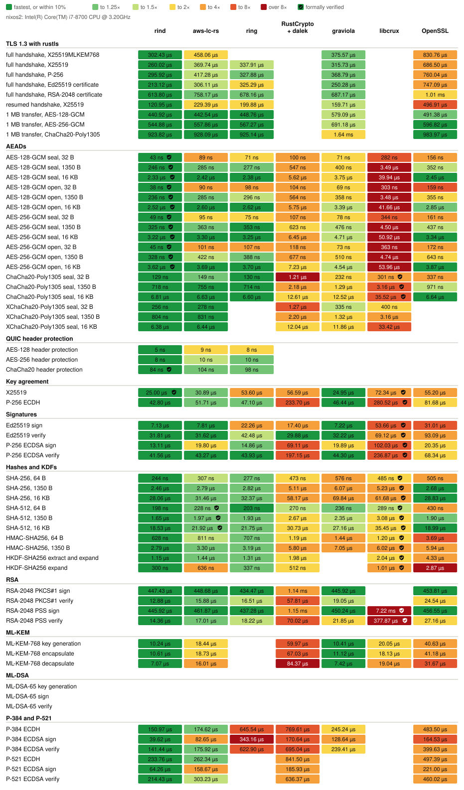
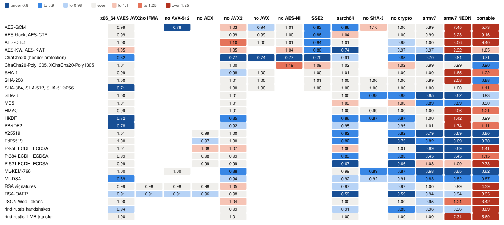

# Benchmarks

<!-- Generated by `admin/bench-report render` from benchmarks/data, benchmarks/verified.toml, and benchmarks/gaps.toml. -->

How long rind and the usual Rust crypto libraries take for the same operations, on three machines, and what each costs to build. Every library runs its native path on each host. A ✓ marks an operation whose whole computation a published formal proof covers, as [Verified code](#verified-code) lists.

## Hosts

| Host | CPU | OS | Measured |
|---|---|---|---|
| `nixos` | AMD Ryzen 9 5900XT 16-Core Processor | NixOS 26.11 (Zokor) (Linux 6.18.56) | 2026-11-05 at [`6024d155`](https://github.com/moq-dev/rind/commit/6024d1557147b1f5dae1da700ed7c7bee38cd086) |
| `desktop` | Intel(R) Core(TM) Ultra 7 270K Plus | Ubuntu 26.04.1 LTS (Linux 7.0.0-42-generic) | 2026-11-05 at [`6024d155`](https://github.com/moq-dev/rind/commit/6024d1557147b1f5dae1da700ed7c7bee38cd086) |
| `nixos2` | Intel(R) Core(TM) i7-8700 CPU @ 3.20GHz | NixOS 26.11 (Zokor) (Linux 6.18.56) | 2026-11-04 at [`a6d9bd72`](https://github.com/moq-dev/rind/commit/a6d9bd7210fc2352f8dec4aa2078230f779398eb) |

Not measured yet: `kixtop`.

Each host builds with the pinned toolchain, in the Nix dev shell on Linux, and runs `admin/bench-report` only when idle. Times are criterion's estimates.

## Speed

Each row is one operation and each column one library. Each cell holds a square per host, colored by that library's time over the fastest library's on the same host, as the legend shows. A ✓ in a square marks verified code. Each square's tooltip, in the SVG opened on its own, gives its time; the tables below each host give them all. A library with no square doesn't offer the operation, or the host didn't time it, as its section says.

<picture>
  <source media="(prefers-color-scheme: dark)" srcset="benchmarks/overview-dark.svg">
  
</picture>

### `nixos`: AMD Ryzen 9 5900XT 16-Core Processor

Measured 2026-11-05 at [`6024d155`](https://github.com/moq-dev/rind/commit/6024d1557147b1f5dae1da700ed7c7bee38cd086), on NixOS 26.11 (Zokor) (Linux 6.18.56) with rustc 1.98.1 (48a229cea 2026-09-01).

<picture>
  <source media="(prefers-color-scheme: dark)" srcset="benchmarks/nixos-dark.svg">
  
</picture>

Times on nixos

| Operation | rind | aws-lc-rs | ring | RustCrypto + dalek | graviola | libcrux | OpenSSL |
|---|---|---|---|---|---|---|---|
| full handshake, X25519MLKEM768 | 239.83 µs | 308.49 µs | - | - | 258.62 µs | - | 805.54 µs |
| full handshake, X25519 | 215.61 µs | 277.77 µs | 296.66 µs | - | 225.37 µs | - | 578.47 µs |
| full handshake, P-256 | 248.67 µs | 312.54 µs | 296.53 µs | - | 266.19 µs | - | 639.58 µs |
| full handshake, Ed25519 certificate | 176.45 µs | 226.97 µs | 289.56 µs | - | 175.24 µs | - | 647.87 µs |
| full handshake, RSA-2048 certificate | 644.89 µs | 650.26 µs | 666.29 µs | - | 582.45 µs | - | 931.27 µs |
| resumed handshake, X25519 | 81.83 µs | 137.94 µs | 162.09 µs | - | 87.66 µs | - | 461.94 µs |
| 1 MB transfer, AES-128-GCM | 290.62 µs | 459.42 µs | 314.22 µs | - | 453.27 µs | - | 492.29 µs |
| 1 MB transfer, AES-256-GCM | 310.98 µs | 487.61 µs | 305.27 µs | - | 513.59 µs | - | 607.83 µs |
| 1 MB transfer, ChaCha20-Poly1305 | 739.91 µs | 739.12 µs | 747.52 µs | - | 1.49 ms | - | 855.61 µs |
| AES-128-GCM seal, 32 B | 40 ns | 81 ns | 54 ns | 95 ns | 67 ns | 308 ns | 114 ns |
| AES-128-GCM seal, 1350 B | 170 ns | 289 ns | 184 ns | 435 ns | 296 ns | 3.91 µs | 323 ns |
| AES-128-GCM seal, 16 KB | 1.39 µs | 2.58 µs | 1.43 µs | 4.18 µs | 2.58 µs | 44.41 µs | 2.62 µs |
| AES-128-GCM open, 32 B | 47 ns | 72 ns | 58 ns | 102 ns | 65 ns | 320 ns | 118 ns |
| AES-128-GCM open, 1350 B | 175 ns | 295 ns | 185 ns | 448 ns | 307 ns | 3.93 µs | 332 ns |
| AES-128-GCM open, 16 KB | 1.45 µs | 2.71 µs | 1.48 µs | 4.28 µs | 2.66 µs | 44.58 µs | 2.75 µs |
| AES-256-GCM seal, 32 B | 44 ns | 81 ns | 58 ns | 101 ns | 73 ns | 426 ns | 119 ns |
| AES-256-GCM seal, 1350 B | 188 ns | 313 ns | 206 ns | 488 ns | 338 ns | 6.96 µs | 345 ns |
| AES-256-GCM seal, 16 KB | 1.54 µs | 2.79 µs | 1.56 µs | 4.83 µs | 3.00 µs | 80.86 µs | 2.82 µs |
| AES-256-GCM open, 32 B | 52 ns | 82 ns | 62 ns | 111 ns | 68 ns | 442 ns | 121 ns |
| AES-256-GCM open, 1350 B | 194 ns | 320 ns | 205 ns | 507 ns | 342 ns | 6.39 µs | 358 ns |
| AES-256-GCM open, 16 KB | 1.62 µs | 2.89 µs | 1.65 µs | 4.92 µs | 3.05 µs | 74.38 µs | 2.96 µs |
| ChaCha20-Poly1305 seal, 32 B | 114 ns | 119 ns | 113 ns | 1.18 µs | 216 ns | 218 ns ✓ | 255 ns |
| ChaCha20-Poly1305 seal, 1350 B | 530 ns | 535 ns | 531 ns | 1.92 µs | 1.08 µs | 2.33 µs ✓ | 742 ns |
| ChaCha20-Poly1305 seal, 16 KB | 4.58 µs | 4.62 µs | 4.55 µs | 9.81 µs | 9.87 µs | 26.03 µs ✓ | 5.10 µs |
| XChaCha20-Poly1305 seal, 32 B | 242 ns | 263 ns | - | 1.35 µs | 348 ns | 336 ns | - |
| XChaCha20-Poly1305 seal, 1350 B | 653 ns | 673 ns | - | 2.06 µs | 1.20 µs | 2.45 µs | - |
| XChaCha20-Poly1305 seal, 16 KB | 4.76 µs | 4.74 µs | - | 9.95 µs | 10.02 µs | 26.08 µs | - |
| AES-128 header protection | 4 ns | 6 ns | 7 ns | - | - | - | - |
| AES-256 header protection | 6 ns | 8 ns | 9 ns | - | - | - | - |
| ChaCha20 header protection | 61 ns ✓ | 81 ns | 75 ns | - | - | - | - |
| X25519 | 24.80 µs ✓ | 25.24 µs | 47.40 µs | 53.79 µs | 24.65 µs | 64.51 µs ✓ | 49.46 µs |
| P-256 ECDH | 39.18 µs | 41.12 µs | 41.79 µs | 256.63 µs | 41.91 µs | 246.51 µs ✓ | 68.12 µs |
| Ed25519 sign | 5.79 µs | 6.10 µs | 17.26 µs | 13.36 µs | 5.79 µs | 40.33 µs ✓ | 23.40 µs |
| Ed25519 verify | 27.18 µs | 27.25 µs | 34.90 µs | 24.97 µs | 27.14 µs | 54.65 µs ✓ | 79.44 µs |
| P-256 ECDSA sign | 8.98 µs | 11.96 µs | 12.76 µs | 64.84 µs | 10.48 µs | 87.54 µs ✓ | 16.42 µs |
| P-256 ECDSA verify | 38.23 µs | 38.71 µs | 39.16 µs | 217.96 µs | 40.39 µs | 208.08 µs ✓ | 57.01 µs |
| SHA-256, 64 B | 80 ns | 101 ns | 86 ns | 58 ns | 67 ns | 355 ns ✓ | 243 ns |
| SHA-256, 1350 B | 653 ns | 669 ns | 662 ns | 631 ns | 642 ns | 3.77 µs ✓ | 827 ns |
| SHA-256, 16 KB | 7.24 µs | 7.38 µs | 7.40 µs | 7.32 µs | 7.31 µs | 45.19 µs ✓ | 7.52 µs |
| SHA-512, 64 B | 195 ns | 233 ns | 202 ns | 203 ns | 185 ns | 268 ns ✓ | 390 ns |
| SHA-512, 1350 B | 2.75 µs | 2.31 µs | 1.97 µs | 2.66 µs | 1.96 µs | 2.80 µs ✓ | 1.50 µs |
| SHA-512, 16 KB | 20.37 µs | 20.45 µs | 20.63 µs | 20.78 µs | 21.56 µs | 29.02 µs ✓ | 14.83 µs |
| HMAC-SHA256, 64 B | 153 ns | 263 ns | 214 ns | 155 ns | 170 ns | 823 ns ✓ | 2.49 µs |
| HMAC-SHA256, 1350 B | 678 ns | 794 ns | 749 ns | 681 ns | 696 ns | 4.05 µs ✓ | 3.03 µs |
| HKDF-SHA256 extract and expand | 304 ns | 376 ns | 398 ns | 310 ns | - | 1.37 µs ✓ | 2.77 µs |
| HKDF-SHA256 expand | 104 ns | 178 ns | 142 ns | 103 ns | - | 706 ns ✓ | 1.96 µs |
| RSA-2048 PKCS#1 sign | 474.44 µs | 435.90 µs | 423.03 µs | 987.29 µs | 411.78 µs | - | 437.30 µs |
| RSA-2048 PKCS#1 verify | 14.79 µs | 13.65 µs | 15.38 µs | 50.57 µs | 24.70 µs | - | 22.22 µs |
| RSA-2048 PSS sign | 475.37 µs | 436.71 µs | 424.64 µs | 995.72 µs | 413.56 µs | 4.79 ms ✓ | 439.05 µs |
| RSA-2048 PSS verify | 11.82 µs | 14.33 µs | 16.27 µs | 96.98 µs | 21.66 µs | 465.38 µs ✓ | 23.36 µs |
| ML-KEM-768 key generation | 8.05 µs | 9.20 µs | - | 58.01 µs | 8.74 µs | 17.51 µs | 26.11 µs |
| ML-KEM-768 encapsulate | 8.33 µs | 9.38 µs | - | 67.87 µs | 10.25 µs | 14.93 µs | 27.30 µs |
| ML-KEM-768 decapsulate | 5.93 µs | 11.29 µs | - | 87.75 µs | 7.10 µs | 15.64 µs | 22.36 µs |
| P-384 ECDH | 129.00 µs | 145.14 µs | 580.80 µs | 782.25 µs | 206.07 µs | - | 451.93 µs |
| P-384 ECDSA sign | 33.91 µs | 64.48 µs | 313.48 µs | 183.17 µs | 110.14 µs | - | 151.27 µs |
| P-384 ECDSA verify | 121.08 µs | 151.44 µs | 560.90 µs | 670.20 µs | 204.92 µs | - | 371.49 µs |
| P-521 ECDH | 221.05 µs | 235.94 µs | - | 604.98 µs | - | - | 390.71 µs |
| P-521 ECDSA sign | 56.66 µs | 125.99 µs | - | 144.49 µs | - | - | 186.41 µs |
| P-521 ECDSA verify | 191.80 µs | 257.70 µs | - | 481.75 µs | - | - | 379.62 µs |

### `desktop`: Intel(R) Core(TM) Ultra 7 270K Plus

Measured 2026-11-05 at [`6024d155`](https://github.com/moq-dev/rind/commit/6024d1557147b1f5dae1da700ed7c7bee38cd086), on Ubuntu 26.04.1 LTS (Linux 7.0.0-42-generic) with rustc 1.98.1 (48a229cea 2026-09-01).

<picture>
  <source media="(prefers-color-scheme: dark)" srcset="benchmarks/desktop-dark.svg">
  
</picture>

Times on desktop

| Operation | rind | aws-lc-rs | ring | RustCrypto + dalek | graviola | libcrux | OpenSSL |
|---|---|---|---|---|---|---|---|
| full handshake, X25519MLKEM768 | 176.38 µs | 237.01 µs | - | - | 188.12 µs | - | 435.26 µs |
| full handshake, X25519 | 152.03 µs | 205.12 µs | 221.18 µs | - | 161.32 µs | - | 365.01 µs |
| full handshake, P-256 | 175.55 µs | 227.34 µs | 223.24 µs | - | 194.81 µs | - | 403.92 µs |
| full handshake, Ed25519 certificate | 123.00 µs | 166.65 µs | 202.37 µs | - | 125.59 µs | - | 374.89 µs |
| full handshake, RSA-2048 certificate | 493.89 µs | 479.50 µs | 487.61 µs | - | 438.68 µs | - | 684.14 µs |
| resumed handshake, X25519 | 55.16 µs | 101.03 µs | 111.69 µs | - | 55.45 µs | - | 229.74 µs |
| 1 MB transfer, AES-128-GCM | 169.85 µs | 234.65 µs | 171.60 µs | - | 288.23 µs | - | 255.06 µs |
| 1 MB transfer, AES-256-GCM | 186.02 µs | 270.36 µs | 188.28 µs | - | 332.16 µs | - | 285.87 µs |
| 1 MB transfer, ChaCha20-Poly1305 | 587.48 µs | 586.46 µs | 588.81 µs | - | 1.16 ms | - | 658.14 µs |
| AES-128-GCM seal, 32 B | 19 ns | 37 ns | 42 ns | 73 ns | 42 ns | 171 ns | 55 ns |
| AES-128-GCM seal, 1350 B | 94 ns | 152 ns | 119 ns | 276 ns | 226 ns | 1.98 µs | 159 ns |
| AES-128-GCM seal, 16 KB | 772 ns | 1.33 µs | 795 ns | 2.45 µs | 2.05 µs | 22.01 µs | 1.34 µs |
| AES-128-GCM open, 32 B | 23 ns | 37 ns | 42 ns | 78 ns | 35 ns | 161 ns | 58 ns |
| AES-128-GCM open, 1350 B | 101 ns | 149 ns | 113 ns | 283 ns | 176 ns | 1.99 µs | 157 ns |
| AES-128-GCM open, 16 KB | 812 ns | 1.26 µs | 823 ns | 2.51 µs | 1.40 µs | 22.00 µs | 1.29 µs |
| AES-256-GCM seal, 32 B | 21 ns | 39 ns | 43 ns | 78 ns | 45 ns | 218 ns | 58 ns |
| AES-256-GCM seal, 1350 B | 109 ns | 176 ns | 135 ns | 312 ns | 261 ns | 2.86 µs | 184 ns |
| AES-256-GCM seal, 16 KB | 924 ns | 1.58 µs | 953 ns | 2.91 µs | 2.42 µs | 32.27 µs | 1.57 µs |
| AES-256-GCM open, 32 B | 24 ns | 37 ns | 44 ns | 81 ns | 38 ns | 218 ns | 61 ns |
| AES-256-GCM open, 1350 B | 110 ns | 174 ns | 123 ns | 323 ns | 203 ns | 2.86 µs | 188 ns |
| AES-256-GCM open, 16 KB | 926 ns | 1.58 µs | 939 ns | 2.97 µs | 1.75 µs | 32.50 µs | 1.60 µs |
| ChaCha20-Poly1305 seal, 32 B | 99 ns | 105 ns | 101 ns | 1.06 µs | 180 ns | 157 ns ✓ | 177 ns |
| ChaCha20-Poly1305 seal, 1350 B | 447 ns | 453 ns | 446 ns | 1.67 µs | 911 ns | 1.78 µs ✓ | 589 ns |
| ChaCha20-Poly1305 seal, 16 KB | 4.13 µs | 4.13 µs | 4.12 µs | 8.15 µs | 8.36 µs | 19.36 µs ✓ | 4.41 µs |
| XChaCha20-Poly1305 seal, 32 B | 188 ns | 196 ns | - | 1.15 µs | 259 ns | 243 ns | - |
| XChaCha20-Poly1305 seal, 1350 B | 528 ns | 541 ns | - | 1.76 µs | 987 ns | 1.83 µs | - |
| XChaCha20-Poly1305 seal, 16 KB | 4.20 µs | 4.29 µs | - | 8.25 µs | 8.30 µs | 19.58 µs | - |
| AES-128 header protection | 2 ns | 3 ns | 3 ns | - | - | - | - |
| AES-256 header protection | 2 ns | 4 ns | 5 ns | - | - | - | - |
| ChaCha20 header protection | 54 ns ✓ | 69 ns | 61 ns | - | - | - | - |
| X25519 | 17.94 µs ✓ | 19.14 µs | 35.19 µs | 36.03 µs | 18.25 µs | 42.71 µs ✓ | 33.93 µs |
| P-256 ECDH | 29.99 µs | 32.02 µs | 34.21 µs | 120.66 µs | 32.86 µs | 168.88 µs ✓ | 52.96 µs |
| Ed25519 sign | 4.29 µs | 4.44 µs | 13.30 µs | 9.56 µs | 4.37 µs | 29.05 µs ✓ | 13.47 µs |
| Ed25519 verify | 21.87 µs | 21.82 µs | 26.51 µs | 22.15 µs | 21.56 µs | 41.91 µs ✓ | 45.62 µs |
| P-256 ECDSA sign | 7.08 µs | 12.42 µs | 12.38 µs | 31.49 µs | 8.81 µs | 60.93 µs ✓ | 14.37 µs |
| P-256 ECDSA verify | 30.78 µs | 30.34 µs | 33.20 µs | 102.68 µs | 32.93 µs | 146.39 µs ✓ | 46.07 µs |
| SHA-256, 64 B | 56 ns | 57 ns | 57 ns | 39 ns | 40 ns | 212 ns ✓ | 157 ns |
| SHA-256, 1350 B | 298 ns | 311 ns | 299 ns | 292 ns | 298 ns | 2.30 µs ✓ | 412 ns |
| SHA-256, 16 KB | 3.21 µs | 3.23 µs | 3.22 µs | 3.21 µs | 3.22 µs | 26.37 µs ✓ | 3.38 µs |
| SHA-512, 64 B | 132 ns | 133 ns ✓ | 139 ns | 125 ns | 146 ns | 163 ns ✓ | 227 ns |
| SHA-512, 1350 B | 1.23 µs | 1.26 µs ✓ | 1.26 µs | 1.17 µs | 1.50 µs | 1.72 µs ✓ | 1.19 µs |
| SHA-512, 16 KB | 14.31 µs | 14.09 µs ✓ | 14.09 µs | 13.36 µs | 17.62 µs | 19.80 µs ✓ | 12.30 µs |
| HMAC-SHA256, 64 B | 87 ns | 177 ns | 143 ns | 103 ns | 109 ns | 547 ns ✓ | 1.54 µs |
| HMAC-SHA256, 1350 B | 340 ns | 433 ns | 396 ns | 355 ns | 364 ns | 2.78 µs ✓ | 1.80 µs |
| HKDF-SHA256 extract and expand | 192 ns | 290 ns | 300 ns | 221 ns | - | 971 ns ✓ | 1.73 µs |
| HKDF-SHA256 expand | 81 ns | 126 ns | 120 ns | 84 ns | - | 456 ns ✓ | 1.24 µs |
| RSA-2048 PKCS#1 sign | 400.25 µs | 349.67 µs | 336.09 µs | 592.98 µs | 341.78 µs | - | 389.03 µs |
| RSA-2048 PKCS#1 verify | 8.99 µs | 10.99 µs | 12.56 µs | 29.03 µs | 13.94 µs | - | 15.50 µs |
| RSA-2048 PSS sign | 393.47 µs | 353.37 µs | 336.61 µs | 582.39 µs | 336.99 µs | 3.76 ms ✓ | 399.27 µs |
| RSA-2048 PSS verify | 9.45 µs | 11.06 µs | 13.17 µs | 35.09 µs | 14.43 µs | 247.95 µs ✓ | 16.29 µs |
| ML-KEM-768 key generation | 6.47 µs | 8.18 µs | - | 40.16 µs | 7.68 µs | 15.00 µs | 19.58 µs |
| ML-KEM-768 encapsulate | 6.71 µs | 8.59 µs | - | 42.13 µs | 9.13 µs | 12.80 µs | 18.57 µs |
| ML-KEM-768 decapsulate | 4.83 µs | 8.92 µs | - | 55.21 µs | 6.56 µs | 13.50 µs | 16.07 µs |
| P-384 ECDH | 100.00 µs | 111.30 µs | 370.25 µs | 430.31 µs | 171.49 µs | - | 262.12 µs |
| P-384 ECDSA sign | 25.54 µs | 46.52 µs | 198.39 µs | 104.37 µs | 89.42 µs | - | 89.07 µs |
| P-384 ECDSA verify | 98.58 µs | 115.28 µs | 359.23 µs | 360.90 µs | 168.94 µs | - | 215.87 µs |
| P-521 ECDH | 160.40 µs | 171.49 µs | - | 433.75 µs | - | - | 274.16 µs |
| P-521 ECDSA sign | 43.70 µs | 88.46 µs | - | 94.28 µs | - | - | 127.75 µs |
| P-521 ECDSA verify | 145.01 µs | 184.47 µs | - | 359.53 µs | - | - | 261.07 µs |

### `nixos2`: Intel(R) Core(TM) i7-8700 CPU @ 3.20GHz

Measured 2026-11-04 at [`a6d9bd72`](https://github.com/moq-dev/rind/commit/a6d9bd7210fc2352f8dec4aa2078230f779398eb), on NixOS 26.11 (Zokor) (Linux 6.18.56) with rustc 1.98.1 (48a229cea 2026-09-01).

Not timed on `nixos2`: AES-128 header protection, AES-256 header protection, ChaCha20 header protection.

<picture>
  <source media="(prefers-color-scheme: dark)" srcset="benchmarks/nixos2-dark.svg">
  
</picture>

Times on nixos2

| Operation | rind | aws-lc-rs | ring | RustCrypto + dalek | graviola | libcrux | OpenSSL |
|---|---|---|---|---|---|---|---|
| full handshake, X25519MLKEM768 | 311.29 µs | 452.02 µs | - | - | 375.56 µs | - | 837.01 µs |
| full handshake, X25519 | 267.07 µs | 379.99 µs | 339.51 µs | - | 316.39 µs | - | 688.73 µs |
| full handshake, P-256 | 302.72 µs | 414.57 µs | 327.28 µs | - | 371.36 µs | - | 750.80 µs |
| full handshake, Ed25519 certificate | 216.15 µs | 307.77 µs | 326.17 µs | - | 251.07 µs | - | 757.62 µs |
| full handshake, RSA-2048 certificate | 809.87 µs | 774.41 µs | 677.82 µs | - | 713.80 µs | - | 1.02 ms |
| resumed handshake, X25519 | 121.78 µs | 229.16 µs | 195.23 µs | - | 160.19 µs | - | 504.16 µs |
| 1 MB transfer, AES-128-GCM | 433.16 µs | 453.78 µs | 469.65 µs | - | 578.33 µs | - | 496.82 µs |
| 1 MB transfer, AES-256-GCM | 544.93 µs | 553.29 µs | 544.73 µs | - | 697.29 µs | - | 609.96 µs |
| 1 MB transfer, ChaCha20-Poly1305 | 924.76 µs | 932.29 µs | 928.70 µs | - | 1.64 ms | - | 1.00 ms |
| AES-128-GCM seal, 32 B | 42 ns ✓ | 89 ns | 72 ns | 101 ns | 72 ns | 290 ns | 161 ns |
| AES-128-GCM seal, 1350 B | 264 ns ✓ | 287 ns | 280 ns | 556 ns | 403 ns | 3.41 µs | 362 ns |
| AES-128-GCM seal, 16 KB | 2.38 µs ✓ | 2.46 µs | 2.38 µs | 5.63 µs | 3.84 µs | 38.50 µs | 2.53 µs |
| AES-128-GCM open, 32 B | 50 ns ✓ | 95 ns | 79 ns | 106 ns | 68 ns | 305 ns | 156 ns |
| AES-128-GCM open, 1350 B | 261 ns ✓ | 297 ns | 278 ns | 569 ns | 362 ns | 3.63 µs | 360 ns |
| AES-128-GCM open, 16 KB | 2.58 µs ✓ | 2.63 µs | 2.59 µs | 5.81 µs | 3.41 µs | 39.83 µs | 2.70 µs |
| AES-256-GCM seal, 32 B | 46 ns ✓ | 96 ns | 76 ns | 109 ns | 80 ns | 343 ns | 167 ns |
| AES-256-GCM seal, 1350 B | 343 ns ✓ | 364 ns | 356 ns | 648 ns | 485 ns | 4.49 µs | 438 ns |
| AES-256-GCM seal, 16 KB | 3.24 µs ✓ | 3.32 µs | 3.25 µs | 6.54 µs | 4.72 µs | 50.79 µs | 3.35 µs |
| AES-256-GCM open, 32 B | 57 ns ✓ | 104 ns | 83 ns | 118 ns | 79 ns | 385 ns | 173 ns |
| AES-256-GCM open, 1350 B | 351 ns ✓ | 391 ns | 371 ns | 672 ns | 456 ns | 4.55 µs | 436 ns |
| AES-256-GCM open, 16 KB | 3.58 µs ✓ | 3.56 µs | 3.59 µs | 6.77 µs | 4.38 µs | 50.89 µs | 3.64 µs |
| ChaCha20-Poly1305 seal, 32 B | 124 ns | 141 ns | 130 ns | 1.16 µs | 222 ns | 274 ns ✓ | 325 ns |
| ChaCha20-Poly1305 seal, 1350 B | 691 ns | 700 ns | 686 ns | 2.08 µs | 1.24 µs | 3.08 µs ✓ | 933 ns |
| ChaCha20-Poly1305 seal, 16 KB | 6.35 µs | 6.43 µs | 6.39 µs | 12.38 µs | 11.98 µs | 34.70 µs ✓ | 6.41 µs |
| XChaCha20-Poly1305 seal, 32 B | 270 ns | 282 ns | - | 1.28 µs | 335 ns | 400 ns | - |
| XChaCha20-Poly1305 seal, 1350 B | 814 ns | 839 ns | - | 2.20 µs | 1.37 µs | 3.12 µs | - |
| XChaCha20-Poly1305 seal, 16 KB | 6.51 µs | 6.55 µs | - | 12.11 µs | 11.96 µs | 34.02 µs | - |
| AES-128 header protection | - | - | - | - | - | - | - |
| AES-256 header protection | - | - | - | - | - | - | - |
| ChaCha20 header protection | - | - | - | - | - | - | - |
| X25519 | 26.86 µs ✓ | 33.12 µs | 55.23 µs | 60.51 µs | 25.17 µs | 73.49 µs ✓ | 55.22 µs |
| P-256 ECDH | 46.60 µs | 56.11 µs | 51.77 µs | 252.15 µs | 50.53 µs | 304.85 µs ✓ | 87.27 µs |
| Ed25519 sign | 7.09 µs | 7.54 µs | 22.05 µs | 16.08 µs | 7.27 µs | 49.67 µs ✓ | 28.46 µs |
| Ed25519 verify | 31.59 µs | 31.57 µs | 41.59 µs | 27.88 µs | 31.39 µs | 64.33 µs ✓ | 93.95 µs |
| P-256 ECDSA sign | 15.72 µs | 22.35 µs | 16.56 µs | 78.32 µs | 23.27 µs | 115.07 µs ✓ | 28.83 µs |
| P-256 ECDSA verify | 47.33 µs | 47.11 µs | 47.60 µs | 211.46 µs | 48.45 µs | 262.54 µs ✓ | 74.70 µs |
| SHA-256, 64 B | 276 ns | 313 ns | 289 ns | 483 ns | 579 ns | 487 ns ✓ | 514 ns |
| SHA-256, 1350 B | 2.88 µs | 2.98 µs | 2.83 µs | 5.33 µs | 6.11 µs | 5.27 µs ✓ | 2.69 µs |
| SHA-256, 16 KB | 31.57 µs | 31.63 µs | 31.56 µs | 58.88 µs | 69.99 µs | 61.29 µs ✓ | 28.35 µs |
| SHA-512, 64 B | 200 ns | 233 ns ✓ | 204 ns | 272 ns | 237 ns | 290 ns ✓ | 436 ns |
| SHA-512, 1350 B | 1.95 µs | 1.98 µs ✓ | 1.95 µs | 2.68 µs | 2.35 µs | 3.08 µs ✓ | 1.92 µs |
| SHA-512, 16 KB | 21.82 µs | 21.95 µs ✓ | 22.31 µs | 31.08 µs | 27.35 µs | 35.63 µs ✓ | 19.04 µs |
| HMAC-SHA256, 64 B | 690 ns | 840 ns | 746 ns | 1.25 µs | 1.47 µs | 1.22 µs ✓ | 3.90 µs |
| HMAC-SHA256, 1350 B | 3.29 µs | 3.49 µs | 3.39 µs | 6.54 µs | 7.49 µs | 7.14 µs ✓ | 6.24 µs |
| HKDF-SHA256 extract and expand | 1.18 µs | 1.35 µs | 1.26 µs | 2.11 µs | - | 2.17 µs ✓ | 4.68 µs |
| HKDF-SHA256 expand | 330 ns | 673 ns | 344 ns | 527 ns | - | 1.07 µs ✓ | 3.12 µs |
| RSA-2048 PKCS#1 sign | 567.70 µs | 454.36 µs | 442.48 µs | 1.16 ms | 458.57 µs | - | 471.98 µs |
| RSA-2048 PKCS#1 verify | 12.97 µs | 15.81 µs | 16.73 µs | 58.28 µs | 19.61 µs | - | 28.37 µs |
| RSA-2048 PSS sign | 576.25 µs | 459.05 µs | 440.44 µs | 1.17 ms | 453.66 µs | 7.10 ms ✓ | 481.14 µs |
| RSA-2048 PSS verify | 15.24 µs | 18.00 µs | 19.36 µs | 71.12 µs | 22.16 µs | 379.99 µs ✓ | 27.30 µs |
| ML-KEM-768 key generation | 12.10 µs | 23.32 µs | - | 71.58 µs | 11.04 µs | 30.74 µs | 42.66 µs |
| ML-KEM-768 encapsulate | 15.73 µs | 20.31 µs | - | 75.08 µs | 12.83 µs | 21.01 µs | 44.49 µs |
| ML-KEM-768 decapsulate | 8.28 µs | 16.61 µs | - | 89.79 µs | 8.30 µs | 19.93 µs | 33.05 µs |
| P-384 ECDH | 159.92 µs | 191.62 µs | 688.80 µs | 871.98 µs | 254.75 µs | - | 510.33 µs |
| P-384 ECDSA sign | 40.21 µs | 85.87 µs | 349.63 µs | 194.33 µs | 133.02 µs | - | 170.79 µs |
| P-384 ECDSA verify | 154.44 µs | 186.63 µs | 628.36 µs | 712.25 µs | 244.84 µs | - | 409.95 µs |
| P-521 ECDH | 225.21 µs | 255.05 µs | - | 822.79 µs | - | - | 498.14 µs |
| P-521 ECDSA sign | 65.70 µs | 160.14 µs | - | 192.13 µs | - | - | 224.59 µs |
| P-521 ECDSA verify | 236.22 µs | 307.98 µs | - | 666.03 µs | - | - | 465.58 µs |

## Build cost

A cold `cargo build --release` of a minimal binary per library (AES-128-GCM, SHA-256, ECDSA P-256, and X25519) and of a rustls client per provider, plus one whose rind-rustls provider holds only those, by `admin/build-cost`: the median of three builds with an empty target directory and a warm download cache, their CPU time, the stripped binary's size, the build tools it needs beyond rustc and a linker, and the crates it compiles. The system OpenSSL build leaves the library itself out of its size; the vendored build is the static figure.

### `nixos`

Measured 2026-11-05 at [`6024d155`](https://github.com/moq-dev/rind/commit/6024d1557147b1f5dae1da700ed7c7bee38cd086), with rustc 1.98.1 (48a229cea 2026-09-01), gcc (GCC) 16.2.0, and 16 jobs.

| Build | Wall s (range) | CPU s | Stripped MB | Tools needed | Crates |
|---|---|---|---|---|---|
| rind | 4.2 (4.1 to 4.2) | 9 | 0.86 | none | 5 |
| aws-lc-rs | 16.3 (16.3 to 16.3) | 54 | 2.99 | cc | 14 |
| ring | 6.7 (6.7 to 6.7) | 9 | 0.74 | cc | 9 |
| RustCrypto + dalek | 4.1 (4.0 to 4.1) | 21 | 0.54 | none | 57 |
| graviola | 2.6 (2.6 to 2.6) | 5 | 0.91 | none | 5 |
| libcrux | 6.8 (6.8 to 6.8) | 16 | 0.75 | none | 27 |
| OpenSSL, the system's, linked dynamically | 3.9 (3.9 to 3.9) | 10 | 0.38 | cc, pkg-config | 18 |
| OpenSSL, vendored | 22.7 (22.6 to 22.7) | 200 | 5.13 | cc, make, perl | 19 |
| rustls + rind-rustls | 4.8 (4.8 to 4.8) | 25 | 2.89 | none | 14 |
| rustls + rind-rustls, one TLS 1.3 suite, X25519, and P-256 | 4.8 (4.8 to 4.8) | 25 | 1.80 | none | 14 |
| rustls + aws-lc-rs | 19.8 (19.7 to 19.8) | 70 | 4.11 | cc | 20 |
| rustls + ring | 10.1 (10.1 to 10.1) | 24 | 1.94 | cc | 16 |

### `desktop`

Measured 2026-11-05 at [`6024d155`](https://github.com/moq-dev/rind/commit/6024d1557147b1f5dae1da700ed7c7bee38cd086), with rustc 1.98.1 (48a229cea 2026-09-01), gcc (GCC) 16.2.0, and 12 jobs.

| Build | Wall s (range) | CPU s | Stripped MB | Tools needed | Crates |
|---|---|---|---|---|---|
| rind | 3.0 (3.0 to 3.0) | 7 | 0.86 | none | 5 |
| aws-lc-rs | 11.7 (11.6 to 11.7) | 37 | 2.99 | cc | 14 |
| ring | 4.9 (4.9 to 5.0) | 7 | 0.74 | cc | 9 |
| RustCrypto + dalek | 2.8 (2.8 to 2.8) | 16 | 0.54 | none | 57 |
| graviola | 1.9 (1.9 to 1.9) | 4 | 0.91 | none | 5 |
| libcrux | 4.7 (4.7 to 4.7) | 12 | 0.75 | none | 27 |
| OpenSSL, the system's, linked dynamically | 2.8 (2.8 to 2.8) | 7 | 0.38 | cc, pkg-config | 18 |
| OpenSSL, vendored | 17.7 (17.7 to 17.8) | 136 | 5.13 | cc, make, perl | 19 |
| rustls + rind-rustls | 3.5 (3.5 to 3.5) | 19 | 2.89 | none | 14 |
| rustls + rind-rustls, one TLS 1.3 suite, X25519, and P-256 | 3.5 (3.5 to 3.5) | 19 | 1.80 | none | 14 |
| rustls + aws-lc-rs | 14.4 (14.4 to 14.4) | 49 | 4.11 | cc | 20 |
| rustls + ring | 7.5 (7.5 to 7.6) | 19 | 1.94 | cc | 16 |

### `nixos2`

Measured 2026-11-04 at [`a6d9bd72`](https://github.com/moq-dev/rind/commit/a6d9bd7210fc2352f8dec4aa2078230f779398eb), with rustc 1.98.1 (48a229cea 2026-09-01), gcc (GCC) 16.2.0, and 2 jobs.

| Build | Wall s (range) | CPU s | Stripped MB | Tools needed | Crates |
|---|---|---|---|---|---|
| rind | 7.6 (7.6 to 7.6) | 11 | 0.83 | none | 5 |
| aws-lc-rs | 33.0 (33.0 to 33.2) | 62 | 2.99 | cc | 14 |
| ring | 10.3 (9.9 to 10.4) | 13 | 0.74 | cc | 9 |
| RustCrypto + dalek | 11.9 (11.9 to 12.0) | 23 | 0.54 | none | 57 |
| graviola | 4.5 (4.4 to 4.6) | 6 | 0.91 | none | 5 |
| libcrux | 10.7 (10.6 to 10.8) | 20 | 0.75 | none | 27 |
| OpenSSL, the system's, linked dynamically | 7.0 (7.0 to 7.1) | 12 | 0.38 | cc, pkg-config | 18 |
| OpenSSL, vendored | 127.1 (119.3 to 132.6) | 242 | 5.13 | cc, make, perl | 19 |
| rustls + rind-rustls | 16.6 (16.2 to 17.9) | 33 | 2.87 | none | 14 |
| rustls + aws-lc-rs | 63.4 (61.3 to 68.8) | 118 | 4.11 | cc | 20 |
| rustls + ring | 22.9 (22.6 to 23.0) | 35 | 1.94 | cc | 16 |

## CPU tiers

GitHub's runners, timed by the nightly `bench` workflow with CPU features denied as `bench.yml` describes: x86_64 runs every feature, and each column to its right denies more (no IFMA: AVX-512 IFMA; no ADX: also ADX; no AVX2: also AVX2, BMI2, SHA-NI, AVX-512, VAES, and VPCLMULQDQ; no AVX: also AVX; no AES-NI: also AES-NI, PCLMULQDQ, and SSE4.1; SSE2: also SSSE3). aarch64 runs with the crypto extension, no crypto without it, and armv7 in 32-bit mode on the same core. Each cell is rind's time over the fastest of aws-lc-rs and ring (aws-lc-rs alone where a feature is denied, since ring can't be denied one), in the row's benchmark where rind trails most. An empty cell runs the same code as the one to its left, so it isn't timed.

From [run 41932862737](https://github.com/moq-dev/rind/actions/runs/41932862737), 2026-11-04 at [`33bcf0e9`](https://github.com/moq-dev/rind/commit/33bcf0e9fcbca76c991cee74ae6be0b31408902d), on AMD EPYC 7763 64-Core Processor, AMD EPYC 9V74 80-Core Processor, Intel(R) Xeon(R) 6975P-C, Neoverse-N2.

<picture>
  <source media="(prefers-color-scheme: dark)" srcset="benchmarks/tiers-dark.svg">
  
</picture>

Every benchmark

| Benchmark | x86_64 | no ADX | no AVX2 | no AVX | no AES-NI | SSE2 | aarch64 | no crypto | armv7 |
|---|---|---|---|---|---|---|---|---|---|
| `aes128-ctr/*/1200B` | 0.86 |  | 0.85 | 0.86 | 0.96 | 0.77 | 0.88 | 0.99 | 0.88 |
| `aes128-ctr/*/1350B` | 0.88 |  | 0.89 | 0.88 | 0.99 | 0.77 | 0.83 | 0.99 | 0.89 |
| `aes128-ctr/*/16KB` | 0.98 |  | 0.98 | 0.99 | 0.93 | 0.76 | 0.93 | 1.00 | 0.98 |
| `aes128-ctr/*/32B` | 0.45 |  | 0.46 | 0.46 | 0.79 | 0.77 | 0.66 | 0.77 | 0.28 |
| `aes128-gcm-open/*/1200B` | 0.73 |  | 0.83 | 0.74 | 1.00 | 0.79 | 0.87 | 1.00 | 0.92 |
| `aes128-gcm-open/*/1350B` | 0.73 |  | 0.82 | 0.74 | 1.00 | 0.79 | 0.87 | 1.00 | 0.94 |
| `aes128-gcm-open/*/16KB` | 0.88 |  | 1.00 | 0.84 | 1.00 | 0.78 | 0.85 | 1.00 | 0.99 |
| `aes128-gcm-open/*/32B` | 0.58 |  | 0.37 | 0.52 | 0.96 | 0.78 | 0.92 | 1.00 | 0.59 |
| `aes128-gcm/*/1200B` | 0.81 |  | 0.83 | 0.74 | 1.00 | 0.79 | 0.87 | 1.00 | 0.91 |
| `aes128-gcm/*/1350B` | 0.75 |  | 0.85 | 0.77 | 1.00 | 0.79 | 0.87 | 1.00 | 0.93 |
| `aes128-gcm/*/16KB` | 0.89 |  | 1.03 | 0.85 | 1.01 | 0.78 | 0.81 | 1.00 | 0.99 |
| `aes128-gcm/*/32B` | 0.60 |  | 0.44 | 0.42 | 0.94 | 0.78 | 1.07 | 1.02 | 0.56 |
| `aes128-gcm/*/key` | 0.94 |  | 0.84 | 0.85 | 0.96 | 0.82 | 0.92 | 0.98 | 0.77 |
| `aes256-ctr/*/1200B` | 0.88 |  | 0.87 | 0.87 | 1.01 | 0.77 | 0.90 | 0.99 | 0.91 |
| `aes256-ctr/*/1350B` | 0.90 |  | 0.88 | 0.90 | 1.01 | 0.77 | 0.85 | 0.99 | 0.91 |
| `aes256-ctr/*/16KB` | 0.99 |  | 1.00 | 0.99 | 0.97 | 0.77 | 0.93 | 1.00 | 0.99 |
| `aes256-ctr/*/32B` | 0.50 |  | 0.49 | 0.50 | 0.82 | 0.77 | 0.75 | 0.83 | 0.31 |
| `aes256-gcm-open/*/1200B` | 0.78 |  | 0.83 | 0.78 | 0.98 | 0.79 | 0.86 | 1.00 | 0.94 |
| `aes256-gcm-open/*/1350B` | 0.77 |  | 0.81 | 0.77 | 1.00 | 0.79 | 0.87 | 1.00 | 0.95 |
| `aes256-gcm-open/*/16KB` | 0.91 |  | 1.02 | 0.89 | 1.02 | 0.78 | 0.80 | 1.00 | 0.99 |
| `aes256-gcm-open/*/32B` | 0.62 |  | 0.38 | 0.53 | 0.94 | 0.78 | 0.89 | 1.00 | 0.59 |
| `aes256-gcm/*/1200B` | 0.87 |  | 0.86 | 0.80 | 0.99 | 0.79 | 0.83 | 1.00 | 0.92 |
| `aes256-gcm/*/1350B` | 0.80 |  | 0.86 | 0.81 | 1.00 | 0.79 | 0.83 | 1.00 | 0.94 |
| `aes256-gcm/*/16KB` | 0.90 |  | 1.02 | 0.91 | 1.01 | 0.78 | 0.77 | 1.00 | 0.99 |
| `aes256-gcm/*/32B` | 0.64 |  | 0.48 | 0.45 | 0.96 | 0.79 | 0.99 | 1.02 | 0.55 |
| `aes256-gcm/*/key` | 0.90 |  | 0.82 | 0.82 | 0.96 | 0.72 | 0.89 | 0.97 | 0.79 |
| `chacha20poly1305/*/1200B` | 0.99 |  | 1.00 |  | 1.08 | 1.00 | 1.00 | 0.99 | 0.96 |
| `chacha20poly1305/*/1350B` | 1.01 |  | 0.99 |  | 1.09 | 1.01 | 1.00 | 0.99 | 0.95 |
| `chacha20poly1305/*/16KB` | 1.00 |  | 1.01 |  | 1.17 | 1.05 | 1.00 | 1.00 | 0.99 |
| `chacha20poly1305/*/32B` | 0.97 |  | 0.94 |  | 0.73 | 0.73 | 0.99 | 0.95 | 0.86 |
| `ed25519-keygen/*` | 1.03 | 0.99 | 1.02 |  |  |  | 0.80 | 0.77 | 0.71 |
| `ed25519-sign/*` | 0.95 | 0.95 | 0.96 |  |  |  | 0.73 | 0.73 | 0.69 |
| `ed25519-verify/*` | 1.00 | 1.01 | 1.00 |  |  |  | 0.90 | 0.72 | 0.88 |
| `hkdf-sha1/expand-aes-256-gcm-key/*` | 0.74 |  | 0.64 |  |  |  | 0.66 | 0.72 | 0.62 |
| `hkdf-sha1/expand/*` | 0.67 |  | 0.57 |  |  |  | 0.55 | 0.61 | 0.54 |
| `hkdf-sha1/extract-expand/*` | 0.79 |  | 0.72 |  |  |  | 0.67 | 0.82 | 0.65 |
| `hkdf-sha256/expand-aes-256-gcm-key/*` | 0.73 |  | 0.54 |  |  |  | 0.75 | 0.62 | 0.54 |
| `hkdf-sha256/expand/*` | 0.70 |  | 0.46 |  |  |  | 0.69 | 0.48 | 0.37 |
| `hkdf-sha256/extract-expand/*` | 0.73 |  | 0.82 |  |  |  | 0.72 | 0.86 | 0.58 |
| `hkdf-sha384/expand-aes-256-gcm-key/*` | 0.87 |  | 0.53 |  |  |  | 0.86 | 0.61 | 0.74 |
| `hkdf-sha384/expand/*` | 0.90 |  | 0.47 |  |  |  | 0.86 | 0.49 | 0.98 |
| `hkdf-sha384/extract-expand/*` | 0.93 |  | 0.85 |  |  |  | 0.90 | 0.89 | 1.01 |
| `hkdf-sha512/expand-aes-256-gcm-key/*` | 0.85 |  | 0.51 |  |  |  | 0.84 | 0.60 | 0.73 |
| `hkdf-sha512/expand/*` | 0.88 |  | 0.47 |  |  |  | 0.84 | 0.48 | 0.97 |
| `hkdf-sha512/extract-expand/*` | 0.91 |  | 0.85 |  |  |  | 0.88 | 0.89 | 0.99 |
| `hmac-sha1/*/1200B` | 0.83 |  | 0.85 |  |  |  | 0.80 | 0.91 | 0.61 |
| `hmac-sha1/*/1350B` | 0.85 |  | 0.86 |  |  |  | 0.82 | 0.92 | 0.63 |
| `hmac-sha1/*/16KB` | 0.98 |  | 0.98 |  |  |  | 0.99 | 0.99 | 0.94 |
| `hmac-sha1/*/32B` | 0.51 |  | 0.55 |  |  |  | 0.46 | 0.68 | 0.36 |
| `hmac-sha1/*/64B` | 0.55 |  | 0.58 |  |  |  | 0.51 | 0.73 | 0.38 |
| `hmac-sha1/*/8KB` | 0.97 |  | 0.97 |  |  |  | 0.96 | 0.98 | 0.89 |
| `hmac-sha1/*/reused-key/1200B` | 0.84 |  | 0.88 |  |  |  | 0.85 | 0.93 | 0.66 |
| `hmac-sha1/*/reused-key/1350B` | 0.86 |  | 0.89 |  |  |  | 0.87 | 0.94 | 0.69 |
| `hmac-sha1/*/reused-key/16KB` | 0.99 |  | 0.98 |  |  |  | 0.99 | 1.00 | 0.96 |
| `hmac-sha1/*/reused-key/32B` | 0.50 |  | 0.54 |  |  |  | 0.44 | 0.62 | 0.26 |
| `hmac-sha1/*/reused-key/64B` | 0.47 |  | 0.58 |  |  |  | 0.50 | 0.70 | 0.31 |
| `hmac-sha1/*/reused-key/8KB` | 0.97 |  | 0.97 |  |  |  | 0.98 | 0.99 | 0.92 |
| `hmac-sha256/*/1200B` | 0.89 |  | 0.93 |  |  |  | 0.92 | 0.95 | 0.65 |
| `hmac-sha256/*/1350B` | 0.90 |  | 0.93 |  |  |  | 0.93 | 0.95 | 0.67 |
| `hmac-sha256/*/16KB` | 0.99 |  | 1.00 |  |  |  | 0.99 | 0.99 | 0.95 |
| `hmac-sha256/*/32B` | 0.70 |  | 0.69 |  |  |  | 0.70 | 0.78 | 0.38 |
| `hmac-sha256/*/64B` | 0.68 |  | 0.73 |  |  |  | 0.75 | 0.82 | 0.40 |
| `hmac-sha256/*/8KB` | 0.98 |  | 0.99 |  |  |  | 0.98 | 0.99 | 0.90 |
| `hmac-sha256/*/reused-key/1200B` | 0.90 |  | 0.95 |  |  |  | 0.92 | 0.96 | 0.69 |
| `hmac-sha256/*/reused-key/1350B` | 0.91 |  | 0.97 |  |  |  | 0.93 | 0.97 | 0.71 |
| `hmac-sha256/*/reused-key/16KB` | 0.99 |  | 1.02 |  |  |  | 0.99 | 1.00 | 0.96 |
| `hmac-sha256/*/reused-key/32B` | 0.62 |  | 0.69 |  |  |  | 0.59 | 0.73 | 0.26 |
| `hmac-sha256/*/reused-key/64B` | 0.61 |  | 0.75 |  |  |  | 0.66 | 0.79 | 0.32 |
| `hmac-sha256/*/reused-key/8KB` | 0.99 |  | 1.00 |  |  |  | 0.98 | 0.99 | 0.93 |
| `hmac-sha384/*/1200B` | 0.97 |  | 0.91 |  |  |  | 0.96 | 0.93 | 1.00 |
| `hmac-sha384/*/1350B` | 0.97 |  | 0.91 |  |  |  | 0.96 | 0.94 | 1.00 |
| `hmac-sha384/*/16KB` | 0.99 |  | 1.00 |  |  |  | 1.00 | 0.99 | 1.00 |
| `hmac-sha384/*/32B` | 0.91 |  | 0.77 |  |  |  | 0.86 | 0.82 | 0.99 |
| `hmac-sha384/*/64B` | 0.91 |  | 0.77 |  |  |  | 0.87 | 0.82 | 0.99 |
| `hmac-sha384/*/8KB` | 0.99 |  | 1.00 |  |  |  | 0.99 | 0.99 | 1.00 |
| `hmac-sha384/*/reused-key/1200B` | 0.97 |  | 0.94 |  |  |  | 0.97 | 0.95 | 0.99 |
| `hmac-sha384/*/reused-key/1350B` | 0.98 |  | 0.95 |  |  |  | 0.97 | 0.95 | 0.99 |
| `hmac-sha384/*/reused-key/16KB` | 1.00 |  | 0.99 |  |  |  | 1.00 | 0.99 | 1.00 |
| `hmac-sha384/*/reused-key/32B` | 0.88 |  | 0.75 |  |  |  | 0.81 | 0.78 | 0.93 |
| `hmac-sha384/*/reused-key/64B` | 0.88 |  | 0.76 |  |  |  | 0.81 | 0.78 | 0.93 |
| `hmac-sha384/*/reused-key/8KB` | 1.00 |  | 0.99 |  |  |  | 0.99 | 0.99 | 1.00 |
| `jwt-eddsa-sign/*/load` | 0.97 |  | 0.98 |  |  |  | 0.74 | 0.74 | 0.69 |
| `jwt-eddsa-sign/*/token` | 0.95 |  | 0.96 |  |  |  | 0.73 | 0.73 | 0.69 |
| `jwt-eddsa-verify/*/load` | 65.59 |  | 80.98 |  |  |  | 58.63 | 58.80 | 140.31 |
| `jwt-eddsa-verify/*/token` | 1.00 |  | 1.01 |  |  |  | 0.72 | 0.72 | 0.63 |
| `jwt-es256-sign/*/load` | 1.30 |  | 1.29 |  |  |  | 1.34 | 1.33 | 0.53 |
| `jwt-es256-sign/*/token` | 0.99 |  | 1.09 |  |  |  | 1.02 | 1.11 | 0.48 |
| `jwt-es256-verify/*/load` | 68.41 |  | 72.43 |  |  |  | 57.02 | 57.06 | 306.53 |
| `jwt-es256-verify/*/token` | 1.00 |  | 1.05 |  |  |  | 1.01 | 1.01 | 0.69 |
| `jwt-es384-sign/*/load` | 0.82 |  | 0.85 |  |  |  | 0.77 | 0.77 | 0.41 |
| `jwt-es384-sign/*/token` | 0.65 |  | 0.68 |  |  |  | 0.61 | 0.62 | 0.39 |
| `jwt-es384-verify/*/load` | 113.05 |  | 122.01 |  |  |  | 93.70 | 94.10 | 460.47 |
| `jwt-es384-verify/*/token` | 0.82 |  | 0.84 |  |  |  | 0.71 | 0.72 | 0.45 |
| `jwt-hs256-sign/*/load` | 0.41 |  | 0.65 |  |  |  | 0.41 | 0.74 | 0.42 |
| `jwt-hs256-sign/*/token` | 0.54 |  | 0.73 |  |  |  | 0.52 | 0.81 | 0.40 |
| `jwt-hs256-verify/*/load` | 0.40 |  | 0.66 |  |  |  | 0.41 | 0.74 | 0.43 |
| `jwt-hs256-verify/*/token` | 0.56 |  | 0.76 |  |  |  | 0.51 | 0.81 | 0.41 |
| `jwt-rs256-sign/*/load` | 250.14 |  | 274.29 |  |  |  | 151.04 | 150.96 | 432.63 |
| `jwt-rs256-sign/*/token` | 0.45 |  | 0.68 |  |  |  | 0.44 | 0.44 | 0.74 |
| `jwt-rs256-verify/*/load` | 17.66 |  | 19.75 |  |  |  | 13.85 | 13.86 | 69.01 |
| `jwt-rs256-verify/*/token` | 0.83 |  | 0.93 |  |  |  | 0.60 | 0.60 | 0.94 |
| `mlkem768-combined/*` | 0.63 |  | 0.78 |  |  |  | 0.80 | 0.73 | 0.55 |
| `mlkem768-decaps/*` | 0.48 |  | 0.57 |  |  |  | 0.52 | 0.49 | 0.36 |
| `mlkem768-encaps/*` | 0.73 |  | 0.88 |  |  |  | 0.99 | 0.87 | 0.68 |
| `mlkem768-keygen/*` | 0.74 |  | 0.90 |  |  |  | 0.98 | 0.87 | 0.68 |
| `p256-ecdh/*` | 0.97 | 0.97 | 0.96 |  |  |  | 0.93 | 0.76 | 0.58 |
| `p256-ecdsa-sign/*` | 0.79 | 0.75 | 0.95 |  |  |  | 0.81 | 0.98 | 0.46 |
| `p256-ecdsa-verify-parsed/*` | 0.93 | 1.04 | 0.97 |  |  |  | 0.93 | 0.93 | 0.63 |
| `p256-ecdsa-verify/*` | 1.02 | 1.14 | 1.06 |  |  |  | 1.02 | 1.02 | 0.70 |
| `p256-keygen/*` | 0.99 | 0.95 | 0.99 |  |  |  | 1.02 | 0.94 | 0.39 |
| `p384-ecdh/*` | 0.91 | 0.92 | 0.92 |  |  |  | 0.78 | 0.78 | 0.37 |
| `p384-ecdsa-sign/*` | 0.55 | 0.62 | 0.57 |  |  |  | 0.49 | 0.51 | 0.40 |
| `p384-ecdsa-verify-parsed/*` | 0.77 | 0.82 | 0.78 |  |  |  | 0.67 | 0.67 | 0.41 |
| `p384-ecdsa-verify/*` | 0.82 | 0.87 | 0.83 |  |  |  | 0.72 | 0.72 | 0.45 |
| `p384-keygen/*` | 0.71 | 0.74 | 0.73 |  |  |  | 0.64 | 0.63 | 0.32 |
| `p521-ecdh/*` | 0.93 | 0.93 | 0.94 |  |  |  | 0.65 | 0.65 | 0.77 |
| `p521-ecdsa-sign/*` | 0.45 | 0.51 | 0.50 |  |  |  | 0.38 | 0.39 | 0.70 |
| `p521-ecdsa-verify-parsed/*` | 0.71 | 0.77 | 0.76 |  |  |  | 0.52 | 0.52 | 1.01 |
| `p521-ecdsa-verify/*` | 0.75 | 0.82 | 0.80 |  |  |  | 0.55 | 0.55 | 1.08 |
| `p521-keygen/*` | 0.77 | 0.77 | 0.81 |  |  |  | 0.60 | 0.58 | 0.64 |
| `pbkdf2-sha1/*` | 1.00 |  | 0.84 |  |  |  | 0.84 | 0.91 | 0.80 |
| `pbkdf2-sha256/*` | 1.04 |  | 0.94 |  |  |  | 0.85 | 0.92 | 0.81 |
| `pbkdf2-sha384/*` | 0.94 |  | 0.90 |  |  |  | 0.96 | 0.94 | 1.00 |
| `pbkdf2-sha512/*` | 0.95 |  | 0.87 |  |  |  | 0.93 | 0.93 | 1.00 |
| `quic-header-protection/aes128/*` | 0.57 |  | 0.68 | 0.60 | 1.06 | 0.80 | 1.06 | 1.01 | 1.02 |
| `quic-header-protection/aes256/*` | 0.52 |  | 0.74 | 0.69 | 1.04 | 0.79 | 0.88 | 1.00 | 1.03 |
| `quic-header-protection/chacha20/*` | 0.80 |  | 0.79 | 0.77 | 0.76 | 0.74 | 0.88 | 0.82 | 0.70 |
| `rsa1024-pkcs1-sha1-verify/*` | 0.75 | 0.79 | 0.78 |  |  |  | 0.82 | 0.54 | 0.97 |
| `rsa2048-key-generation/*` | 0.65 | 0.71 | 0.73 |  |  |  | 0.44 | 0.48 | 1.31 |
| `rsa2048-load/*` | 0.40 | 0.44 | 0.39 |  |  |  | 0.43 | 0.43 | 0.61 |
| `rsa2048-pkcs1-sha256-sign/*` | 0.93 | 0.48 | 0.98 |  |  |  | 0.85 | 0.55 | 0.98 |
| `rsa2048-pkcs1-sha256-verify-parsed/*` | 0.82 | 0.91 | 0.92 |  |  |  | 0.57 | 0.57 | 0.91 |
| `rsa2048-pkcs1-sha256-verify/*` | 0.83 | 0.90 | 0.91 |  |  |  | 0.79 | 0.60 | 0.94 |
| `rsa2048-pss-sha256-sign/*` | 0.93 | 0.48 | 0.98 |  |  |  | 0.85 | 0.55 | 0.98 |
| `rsa2048-pss-sha256-verify/*` | 0.84 | 0.91 | 0.91 |  |  |  | 0.78 | 0.62 | 0.94 |
| `rsa2056-pkcs1-sha256-sign/*` | 1.04 | 1.09 | 1.02 |  |  |  | 0.99 | 0.97 | 1.02 |
| `rsa2056-pkcs1-sha256-verify/*` | 0.94 | 0.93 | 0.91 |  |  |  | 0.95 | 0.95 | 0.99 |
| `rsa2560-pkcs1-sha256-sign/*` | 0.97 | 1.08 | 1.03 |  |  |  | 0.95 | 0.95 | 0.97 |
| `rsa3072-key-generation/*` | 0.79 | 0.91 | 0.80 |  |  |  | 0.45 | 0.49 | 0.82 |
| `rsa3072-pkcs1-sha256-sign/*` | 0.96 | 0.36 | 0.99 |  |  |  | 0.91 | 0.51 | 0.98 |
| `rsa3072-pkcs1-sha256-verify/*` | 0.91 | 0.94 | 0.94 |  |  |  | 0.77 | 0.55 | 0.93 |
| `rsa4096-key-generation/*` | 2.04 | 1.24 | 1.62 |  |  |  | 0.57 | 0.59 | 1.50 |
| `rsa4096-pkcs1-sha256-sign/*` | 0.97 | 0.31 | 0.99 |  |  |  | 0.92 | 0.60 | 0.99 |
| `rsa4096-pkcs1-sha256-verify/*` | 0.94 | 0.95 | 0.95 |  |  |  | 0.76 | 0.56 | 0.91 |
| `rsa6144-pkcs1-sha256-sign/*` | 0.96 | 0.97 | 0.98 |  |  |  | 0.53 | 0.53 | 0.89 |
| `rsa6144-pkcs1-sha256-verify/*` | 0.94 | 0.96 | 0.96 |  |  |  | 0.76 | 0.57 | 0.90 |
| `rsa8192-load/*` | 0.44 | 0.54 | 0.42 |  |  |  | 0.48 | 0.48 | 0.59 |
| `rsa8192-pkcs1-sha256-sign/*` | 0.95 | 0.96 | 0.98 |  |  |  | 0.53 | 0.52 | 0.92 |
| `rsa8192-pkcs1-sha256-verify/*` | 0.95 | 0.96 | 0.97 |  |  |  | 0.75 | 0.57 | 0.89 |
| `rustls-bulk/aes128-gcm/*` | 0.95 |  | 1.01 |  |  |  | 0.85 | 1.00 | 0.99 |
| `rustls-bulk/aes256-gcm/*` | 0.95 |  | 1.01 |  |  |  | 0.81 | 1.00 | 0.99 |
| `rustls-bulk/chacha20poly1305/*` | 0.98 |  | 1.00 |  |  |  | 1.00 | 1.00 | 1.00 |
| `rustls-full-handshake-group/secp256r1/*` | 0.85 |  | 0.90 |  |  |  | 0.92 | 0.81 | 0.59 |
| `rustls-full-handshake-group/secp384r1/*` | 0.85 |  | 0.89 |  |  |  | 0.81 | 0.80 | 0.45 |
| `rustls-full-handshake-group/x25519/*` | 0.82 |  | 0.91 |  |  |  | 0.86 | 0.84 | 0.60 |
| `rustls-full-handshake-group/x25519mlkem768/*` | 0.78 |  | 0.88 |  |  |  | 0.86 | 0.84 | 0.60 |
| `rustls-full-handshake-key/ecdsa-p256/*` | 0.81 |  | 0.91 |  |  |  | 0.86 | 0.84 | 0.60 |
| `rustls-full-handshake-key/ecdsa-p384/*` | 0.76 |  | 0.80 |  |  |  | 0.70 | 0.70 | 0.45 |
| `rustls-full-handshake-key/ecdsa-p521/*` | 0.71 |  | 0.76 |  |  |  | 0.55 | 0.55 | 0.96 |
| `rustls-full-handshake-key/ed25519/*` | 0.80 |  | 0.87 |  |  |  | 0.77 | 0.71 | 0.73 |
| `rustls-full-handshake-key/rsa-2048/*` | 0.81 |  | 0.94 |  |  |  | 0.83 | 0.57 | 0.92 |
| `rustls-full-handshake-key/rsa-3072/*` | 0.89 |  | 0.97 |  |  |  | 0.89 | 0.52 | 0.95 |
| `rustls-full-handshake-key/rsa-4096/*` | 0.93 |  | 0.98 |  |  |  | 0.90 | 0.60 | 0.96 |
| `rustls-resumed-handshake/secp256r1/*` | 0.75 |  | 0.78 |  |  |  | 0.86 | 0.70 | 0.55 |
| `rustls-resumed-handshake/secp384r1/*` | 0.79 |  | 0.84 |  |  |  | 0.75 | 0.75 | 0.36 |
| `rustls-resumed-handshake/x25519/*` | 0.62 |  | 0.74 |  |  |  | 0.70 | 0.71 | 0.63 |
| `rustls-resumed-handshake/x25519mlkem768/*` | 0.61 |  | 0.77 |  |  |  | 0.74 | 0.76 | 0.45 |
| `sha1/*/1200B` | 0.96 |  | 0.97 | 0.97 |  | 0.98 | 0.95 | 0.98 | 0.94 |
| `sha1/*/1350B` | 0.95 |  | 0.98 | 0.97 |  | 0.98 | 0.95 | 0.98 | 0.94 |
| `sha1/*/16KB` | 1.00 |  | 1.02 | 1.00 |  | 1.00 | 1.00 | 1.00 | 1.00 |
| `sha1/*/32B` | 0.79 |  | 0.70 | 0.69 |  | 0.86 | 0.61 | 0.73 | 0.68 |
| `sha1/*/64B` | 0.86 |  | 0.77 | 0.77 |  | 0.90 | 0.70 | 0.82 | 0.75 |
| `sha1/*/8KB` | 0.99 |  | 0.99 | 0.99 |  | 1.00 | 1.00 | 1.00 | 0.99 |
| `sha256-updates/*/16B` | 0.81 |  | 0.97 | 0.96 |  | 0.97 | 0.83 | 0.96 | 0.73 |
| `sha256-updates/*/1B` | 0.81 |  | 0.78 | 0.87 |  | 0.88 | 0.60 | 0.69 | 0.51 |
| `sha256/*/1200B` | 0.99 |  | 0.99 | 1.00 |  | 0.99 | 1.01 | 0.99 | 0.94 |
| `sha256/*/1350B` | 0.98 |  | 1.00 | 1.00 |  | 1.00 | 0.99 | 0.99 | 0.95 |
| `sha256/*/16KB` | 1.00 |  | 1.01 | 1.01 |  | 1.00 | 1.00 | 1.00 | 1.00 |
| `sha256/*/32B` | 0.86 |  | 0.85 | 0.85 |  | 0.88 | 0.81 | 0.81 | 0.68 |
| `sha256/*/64B` | 1.05 |  | 0.91 | 0.90 |  | 0.96 | 0.89 | 0.89 | 0.78 |
| `sha256/*/8KB` | 0.99 |  | 1.01 | 1.01 |  | 1.00 | 1.00 | 1.00 | 0.99 |
| `sha512-256/*/1200B` | 1.00 |  | 0.98 | 0.98 |  | 1.00 | 0.99 | 0.98 | 1.01 |
| `sha512-256/*/1350B` | 1.00 |  | 0.98 | 0.99 |  | 0.99 | 1.00 | 0.99 | 1.00 |
| `sha512-256/*/16KB` | 1.00 |  | 0.99 | 1.00 |  | 1.00 | 1.00 | 1.00 | 1.00 |
| `sha512-256/*/32B` | 1.02 |  | 0.87 | 0.89 |  | 0.98 | 0.92 | 0.86 | 1.02 |
| `sha512-256/*/64B` | 1.02 |  | 0.87 | 0.88 |  | 0.99 | 0.94 | 0.86 | 1.02 |
| `sha512-256/*/8KB` | 1.00 |  | 0.99 | 1.00 |  | 1.00 | 1.00 | 1.00 | 1.00 |
| `sha512/*/1200B` | 0.99 |  | 0.97 | 0.97 |  | 0.99 | 0.99 | 0.98 | 1.00 |
| `sha512/*/1350B` | 1.00 |  | 0.98 | 0.98 |  | 0.99 | 1.00 | 0.98 | 1.00 |
| `sha512/*/16KB` | 1.00 |  | 0.99 | 1.00 |  | 0.99 | 1.00 | 1.00 | 1.00 |
| `sha512/*/32B` | 0.96 |  | 0.83 | 0.83 |  | 0.92 | 0.89 | 0.84 | 0.99 |
| `sha512/*/64B` | 0.96 |  | 0.82 | 0.83 |  | 0.92 | 0.91 | 0.84 | 1.00 |
| `sha512/*/8KB` | 1.00 |  | 0.99 | 0.99 |  | 1.00 | 1.00 | 1.00 | 1.00 |
| `x25519-ecdh/*` | 0.99 | 0.99 | 0.99 |  |  |  | 0.81 | 0.80 | 0.79 |
| `x25519-keygen/*` | 1.01 | 0.99 | 0.99 |  |  |  | 0.76 | 0.73 | 0.69 |
| `xchacha20poly1305/*/1200B` | 1.00 |  | 0.99 |  | 1.02 | 1.00 | 1.00 | 1.00 | 0.95 |
| `xchacha20poly1305/*/1350B` | 0.99 |  | 0.99 |  | 1.07 | 1.00 | 1.00 | 1.00 | 0.95 |
| `xchacha20poly1305/*/16KB` | 1.00 |  | 1.00 |  | 1.17 | 1.05 | 1.00 | 1.00 | 0.99 |
| `xchacha20poly1305/*/32B` | 0.98 |  | 0.99 |  | 0.94 | 0.93 | 1.00 | 1.01 | 0.89 |

## Known gaps

Each operation where another library is more than 10% faster than rind, on a host's native path or a CPU tier, and what is decided: a [speed](quest/m2/speed/README.md) quest that closes it, or the reason it stays. `benchmarks/gaps.toml` holds this table, and `admin/bench-report render` refuses a gap it lacks or an entry that is no longer a gap.

| Operation | On | rind's time over the fastest | Decision |
|---|---|---|---|
| RSA-2048 PKCS#1 sign, RSA-2048 PSS sign, full handshake, RSA-2048 certificate | `nixos`, `desktop`, `nixos2` | 1.11× to 1.31× (graviola, ring) | [Confirm x86_64 RSA-2048 signing level in the report](quest/m2/speed/x86-rsa2048-sign.md) |
| SHA-256, 64 B | `nixos`, `desktop` | 1.38× to 1.44× (RustCrypto + dalek) | Narrowed by [#352](https://github.com/moq-dev/rind/pull/352), after this data: on the SHA extensions the last block is padded and the digest written in registers, and `digest::Context::finish` takes `&mut self`, so it no longer copies the context. Interleaved runs on `nixos` measured rind at 1.16× RustCrypto's time and 1.03× graviola's at 64 B, from 1.44×, and ahead of both at 32 B; `digest::digest` beats RustCrypto at 64 B. Closed by [#394](https://github.com/moq-dev/rind/pull/394), which drops the context's wipe on drop: on GitHub's AMD EPYC 9V45 runner it measured rind at 0.84× main's time at 64 B and 0.86× RustCrypto's. The next refresh drops this entry. |
| SHA-512, 16 KB | `nixos`, `desktop`, `nixos2` | 1.15× to 1.37× (OpenSSL) | Closed by [#353](https://github.com/moq-dev/rind/pull/353), after this data: CPUs with AVX2 run OpenSSL's AVX2 routine, the one OpenSSL runs on `nixos2`, and those with the SHA512 instructions OpenSSL's routine for them. Interleaved runs measured rind at 0.96× OpenSSL's time on `nixos` and 0.22× on `desktop`. The next refresh drops this entry. |
| SHA-256, 16 KB | `nixos2` | 1.11× (OpenSSL) | Closed by [#353](https://github.com/moq-dev/rind/pull/353), after this data: CPUs with AVX2 but without the SHA extensions run OpenSSL's AVX2 routine, the one OpenSSL runs on `nixos2`. The next refresh drops this entry. |
| SHA-512, 1350 B | `nixos` | 1.83× (OpenSSL) | Closed by [#353](https://github.com/moq-dev/rind/pull/353), after this data: Zen 3 runs OpenSSL's AVX2 routine rather than aws-lc's scalar one, which interleaved runs measured at 0.84× OpenSSL's time at this size. The next refresh drops this entry. |
| Ed25519 verify, ML-KEM-768 encapsulate | `nixos2` | 1.13× to 1.23× (RustCrypto + dalek, graviola) | From an older run than the other hosts', before [#339](https://github.com/moq-dev/rind/pull/339) reworked Ed25519 for its proof. Neither shows on the other hosts, and the next refresh rechecks both. |
| `p256-ecdsa-verify/*` | no ADX tier | 1.14× (aws-lc-rs) | Only CPUs older than Broadwell and Zen lack ADX, and there rind runs s2n-bignum's verified `_alt` routines. |
| `chacha20poly1305/*/16KB`, `xchacha20poly1305/*/16KB` | no AES-NI tier | 1.17× (aws-lc-rs) | Without SSE4.1 rind runs Graviola's scalar Poly1305 rather than port BoringSSL's SSE2 `poly1305_vec.c` for CPUs older than Westmere, as README records. |

## Verified code

A ✓ means a published, machine-checked proof shows that all the code computing the operation, as that library runs it on that host, gives the specified result for every input: the cipher and its mode, the hash over every block with its padding, the whole scalar multiplication or exponentiation, and the glue around them, such as clamping, byte conversion, and point encoding. Parsing DER key and signature containers, randomness, and the message hash a signature takes are left out. Proofs of memory safety alone, or of only some of the code, earn no ✓. `benchmarks/verified.toml` holds this table.

| Library | Operations | Platform | Proof |
|---|---|---|---|
| rind | `x25519-ecdh` | x86_64 | [rind's Lean proof, through Aeneas and a hand model of the function-pointer dispatch Aeneas cannot translate, which assumes each key's dispatch table holds its own curve's functions, the only table rind builds, of its agreement API's X25519 down to s2n-bignum's routines, composed with s2n-bignum's HOL Light proofs of curve25519_x25519, curve25519_x25519base, their _alt forms without BMI2 and ADX, and bignum_eq, of s2n-bignum's own object code, which rind transliterates](https://github.com/moq-dev/rind/blob/main/proofs/Rind/X86_64/X25519.lean) |
| rind | `x25519-ecdh` | aarch64 | [rind's Lean proof, through Aeneas and a hand model of the function-pointer dispatch Aeneas cannot translate, which assumes each key's dispatch table holds its own curve's functions, the only table rind builds, of its agreement API's X25519 down to s2n-bignum's routines, composed with s2n-bignum's HOL Light proofs of curve25519_x25519_alt, curve25519_x25519base_alt, and bignum_eq, of s2n-bignum's own object code, which rind transliterates](https://github.com/moq-dev/rind/blob/main/proofs/Rind/X86_64/X25519.lean) |
| rind | `sha512/*` | x86_64 with intel, avx, ssse3 without avx2 | [rind's Lean proof, through Aeneas and hand models of the function-pointer dispatch Aeneas cannot translate, of its digest API's SHA-512, padding included, down to aws-lc's sha512_block_data_order_avx, which rind runs only on Intel's CPUs without AVX2, composed with aws-lc-verification's SAW proof of that routine, of aws-lc c21d40da, whose SHA-512 code rind's copy from 91c93a8e keeps](https://github.com/moq-dev/rind/blob/main/proofs/Rind/X86_64/Sha512.lean) |
| rind | `sha512/*` | aarch64 without sha3 | [rind's Lean proof, through Aeneas and hand models of the function-pointer dispatch Aeneas cannot translate, of its digest API's SHA-512, padding included, down to aws-lc's sha512_block_data_order_nohw, which rind runs without the SHA-512 instructions, composed with aws-lc-verification's NSym proof of that routine, with its ArmSpecGap caveat, of aws-lc c21d40da, whose SHA-512 code rind's copy from 91c93a8e keeps](https://github.com/moq-dev/rind/blob/main/proofs/Rind/X86_64/Sha512.lean) |
| rind | `ed25519-sign`, `ed25519-verify` | x86_64 with intel, avx, ssse3 without avx2 | [rind's Lean proof, through Aeneas and a hand model of the function-pointer dispatch Aeneas cannot translate, of its signature API's Ed25519 key loading, signing, and verification, small-order key refusal included, down to s2n-bignum's routines and its SHA-512 down to aws-lc's sha512_block_data_order_avx, which rind runs only on Intel's CPUs without AVX2, composed with s2n-bignum's HOL Light proofs of edwards25519_decode, edwards25519_scalarmulbase, edwards25519_scalarmuldouble, bignum_madd_n25519, their _alt forms without BMI2 and ADX, bignum_mod_n25519, bignum_neg_p25519, bignum_lt, and bignum_eq, of s2n-bignum's own object code, which rind transliterates, and aws-lc-verification's SAW proof of that SHA-512 routine](https://github.com/moq-dev/rind/blob/main/proofs/Rind/X86_64/Ed25519.lean) |
| rind | `ed25519-sign`, `ed25519-verify` | aarch64 without sha3 | [rind's Lean proof, through Aeneas and a hand model of the function-pointer dispatch Aeneas cannot translate, of its signature API's Ed25519 key loading, signing, and verification, small-order key refusal included, down to s2n-bignum's routines and its SHA-512 down to aws-lc's sha512_block_data_order_nohw, which rind runs without the SHA-512 instructions, composed with s2n-bignum's HOL Light proofs of edwards25519_decode_alt, edwards25519_scalarmulbase_alt, edwards25519_scalarmuldouble_alt, bignum_madd_n25519_alt, bignum_mod_n25519, bignum_neg_p25519, bignum_lt, and bignum_eq, of s2n-bignum's own object code, which rind transliterates, and aws-lc-verification's NSym proof of that SHA-512 routine, with its ArmSpecGap caveat](https://github.com/moq-dev/rind/blob/main/proofs/Rind/X86_64/Ed25519.lean) |
| rind | `p256-ecdh` | aarch64 | [rind's Lean proof, through Aeneas and hand models of the function-pointer dispatch and of key generation's draws through a dyn RandomSource, which Aeneas cannot translate, of its agreement API's P-256 key generation, public key, and agreement down to s2n-bignum's routines, composed with s2n-bignum's HOL Light proofs of p256_scalarmulbase_alt, p256_scalarmul_alt, bignum_tomont_p256, bignum_demont_p256, bignum_add_p256, bignum_montmul_p256, bignum_montsqr_p256, bignum_mod_n256_4, and bignum_eq, of s2n-bignum's own object code, which rind transliterates, with rind's generator table proven to hold the multiples of G that s2n-bignum's proof assumes](https://github.com/moq-dev/rind/blob/main/proofs/Rind/Aarch64/P256.lean) |
| rind | `p256-ecdsa-sign`, `p256-ecdsa-verify` | aarch64 | [rind's Lean proof, through Aeneas and hand models of the function-pointer dispatch and of the nonces' draws through a dyn RandomSource, which Aeneas cannot translate, of its signature API's P-256 ECDSA with SHA-256 and fixed-length signatures, key generation and loading, signing, and verification, down to s2n-bignum's routines, composed with s2n-bignum's HOL Light proofs of p256_scalarmulbase_alt, p256_montjadd_alt, p256_montjdouble_alt, p256_montjmixadd_alt, bignum_inv_p256, bignum_neg_p256, bignum_tomont_p256, bignum_demont_p256, bignum_add_p256, bignum_montmul_p256, bignum_montsqr_p256, bignum_mod_n256_4, bignum_modadd, bignum_montmul, bignum_demont, bignum_modinv, and bignum_eq, of s2n-bignum's own object code, which rind transliterates, with the group laws its twin multiplication relies on proven from Mathlib's and the generator's order n proven, assuming HOL Light's P256_GROUP_ELEMENT_ORDER, that a point has order n, only for verification with a parsed public key, and proving a signature right when signing returns, as its nonce loop has no bound](https://github.com/moq-dev/rind/blob/main/proofs/Rind/Aarch64/P256Signature.lean) |
| rind | `quic-header-protection/chacha20` | x86_64 | [rind's Lean proof, through Aeneas and a hand model of the function-pointer dispatch Aeneas cannot translate, which assumes each key's mask is its own cipher's, the only one rind builds, of its header-protection API's ChaCha20 against RFC 9001 and RFC 8439, HACL*'s rounds included](https://github.com/moq-dev/rind/blob/main/proofs/Rind/X86_64/ChaCha20.lean) |
| rind | `quic-header-protection/chacha20` | aarch64 | [rind's Lean proof, through Aeneas and a hand model of the function-pointer dispatch Aeneas cannot translate, which assumes each key's mask is its own cipher's, the only one rind builds, of its header-protection API's ChaCha20 against RFC 9001 and RFC 8439, HACL*'s rounds included](https://github.com/moq-dev/rind/blob/main/proofs/Rind/X86_64/ChaCha20.lean) |
| rind | `aes128-gcm/*`, `aes128-gcm-open/*`, `aes256-gcm/*`, `aes256-gcm-open/*` | x86_64 with aes, pclmulqdq, ssse3, sse4.1, avx, movbe without vaes | [rind's Lean proof, through Aeneas and hand models of the function-pointer dispatch, of the AES-NI key expansion and block cipher's raw-pointer loads, and of the SIMD intrinsics as Intel's manual defines them, of its AEAD API's AES-GCM key setup, seal, and open, for AAD and messages under 2^32 bytes, down to HACL*'s Vale AES-GCM routines, composed with Vale's F* proofs of Gcm_blocks_stdcall, Gcm_blocks_decrypt_stdcall, and Compute_iv_stdcall, of the code Vale prints at HACL* f557259007db, which rind imports](https://github.com/moq-dev/rind/blob/main/proofs/Rind/X86_64/AesGcm.lean) |
| aws-lc-rs | `sha512/*` | x86_64 with intel, avx, ssse3 | [aws-lc-verification's SAW proof of SHA-512 through EVP_Digest, padding included, over sha512_block_data_order_avx, which aws-lc runs only on Intel; of aws-lc c21d40da, whose SHA-512 code 5.12.0 keeps](https://github.com/awslabs/aws-lc-verification/blob/797302470c1703cbb1a3a6fa98daffef0bfd3d80/SAW/proof/SHA512/verify-SHA512-x86.saw) |
| libcrux | `sha256/*`, `sha512/*` | any architecture | [HACL*'s F* proof of Hacl.Streaming.SHA2's hash_256 and hash_512, compiled to Rust by an unverified step](https://github.com/hacl-star/hacl-star/blob/f557259007db9933442dde10aa995c1b00bd3446/code/streaming/Hacl.Streaming.SHA2.fst) |
| libcrux | `hmac-sha256/*` | any architecture | [HACL*'s F* proof of Hacl.HMAC's compute_sha2_256, compiled to Rust by an unverified step](https://github.com/hacl-star/hacl-star/blob/f557259007db9933442dde10aa995c1b00bd3446/code/hmac/Hacl.HMAC.fst) |
| libcrux | `hkdf-sha256/*` | any architecture | [HACL*'s F* proof of Hacl.HKDF's extract_sha2_256 and expand_sha2_256, compiled to Rust by an unverified step](https://github.com/hacl-star/hacl-star/blob/f557259007db9933442dde10aa995c1b00bd3446/code/hkdf/Hacl.HKDF.fst) |
| libcrux | `chacha20poly1305/*` | any architecture | [HACL*'s F* proof of Hacl.Chacha20Poly1305_32, compiled to Rust by an unverified step](https://github.com/hacl-star/hacl-star/blob/f557259007db9933442dde10aa995c1b00bd3446/code/chacha20poly1305/Hacl.Chacha20Poly1305_32.fst) |
| libcrux | `x25519-ecdh` | any architecture | [HACL*'s F* proof of Hacl.Curve25519_51's secret_to_public and ecdh, compiled to Rust by an unverified step](https://github.com/hacl-star/hacl-star/blob/f557259007db9933442dde10aa995c1b00bd3446/code/curve25519/Hacl.Curve25519_51.fst) |
| libcrux | `ed25519-sign`, `ed25519-verify` | any architecture | [HACL*'s F* proof of Hacl.Ed25519's sign and verify, compiled to Rust by an unverified step](https://github.com/hacl-star/hacl-star/blob/f557259007db9933442dde10aa995c1b00bd3446/code/ed25519/Hacl.Ed25519.fst) |
| libcrux | `p256-ecdh`, `p256-ecdsa-sign`, `p256-ecdsa-verify` | any architecture | [HACL*'s F* proof of Hacl.P256's dh_initiator, dh_responder, ecdsa_sign_p256_sha2, and ecdsa_verif_p256_sha2, compiled to Rust by an unverified step](https://github.com/hacl-star/hacl-star/blob/f557259007db9933442dde10aa995c1b00bd3446/code/ecdsap256/Hacl.P256.fst) |
| libcrux | `rsa2048-pss-sha256-sign`, `rsa2048-pss-sha256-verify` | any architecture | [HACL*'s F* proof of Hacl.RSAPSS's rsapss_skey_sign and rsapss_pkey_verify, signing without the CRT, compiled to Rust by an unverified step](https://github.com/hacl-star/hacl-star/blob/f557259007db9933442dde10aa995c1b00bd3446/code/rsapss/Hacl.RSAPSS.fst) |
