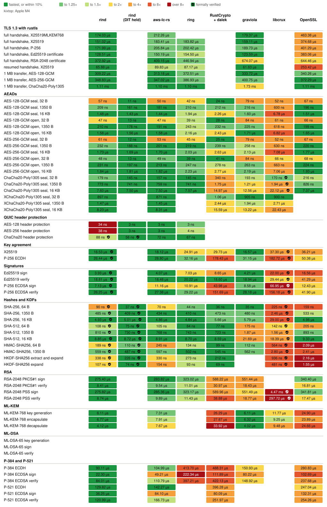
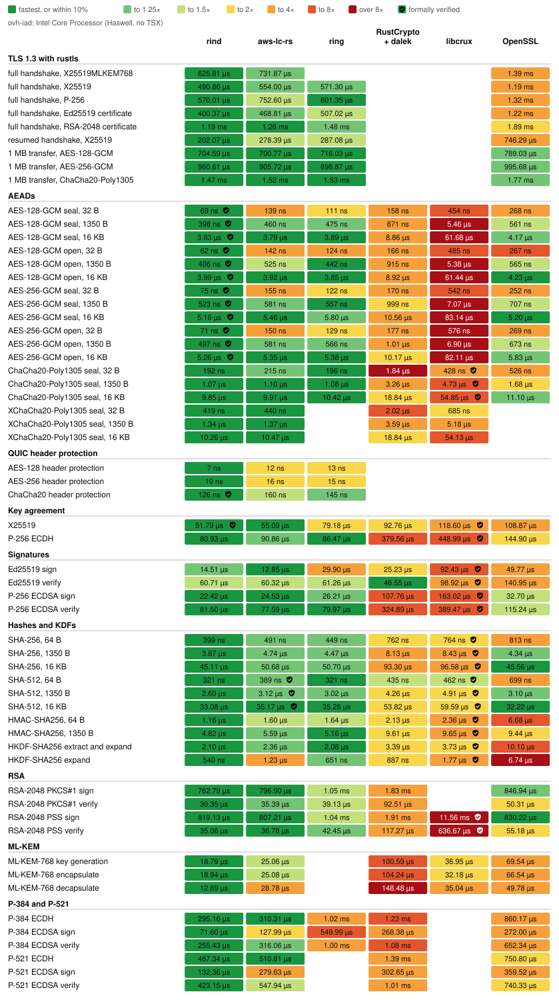
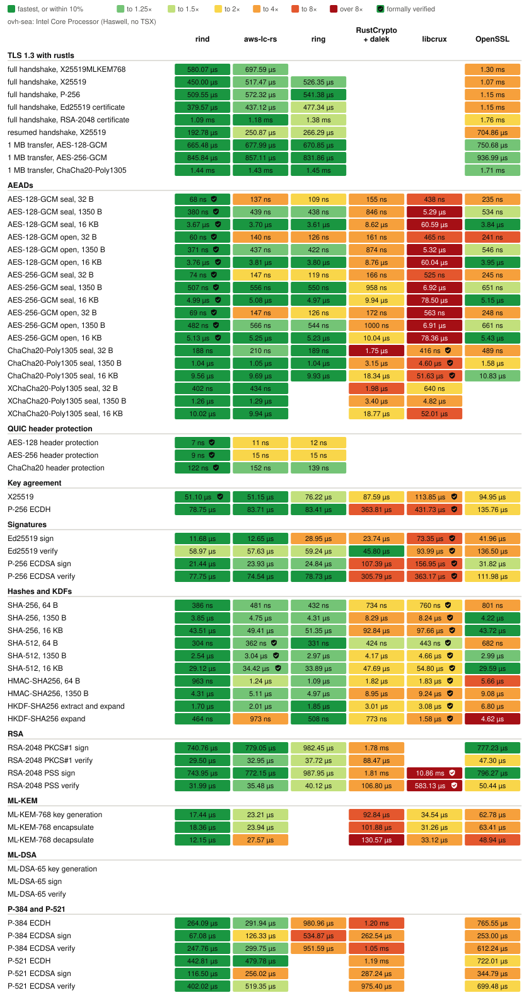

# Benchmarks

<!-- Generated by `admin/bench-report render` from benchmarks/data, benchmarks/verified.toml, and benchmarks/gaps.toml. -->

How long rind and the usual Rust crypto libraries take for the same operations, on five machines, and what each costs to build. Every library runs its native path on each host. A ✓ marks an operation whose whole computation a published formal proof covers, as [Verified code](#verified-code) lists.

## Hosts

| Host | CPU | OS | Measured |
|---|---|---|---|
| `nixos` | AMD Ryzen 9 5900XT 16-Core Processor | NixOS 26.11 (Zokor) (Linux 6.18.56) | 2026-11-12 at [`0d2e74b4`](https://github.com/moq-dev/rind/commit/0d2e74b489c1067beeab373f9de75d24574b4bc5) |
| `desktop` | Intel(R) Core(TM) Ultra 7 270K Plus | Ubuntu 26.04.1 LTS (Linux 7.0.0-42-generic) | 2026-11-07 at [`9e7f6a5a`](https://github.com/moq-dev/rind/commit/9e7f6a5a9ea59a0cf1251c24af6c5d4f21c2b0fd) |
| `kixtop` | Apple M4 | macOS 26.6.2 (25.6.0) | 2026-11-12 at [`0d2e74b4`](https://github.com/moq-dev/rind/commit/0d2e74b489c1067beeab373f9de75d24574b4bc5) |
| `ovh-iad` | Intel Core Processor (Haswell, no TSX) | NixOS 26.11 (Zokor) (Linux 6.18.40) | 2026-11-12 at [`0d2e74b4`](https://github.com/moq-dev/rind/commit/0d2e74b489c1067beeab373f9de75d24574b4bc5) |
| `ovh-sea` | Intel Core Processor (Haswell, no TSX) | NixOS 26.11 (Zokor) (Linux 6.18.40) | 2026-11-12 at [`0d2e74b4`](https://github.com/moq-dev/rind/commit/0d2e74b489c1067beeab373f9de75d24574b4bc5) |

Each host builds with the pinned toolchain in the Nix dev shell, and runs `admin/bench-report` only when idle. Times are criterion's estimates.

## Speed

Each row is one operation and each column one library. Each cell holds a square per host, colored by that library's time over the fastest library's on the same host, as the legend shows. A shield in a square marks verified code. Each square's tooltip, in the SVG opened on its own, gives its time; the tables below each host give them all. A library with no square doesn't offer the operation, or the host didn't time it, as its section says.

rind (DIT held) times rind with `rind::cpu::Dit::hold()` held across the timed loop, as a caller batching calls does, so that DIT is set once rather than around each call. Only an Apple CPU times it, since elsewhere it runs the same code as rind's own column, and it never counts as the fastest library.

<picture>
  <source media="(prefers-color-scheme: dark)" srcset="benchmarks/overview-dark.svg">
  
</picture>

### `nixos`: AMD Ryzen 9 5900XT 16-Core Processor

Measured 2026-11-12 at [`0d2e74b4`](https://github.com/moq-dev/rind/commit/0d2e74b489c1067beeab373f9de75d24574b4bc5), on NixOS 26.11 (Zokor) (Linux 6.18.56) with rustc 1.98.1 (48a229cea 2026-09-01).

<picture>
  <source media="(prefers-color-scheme: dark)" srcset="benchmarks/nixos-dark.svg">
  
</picture>

Times on nixos

| Operation | rind | aws-lc-rs | ring | RustCrypto + dalek | graviola | libcrux | OpenSSL |
|---|---|---|---|---|---|---|---|
| full handshake, X25519MLKEM768 | 233.14 µs | 303.10 µs | - | - | 244.61 µs | - | 640.07 µs |
| full handshake, X25519 | 203.05 µs | 261.15 µs | 287.30 µs | - | 211.70 µs | - | 546.97 µs |
| full handshake, P-256 | 234.46 µs | 296.10 µs | 282.26 µs | - | 249.07 µs | - | 601.44 µs |
| full handshake, Ed25519 certificate | 164.59 µs | 214.92 µs | 276.48 µs | - | 165.82 µs | - | 611.70 µs |
| full handshake, RSA-2048 certificate | 519.50 µs | 618.26 µs | 630.85 µs | - | 552.60 µs | - | 880.90 µs |
| resumed handshake, X25519 | 73.91 µs | 129.43 µs | 156.77 µs | - | 75.58 µs | - | 355.13 µs |
| 1 MB transfer, AES-128-GCM | 264.78 µs | 428.18 µs | 266.54 µs | - | 417.60 µs | - | 463.16 µs |
| 1 MB transfer, AES-256-GCM | 285.34 µs | 452.00 µs | 286.76 µs | - | 470.22 µs | - | 490.03 µs |
| 1 MB transfer, ChaCha20-Poly1305 | 679.26 µs | 676.69 µs | 676.17 µs | - | 1.36 ms | - | 777.85 µs |
| AES-128-GCM seal, 32 B | 41 ns | 72 ns | 54 ns | 97 ns | 70 ns | 310 ns | 112 ns |
| AES-128-GCM seal, 1350 B | 165 ns | 282 ns | 187 ns | 430 ns | 297 ns | 4.59 µs | 312 ns |
| AES-128-GCM seal, 16 KB | 1.45 µs | 2.59 µs | 1.41 µs | 4.27 µs | 2.69 µs | 54.08 µs | 2.66 µs |
| AES-128-GCM open, 32 B | 45 ns | 96 ns | 67 ns | 114 ns | 69 ns | 348 ns | 138 ns |
| AES-128-GCM open, 1350 B | 172 ns | 316 ns | 202 ns | 486 ns | 328 ns | 4.11 µs | 360 ns |
| AES-128-GCM open, 16 KB | 1.54 µs | 2.85 µs | 1.57 µs | 4.78 µs | 2.82 µs | 46.53 µs | 2.87 µs |
| AES-256-GCM seal, 32 B | 46 ns | 81 ns | 59 ns | 104 ns | 78 ns | 444 ns | 120 ns |
| AES-256-GCM seal, 1350 B | 228 ns | 341 ns | 218 ns | 634 ns | 364 ns | 7.31 µs | 360 ns |
| AES-256-GCM seal, 16 KB | 1.65 µs | 2.97 µs | 1.65 µs | 4.97 µs | 3.25 µs | 87.98 µs | 3.13 µs |
| AES-256-GCM open, 32 B | 38 ns | 85 ns | 68 ns | 109 ns | 87 ns | 568 ns | 177 ns |
| AES-256-GCM open, 1350 B | 189 ns | 370 ns | 223 ns | 540 ns | 366 ns | 7.10 µs | 383 ns |
| AES-256-GCM open, 16 KB | 1.68 µs | 2.99 µs | 1.68 µs | 5.13 µs | 3.20 µs | 81.75 µs | 3.08 µs |
| ChaCha20-Poly1305 seal, 32 B | 117 ns | 124 ns | 118 ns | 1.23 µs | 223 ns | 234 ns ✓ | 266 ns |
| ChaCha20-Poly1305 seal, 1350 B | 553 ns | 559 ns | 551 ns | 2.00 µs | 1.12 µs | 2.43 µs ✓ | 773 ns |
| ChaCha20-Poly1305 seal, 16 KB | 4.60 µs | 4.64 µs | 4.69 µs | 9.76 µs | 9.87 µs | 25.87 µs ✓ | 5.09 µs |
| XChaCha20-Poly1305 seal, 32 B | 234 ns | 254 ns | - | 1.33 µs | 338 ns | 338 ns | - |
| XChaCha20-Poly1305 seal, 1350 B | 657 ns | 692 ns | - | 2.15 µs | 1.24 µs | 2.50 µs | - |
| XChaCha20-Poly1305 seal, 16 KB | 4.79 µs | 4.88 µs | - | 10.09 µs | 10.14 µs | 26.85 µs | - |
| AES-128 header protection | 4 ns ✓ | 6 ns | 7 ns | - | - | - | - |
| AES-256 header protection | 5 ns ✓ | 8 ns | 9 ns | - | - | - | - |
| ChaCha20 header protection | 63 ns ✓ | 82 ns | 75 ns | - | - | - | - |
| X25519 | 32.38 µs ✓ | 25.49 µs | 47.78 µs | 52.59 µs | 24.44 µs | 63.66 µs ✓ | 50.08 µs |
| P-256 ECDH | 39.01 µs | 41.05 µs | 42.33 µs | 255.79 µs | 42.61 µs | 248.14 µs ✓ | 69.31 µs |
| Ed25519 sign | 5.76 µs | 6.08 µs | 17.23 µs | 13.53 µs | 5.87 µs | 41.20 µs ✓ | 23.89 µs |
| Ed25519 verify | 25.32 µs | 27.34 µs | 36.54 µs | 25.08 µs | 25.29 µs | 53.79 µs ✓ | 78.07 µs |
| P-256 ECDSA sign | 8.71 µs | 12.41 µs | 12.88 µs | 65.00 µs | 10.63 µs | 87.35 µs ✓ | 16.78 µs |
| P-256 ECDSA verify | 39.01 µs | 38.96 µs | 39.49 µs | 220.30 µs | 40.93 µs | 212.52 µs ✓ | 58.47 µs |
| SHA-256, 64 B | 51 ns | 90 ns | 77 ns | 55 ns | 62 ns | 333 ns ✓ | 228 ns |
| SHA-256, 1350 B | 575 ns | 619 ns | 609 ns | 593 ns | 602 ns | 3.67 µs ✓ | 761 ns |
| SHA-256, 16 KB | 7.15 µs | 6.86 µs | 6.84 µs | 6.85 µs | 7.08 µs | 51.56 µs ✓ | 7.25 µs |
| SHA-512, 64 B | 133 ns | 211 ns | 193 ns | 186 ns | 187 ns | 239 ns ✓ | 321 ns |
| SHA-512, 1350 B | 1.25 µs | 1.88 µs | 1.78 µs | 1.84 µs | 1.78 µs | 2.41 µs ✓ | 1.46 µs |
| SHA-512, 16 KB | 14.39 µs | 20.83 µs | 20.67 µs | 21.79 µs | 20.54 µs | 27.89 µs ✓ | 14.81 µs |
| SHA3-256, 64 B | 261 ns ✓ | 277 ns | - | 279 ns | - | 293 ns | - |
| SHA3-256, 1350 B | 2.22 µs ✓ | 2.26 µs | - | 2.77 µs | - | 3.47 µs | - |
| SHA3-256, 16 KB | 26.54 µs ✓ | 26.79 µs | - | 33.68 µs | - | 32.53 µs | - |
| SHA3-512, 64 B | 253 ns ✓ | 294 ns | - | 280 ns | - | 285 ns | - |
| SHA3-512, 1350 B | 4.24 µs ✓ | 4.09 µs | - | 5.16 µs | - | 5.17 µs | - |
| SHA3-512, 16 KB | 51.54 µs ✓ | 50.24 µs | - | 63.97 µs | - | 63.27 µs | - |
| HMAC-SHA256, 64 B | 134 ns | 266 ns | 216 ns | 156 ns | 171 ns | 846 ns ✓ | 2.54 µs |
| HMAC-SHA256, 1350 B | 665 ns | 798 ns | 750 ns | 692 ns | 708 ns | 4.12 µs ✓ | 3.12 µs |
| HKDF-SHA256 extract and expand | 256 ns | 376 ns | 424 ns | 312 ns | - | 1.40 µs ✓ | 2.74 µs |
| HKDF-SHA256 expand | 88 ns | 182 ns | 144 ns | 106 ns | - | 732 ns ✓ | 1.99 µs |
| RSA-2048 PKCS#1 sign | 408.18 µs | 434.47 µs | 426.17 µs | 1.01 ms | 421.91 µs | - | 450.29 µs |
| RSA-2048 PKCS#1 verify | 11.62 µs ✓ | 13.67 µs | 15.51 µs | 50.66 µs | 17.60 µs | - | 20.99 µs |
| RSA-2048 PSS sign | 402.26 µs | 440.71 µs | 437.17 µs | 1.00 ms | 415.91 µs | 4.97 ms ✓ | 445.97 µs |
| RSA-2048 PSS verify | 12.05 µs | 14.17 µs | 16.21 µs | 59.97 µs | 17.90 µs | 287.59 µs ✓ | 22.14 µs |
| ML-KEM-768 key generation | 8.05 µs | 9.26 µs | - | 57.84 µs | 8.60 µs | 17.26 µs | 26.36 µs |
| ML-KEM-768 encapsulate | 8.36 µs | 9.72 µs | - | 68.31 µs | 10.34 µs | 14.97 µs | 27.48 µs |
| ML-KEM-768 decapsulate | 5.79 µs | 11.51 µs | - | 88.65 µs | 7.20 µs | 15.89 µs | 22.76 µs |
| ML-DSA-65 key generation | 27.08 µs | 33.44 µs | - | 248.67 µs | - | 45.11 µs | 131.62 µs |
| ML-DSA-65 sign | 74.73 µs | 96.38 µs | - | 924.87 µs | - | 112.70 µs | 766.79 µs |
| ML-DSA-65 verify | 22.38 µs | 30.10 µs | - | 100.30 µs | - | 48.04 µs | 133.91 µs |
| P-384 ECDH | 129.10 µs | 146.77 µs | 584.64 µs | 754.73 µs | 209.00 µs | - | 464.48 µs |
| P-384 ECDSA sign | 31.91 µs | 65.23 µs | 316.70 µs | 165.36 µs | 110.76 µs | - | 152.31 µs |
| P-384 ECDSA verify | 122.09 µs | 154.55 µs | 573.39 µs | 671.57 µs | 207.01 µs | - | 376.54 µs |
| P-521 ECDH | 221.39 µs | 234.51 µs | - | 613.35 µs | - | - | 397.86 µs |
| P-521 ECDSA sign | 56.21 µs | 127.41 µs | - | 146.23 µs | - | - | 189.83 µs |
| P-521 ECDSA verify | 196.01 µs | 263.54 µs | - | 488.51 µs | - | - | 383.93 µs |

### `desktop`: Intel(R) Core(TM) Ultra 7 270K Plus

Measured 2026-11-07 at [`9e7f6a5a`](https://github.com/moq-dev/rind/commit/9e7f6a5a9ea59a0cf1251c24af6c5d4f21c2b0fd), on Ubuntu 26.04.1 LTS (Linux 7.0.0-42-generic) with rustc 1.98.1 (48a229cea 2026-09-01).

Not timed on `desktop`: SHA3-256, 64 B, SHA3-256, 1350 B, SHA3-256, 16 KB, SHA3-512, 64 B, SHA3-512, 1350 B, SHA3-512, 16 KB, ML-DSA-65 key generation, ML-DSA-65 sign, ML-DSA-65 verify.

<picture>
  <source media="(prefers-color-scheme: dark)" srcset="benchmarks/desktop-dark.svg">
  
</picture>

Times on desktop

| Operation | rind | aws-lc-rs | ring | RustCrypto + dalek | graviola | libcrux | OpenSSL |
|---|---|---|---|---|---|---|---|
| full handshake, X25519MLKEM768 | 172.30 µs | 233.73 µs | - | - | 188.19 µs | - | 438.88 µs |
| full handshake, X25519 | 151.32 µs | 201.93 µs | 221.01 µs | - | 161.40 µs | - | 366.38 µs |
| full handshake, P-256 | 174.55 µs | 227.86 µs | 219.51 µs | - | 191.81 µs | - | 400.76 µs |
| full handshake, Ed25519 certificate | 121.90 µs | 166.63 µs | 202.04 µs | - | 123.71 µs | - | 368.21 µs |
| full handshake, RSA-2048 certificate | 432.83 µs | 480.43 µs | 488.22 µs | - | 440.42 µs | - | 670.54 µs |
| resumed handshake, X25519 | 54.39 µs | 101.36 µs | 111.29 µs | - | 55.62 µs | - | 232.44 µs |
| 1 MB transfer, AES-128-GCM | 168.21 µs | 233.34 µs | 170.08 µs | - | 289.61 µs | - | 250.85 µs |
| 1 MB transfer, AES-256-GCM | 184.54 µs | 265.29 µs | 188.67 µs | - | 337.96 µs | - | 285.79 µs |
| 1 MB transfer, ChaCha20-Poly1305 | 596.91 µs | 595.41 µs | 590.49 µs | - | 1.16 ms | - | 658.48 µs |
| AES-128-GCM seal, 32 B | 20 ns | 38 ns | 41 ns | 73 ns | 42 ns | 171 ns | 57 ns |
| AES-128-GCM seal, 1350 B | 93 ns | 159 ns | 119 ns | 278 ns | 226 ns | 1.98 µs | 160 ns |
| AES-128-GCM seal, 16 KB | 799 ns | 1.32 µs | 818 ns | 2.49 µs | 2.05 µs | 22.05 µs | 1.35 µs |
| AES-128-GCM open, 32 B | 15 ns | 38 ns | 41 ns | 78 ns | 36 ns | 162 ns | 59 ns |
| AES-128-GCM open, 1350 B | 89 ns | 151 ns | 114 ns | 283 ns | 175 ns | 1.99 µs | 162 ns |
| AES-128-GCM open, 16 KB | 793 ns | 1.26 µs | 814 ns | 2.51 µs | 1.40 µs | 21.94 µs | 1.29 µs |
| AES-256-GCM seal, 32 B | 21 ns | 39 ns | 43 ns | 78 ns | 45 ns | 217 ns | 61 ns |
| AES-256-GCM seal, 1350 B | 107 ns | 175 ns | 134 ns | 313 ns | 257 ns | 2.87 µs | 184 ns |
| AES-256-GCM seal, 16 KB | 954 ns | 1.58 µs | 975 ns | 2.90 µs | 2.46 µs | 32.86 µs | 1.60 µs |
| AES-256-GCM open, 32 B | 16 ns | 38 ns | 43 ns | 82 ns | 38 ns | 215 ns | 61 ns |
| AES-256-GCM open, 1350 B | 99 ns | 172 ns | 121 ns | 318 ns | 201 ns | 2.85 µs | 189 ns |
| AES-256-GCM open, 16 KB | 899 ns | 1.55 µs | 933 ns | 2.92 µs | 1.71 µs | 32.61 µs | 1.58 µs |
| ChaCha20-Poly1305 seal, 32 B | 98 ns | 103 ns | 99 ns | 1.05 µs | 177 ns | 157 ns ✓ | 175 ns |
| ChaCha20-Poly1305 seal, 1350 B | 440 ns | 446 ns | 448 ns | 1.64 µs | 890 ns | 1.77 µs ✓ | 587 ns |
| ChaCha20-Poly1305 seal, 16 KB | 4.19 µs | 4.13 µs | 4.12 µs | 8.03 µs | 8.29 µs | 19.31 µs ✓ | 4.35 µs |
| XChaCha20-Poly1305 seal, 32 B | 186 ns | 199 ns | - | 1.15 µs | 255 ns | 244 ns | - |
| XChaCha20-Poly1305 seal, 1350 B | 529 ns | 539 ns | - | 1.73 µs | 974 ns | 1.83 µs | - |
| XChaCha20-Poly1305 seal, 16 KB | 4.17 µs | 4.23 µs | - | 8.15 µs | 8.40 µs | 19.61 µs | - |
| AES-128 header protection | 2 ns ✓ | 3 ns | 3 ns | - | - | - | - |
| AES-256 header protection | 2 ns ✓ | 5 ns | 5 ns | - | - | - | - |
| ChaCha20 header protection | 53 ns ✓ | 68 ns | 60 ns | - | - | - | - |
| X25519 | 18.20 µs ✓ | 19.24 µs | 35.63 µs | 36.06 µs | 18.09 µs | 42.68 µs ✓ | 33.95 µs |
| P-256 ECDH | 29.52 µs | 31.77 µs | 33.64 µs | 121.30 µs | 33.67 µs | 171.68 µs ✓ | 52.92 µs |
| Ed25519 sign | 4.11 µs | 4.49 µs | 13.11 µs | 9.60 µs | 4.40 µs | 28.54 µs ✓ | 13.67 µs |
| Ed25519 verify | 21.43 µs | 21.41 µs | 25.93 µs | 21.87 µs | 21.45 µs | 41.83 µs ✓ | 44.79 µs |
| P-256 ECDSA sign | 6.74 µs | 12.25 µs | 12.20 µs | 31.32 µs | 8.97 µs | 61.81 µs ✓ | 14.45 µs |
| P-256 ECDSA verify | 30.59 µs | 29.75 µs | 33.23 µs | 103.24 µs | 32.36 µs | 147.27 µs ✓ | 46.46 µs |
| SHA-256, 64 B | 28 ns | 57 ns | 56 ns | 39 ns | 40 ns | 218 ns ✓ | 158 ns |
| SHA-256, 1350 B | 269 ns | 306 ns | 304 ns | 296 ns | 292 ns | 2.29 µs ✓ | 406 ns |
| SHA-256, 16 KB | 3.19 µs | 3.23 µs | 3.22 µs | 3.22 µs | 3.22 µs | 26.90 µs ✓ | 3.36 µs |
| SHA-512, 64 B | 60 ns | 134 ns ✓ | 140 ns | 120 ns | 148 ns | 166 ns ✓ | 226 ns |
| SHA-512, 1350 B | 249 ns | 1.24 µs ✓ | 1.26 µs | 1.17 µs | 1.49 µs | 1.72 µs ✓ | 1.17 µs |
| SHA-512, 16 KB | 2.63 µs | 14.12 µs ✓ | 14.10 µs | 13.51 µs | 17.50 µs | 20.10 µs ✓ | 12.29 µs |
| SHA3-256, 64 B | - | - | - | - | - | - | - |
| SHA3-256, 1350 B | - | - | - | - | - | - | - |
| SHA3-256, 16 KB | - | - | - | - | - | - | - |
| SHA3-512, 64 B | - | - | - | - | - | - | - |
| SHA3-512, 1350 B | - | - | - | - | - | - | - |
| SHA3-512, 16 KB | - | - | - | - | - | - | - |
| HMAC-SHA256, 64 B | 75 ns | 180 ns | 145 ns | 103 ns | 110 ns | 537 ns ✓ | 1.55 µs |
| HMAC-SHA256, 1350 B | 328 ns | 435 ns | 397 ns | 356 ns | 358 ns | 2.68 µs ✓ | 1.81 µs |
| HKDF-SHA256 extract and expand | 158 ns | 285 ns | 303 ns | 223 ns | - | 965 ns ✓ | 1.72 µs |
| HKDF-SHA256 expand | 66 ns | 124 ns | 120 ns | 84 ns | - | 480 ns ✓ | 1.23 µs |
| RSA-2048 PKCS#1 sign | 341.49 µs | 344.24 µs | 336.10 µs | 580.18 µs | 343.75 µs | - | 393.45 µs |
| RSA-2048 PKCS#1 verify | 8.92 µs ✓ | 10.96 µs | 12.78 µs | 29.01 µs | 13.98 µs | - | 15.51 µs |
| RSA-2048 PSS sign | 341.45 µs | 346.55 µs | 342.49 µs | 581.16 µs | 344.58 µs | 3.69 ms ✓ | 390.44 µs |
| RSA-2048 PSS verify | 9.15 µs | 11.16 µs | 13.19 µs | 35.27 µs | 14.30 µs | 251.91 µs ✓ | 16.25 µs |
| ML-KEM-768 key generation | 6.35 µs | 8.13 µs | - | 39.63 µs | 7.37 µs | 15.02 µs | 19.81 µs |
| ML-KEM-768 encapsulate | 6.50 µs | 8.48 µs | - | 41.38 µs | 9.00 µs | 12.80 µs | 18.77 µs |
| ML-KEM-768 decapsulate | 4.64 µs | 8.90 µs | - | 54.87 µs | 6.54 µs | 13.44 µs | 15.77 µs |
| ML-DSA-65 key generation | - | - | - | - | - | - | - |
| ML-DSA-65 sign | - | - | - | - | - | - | - |
| ML-DSA-65 verify | - | - | - | - | - | - | - |
| P-384 ECDH | 100.20 µs | 109.34 µs | 369.83 µs | 402.09 µs | 174.12 µs | - | 265.21 µs |
| P-384 ECDSA sign | 23.48 µs | 46.55 µs | 197.31 µs | 85.50 µs | 90.29 µs | - | 88.98 µs |
| P-384 ECDSA verify | 100.10 µs | 115.71 µs | 357.26 µs | 359.61 µs | 166.49 µs | - | 216.27 µs |
| P-521 ECDH | 159.57 µs | 171.50 µs | - | 428.27 µs | - | - | 276.64 µs |
| P-521 ECDSA sign | 40.09 µs | 88.28 µs | - | 94.09 µs | - | - | 127.93 µs |
| P-521 ECDSA verify | 145.10 µs | 186.69 µs | - | 352.95 µs | - | - | 261.10 µs |

### `kixtop`: Apple M4

Measured 2026-11-12 at [`0d2e74b4`](https://github.com/moq-dev/rind/commit/0d2e74b489c1067beeab373f9de75d24574b4bc5), on macOS 26.6.2 (25.6.0) with rustc 1.98.1 (48a229cea 2026-09-01).

The maintainer's MacBook, in daily use. Its cores have DIT, which rind sets around each call that handles a secret and the other libraries never set; Known gaps gives its cost.

<picture>
  <source media="(prefers-color-scheme: dark)" srcset="benchmarks/kixtop-dark.svg">
  
</picture>

Times on kixtop

| Operation | rind | rind (DIT held) | aws-lc-rs | ring | RustCrypto + dalek | graviola | libcrux | OpenSSL |
|---|---|---|---|---|---|---|---|---|
| full handshake, X25519MLKEM768 | 173.23 µs | - | 212.56 µs | - | - | 180.17 µs | - | 456.82 µs |
| full handshake, X25519 | 151.22 µs | - | 185.85 µs | 184.69 µs | - | 159.17 µs | - | 372.49 µs |
| full handshake, P-256 | 170.52 µs | - | 206.23 µs | 200.21 µs | - | 190.85 µs | - | 399.16 µs |
| full handshake, Ed25519 certificate | 126.33 µs | - | 150.61 µs | 154.72 µs | - | 123.77 µs | - | 380.72 µs |
| full handshake, RSA-2048 certificate | 369.16 µs | - | 405.76 µs | 444.92 µs | - | 678.21 µs | - | 640.42 µs |
| resumed handshake, X25519 | 65.26 µs | - | 91.11 µs | 87.09 µs | - | 61.83 µs | - | 254.27 µs |
| 1 MB transfer, AES-128-GCM | 296.33 µs | - | 292.60 µs | 361.56 µs | - | 312.02 µs | - | 323.80 µs |
| 1 MB transfer, AES-256-GCM | 330.76 µs | - | 324.80 µs | 373.95 µs | - | 387.84 µs | - | 356.52 µs |
| 1 MB transfer, ChaCha20-Poly1305 | 1.11 ms | - | 1.11 ms | 1.10 ms | - | 1.75 ms | - | 1.09 ms |
| AES-128-GCM seal, 32 B | 59 ns | 12 ns | 50 ns | 42 ns | 24 ns | 78 ns | 54 ns | 70 ns |
| AES-128-GCM seal, 1350 B | 214 ns | 163 ns | 180 ns | 212 ns | 216 ns | 217 ns | 617 ns | 196 ns |
| AES-128-GCM seal, 16 KB | 1.48 µs | 1.43 µs | 1.45 µs | 1.95 µs | 2.31 µs | 1.61 µs | 6.94 µs | 1.52 µs |
| AES-128-GCM open, 32 B | 49 ns | 14 ns | 47 ns | 39 ns | 28 ns | 84 ns | 63 ns | 67 ns |
| AES-128-GCM open, 1350 B | 219 ns | 180 ns | 193 ns | 245 ns | 234 ns | 226 ns | 638 ns | 199 ns |
| AES-128-GCM open, 16 KB | 1.59 µs | 1.56 µs | 1.58 µs | 2.18 µs | 2.45 µs | 1.72 µs | 6.87 µs | 1.66 µs |
| AES-256-GCM seal, 32 B | 61 ns | 12 ns | 54 ns | 45 ns | 25 ns | 80 ns | 53 ns | 67 ns |
| AES-256-GCM seal, 1350 B | 241 ns | 189 ns | 204 ns | 218 ns | 242 ns | 260 ns | 643 ns | 222 ns |
| AES-256-GCM seal, 16 KB | 1.75 µs | 1.69 µs | 1.73 µs | 2.03 µs | 2.67 µs | 2.15 µs | 7.20 µs | 1.78 µs |
| AES-256-GCM open, 32 B | 50 ns | 14 ns | 50 ns | 40 ns | 41 ns | 85 ns | 66 ns | 69 ns |
| AES-256-GCM open, 1350 B | 235 ns | 201 ns | 217 ns | 250 ns | 264 ns | 265 ns | 657 ns | 226 ns |
| AES-256-GCM open, 16 KB | 1.85 µs | 1.85 µs | 1.83 µs | 2.23 µs | 2.84 µs | 2.19 µs | 7.23 µs | 1.92 µs |
| ChaCha20-Poly1305 seal, 32 B | 183 ns | 150 ns | 160 ns | 147 ns | 344 ns | 196 ns | 170 ns ✓ | 217 ns |
| ChaCha20-Poly1305 seal, 1350 B | 786 ns | 753 ns | 765 ns | 748 ns | 1.78 µs | 1.23 µs | 1.96 µs ✓ | 841 ns |
| ChaCha20-Poly1305 seal, 16 KB | 7.62 µs | 7.64 µs | 7.60 µs | 7.61 µs | 15.17 µs | 12.68 µs | 22.16 µs ✓ | 7.42 µs |
| XChaCha20-Poly1305 seal, 32 B | 891 ns | - | 872 ns | - | 1.05 µs | 916 ns | 905 ns | - |
| XChaCha20-Poly1305 seal, 1350 B | 1.50 µs | - | 1.47 µs | - | 2.50 µs | 1.95 µs | 2.73 µs | - |
| XChaCha20-Poly1305 seal, 16 KB | 8.36 µs | - | 8.33 µs | - | 15.79 µs | 13.27 µs | 22.71 µs | - |
| AES-128 header protection | 36 ns | 4 ns | 3 ns | 3 ns | - | - | - | - |
| AES-256 header protection | 40 ns | 4 ns | 3 ns | 4 ns | - | - | - | - |
| ChaCha20 header protection | 86 ns ✓ | 58 ns ✓ | 73 ns | 68 ns | - | - | - | - |
| X25519 | 16.53 µs ✓ | - | 17.71 µs | 24.40 µs | 30.01 µs | 16.56 µs | 37.33 µs ✓ | 35.93 µs |
| P-256 ECDH | 26.26 µs ✓ | - | 28.65 µs | 32.28 µs | 178.86 µs | 31.14 µs | 183.27 µs ✓ | 50.46 µs |
| Ed25519 sign | 3.95 µs | - | 4.07 µs | 7.08 µs | 8.64 µs | 4.15 µs | 22.14 µs ✓ | 16.50 µs |
| Ed25519 verify | 16.50 µs | - | 18.52 µs | 19.97 µs | 18.44 µs | 16.65 µs | 29.49 µs ✓ | 40.52 µs |
| P-256 ECDSA sign | 7.17 µs ✓ | - | 11.31 µs | 11.03 µs | 44.56 µs | 8.68 µs | 67.09 µs ✓ | 12.59 µs |
| P-256 ECDSA verify | 26.16 µs ✓ | - | 27.18 µs | 29.20 µs | 152.42 µs | 28.23 µs | 156.63 µs ✓ | 41.84 µs |
| SHA-256, 64 B | 95 ns ✓ | 37 ns ✓ | 71 ns | 45 ns | 37 ns | 35 ns | 226 ns ✓ | 161 ns |
| SHA-256, 1350 B | 486 ns ✓ | 408 ns ✓ | 434 ns | 410 ns | 472 ns | 474 ns | 2.51 µs ✓ | 530 ns |
| SHA-256, 16 KB | 4.94 µs ✓ | 4.85 µs ✓ | 4.86 µs | 4.85 µs | 5.74 µs | 5.74 µs | 29.30 µs ✓ | 4.98 µs |
| SHA-512, 64 B | 114 ns | 78 ns | 106 ns | 87 ns | 78 ns | 174 ns | 141 ns ✓ | 206 ns |
| SHA-512, 1350 B | 822 ns | 734 ns | 768 ns | 738 ns | 723 ns | 1.87 µs | 1.56 µs ✓ | 886 ns |
| SHA-512, 16 KB | 8.78 µs | 8.73 µs | 8.71 µs | 8.68 µs | 8.51 µs | 21.67 µs | 18.50 µs ✓ | 8.78 µs |
| SHA3-256, 64 B | 166 ns ✓ | - | 176 ns | - | 128 ns | - | 154 ns | - |
| SHA3-256, 1350 B | 1.37 µs ✓ | - | 1.35 µs | - | 1.28 µs | - | 1.66 µs | - |
| SHA3-256, 16 KB | 16.17 µs ✓ | - | 15.90 µs | - | 15.43 µs | - | 20.22 µs | - |
| SHA3-512, 64 B | 170 ns ✓ | - | 173 ns | - | 137 ns | - | 175 ns | - |
| SHA3-512, 1350 B | 2.55 µs ✓ | - | 2.51 µs | - | 2.43 µs | - | 3.22 µs | - |
| SHA3-512, 16 KB | 30.52 µs ✓ | - | 30.21 µs | - | 29.20 µs | - | 38.27 µs | - |
| HMAC-SHA256, 64 B | 198 ns ✓ | 106 ns ✓ | 247 ns | 136 ns | 101 ns | 114 ns | 568 ns ✓ | 2.08 µs |
| HMAC-SHA256, 1350 B | 563 ns ✓ | 477 ns ✓ | 612 ns | 505 ns | 541 ns | 559 ns | 2.84 µs ✓ | 2.45 µs |
| HKDF-SHA256 extract and expand | 347 ns ✓ | 213 ns ✓ | 330 ns | 316 ns | 216 ns | - | 937 ns ✓ | 2.16 µs |
| HKDF-SHA256 expand | 107 ns ✓ | 74 ns ✓ | 153 ns | 100 ns | 69 ns | - | 482 ns ✓ | 1.53 µs |
| RSA-2048 PKCS#1 sign | 274.60 µs | - | 284.43 µs | 322.81 µs | 585.97 µs | 555.17 µs | - | 340.99 µs |
| RSA-2048 PKCS#1 verify | 8.66 µs | - | 9.49 µs | 10.95 µs | 30.53 µs | 18.52 µs | - | 16.53 µs |
| RSA-2048 PSS sign | 275.24 µs | - | 285.88 µs | 322.64 µs | 586.71 µs | 556.25 µs | 4.44 ms ✓ | 342.04 µs |
| RSA-2048 PSS verify | 9.00 µs | - | 9.82 µs | 11.41 µs | 38.86 µs | 18.87 µs | 296.70 µs ✓ | 17.26 µs |
| ML-KEM-768 key generation | 6.14 µs | - | 7.47 µs | - | 26.54 µs | 6.19 µs | 12.00 µs | 25.12 µs |
| ML-KEM-768 encapsulate | 6.77 µs | - | 7.98 µs | - | 27.68 µs | 6.42 µs | 9.30 µs | 23.71 µs |
| ML-KEM-768 decapsulate | 4.13 µs | - | 7.63 µs | - | 34.46 µs | 4.04 µs | 9.57 µs | 24.40 µs |
| ML-DSA-65 key generation | 20.33 µs | - | 23.73 µs | - | 131.64 µs | - | 46.24 µs | 82.69 µs |
| ML-DSA-65 sign | 54.96 µs | - | 64.06 µs | - | 453.30 µs | - | 130.86 µs | 397.50 µs |
| ML-DSA-65 verify | 17.21 µs | - | 20.23 µs | - | 49.54 µs | - | 35.99 µs | 73.00 µs |
| P-384 ECDH | 90.83 µs | - | 104.30 µs | 411.40 µs | 494.73 µs | 153.28 µs | - | 279.58 µs |
| P-384 ECDSA sign | 22.52 µs | - | 49.14 µs | 224.55 µs | 112.02 µs | 81.02 µs | - | 103.75 µs |
| P-384 ECDSA verify | 85.87 µs | - | 110.86 µs | 395.56 µs | 425.01 µs | 150.92 µs | - | 236.60 µs |
| P-521 ECDH | 129.89 µs | - | 142.21 µs | - | 398.58 µs | - | - | 247.94 µs |
| P-521 ECDSA sign | 36.21 µs | - | 83.82 µs | - | 79.54 µs | - | - | 132.25 µs |
| P-521 ECDSA verify | 120.80 µs | - | 166.18 µs | - | 250.16 µs | - | - | 253.32 µs |

### `ovh-iad`: Intel Core Processor (Haswell, no TSX)

Measured 2026-11-12 at [`0d2e74b4`](https://github.com/moq-dev/rind/commit/0d2e74b489c1067beeab373f9de75d24574b4bc5), on NixOS 26.11 (Zokor) (Linux 6.18.40) with rustc 1.98.1 (48a229cea 2026-09-01).

OVH VPS in Virginia, 4 shared vCPUs: other tenants add noise that a dedicated host's times lack.

graviola isn't timed on `ovh-iad`: it requires ADX, which this CPU lacks.

<picture>
  <source media="(prefers-color-scheme: dark)" srcset="benchmarks/ovh-iad-dark.svg">
  
</picture>

Times on ovh-iad

| Operation | rind | aws-lc-rs | ring | RustCrypto + dalek | libcrux | OpenSSL |
|---|---|---|---|---|---|---|
| full handshake, X25519MLKEM768 | 588.12 µs | 768.28 µs | - | - | - | 1.41 ms |
| full handshake, X25519 | 483.06 µs | 585.71 µs | 610.75 µs | - | - | 1.11 ms |
| full handshake, P-256 | 543.12 µs | 654.75 µs | 577.46 µs | - | - | 1.24 ms |
| full handshake, Ed25519 certificate | 390.57 µs | 460.78 µs | 499.35 µs | - | - | 1.43 ms |
| full handshake, RSA-2048 certificate | 1.16 ms | 1.29 ms | 1.49 ms | - | - | 1.84 ms |
| resumed handshake, X25519 | 205.71 µs | 269.63 µs | 282.15 µs | - | - | 794.35 µs |
| 1 MB transfer, AES-128-GCM | 755.33 µs | 715.20 µs | 734.23 µs | - | - | 839.00 µs |
| 1 MB transfer, AES-256-GCM | 910.52 µs | 904.75 µs | 891.28 µs | - | - | 970.66 µs |
| 1 MB transfer, ChaCha20-Poly1305 | 1.50 ms | 1.51 ms | 1.51 ms | - | - | 1.76 ms |
| AES-128-GCM seal, 32 B | 67 ns ✓ | 144 ns | 115 ns | 162 ns | 451 ns | 246 ns |
| AES-128-GCM seal, 1350 B | 389 ns ✓ | 452 ns | 450 ns | 873 ns | 5.55 µs | 581 ns |
| AES-128-GCM seal, 16 KB | 3.90 µs ✓ | 3.91 µs | 3.75 µs | 8.81 µs | 62.26 µs | 4.13 µs |
| AES-128-GCM open, 32 B | 64 ns ✓ | 144 ns | 124 ns | 166 ns | 484 ns | 247 ns |
| AES-128-GCM open, 1350 B | 426 ns ✓ | 450 ns | 449 ns | 894 ns | 5.48 µs | 597 ns |
| AES-128-GCM open, 16 KB | 3.96 µs ✓ | 4.01 µs | 3.85 µs | 8.91 µs | 61.22 µs | 4.07 µs |
| AES-256-GCM seal, 32 B | 73 ns ✓ | 150 ns | 121 ns | 167 ns | 537 ns | 263 ns |
| AES-256-GCM seal, 1350 B | 515 ns ✓ | 575 ns | 564 ns | 987 ns | 7.48 µs | 742 ns |
| AES-256-GCM seal, 16 KB | 5.08 µs ✓ | 5.24 µs | 5.37 µs | 10.03 µs | 80.19 µs | 5.52 µs |
| AES-256-GCM open, 32 B | 74 ns ✓ | 158 ns | 132 ns | 176 ns | 563 ns | 267 ns |
| AES-256-GCM open, 1350 B | 500 ns ✓ | 598 ns | 553 ns | 1.01 µs | 7.04 µs | 671 ns |
| AES-256-GCM open, 16 KB | 5.53 µs ✓ | 5.22 µs | 5.50 µs | 10.50 µs | 82.06 µs | 5.57 µs |
| ChaCha20-Poly1305 seal, 32 B | 189 ns | 212 ns | 192 ns | 1.78 µs | 446 ns ✓ | 501 ns |
| ChaCha20-Poly1305 seal, 1350 B | 1.11 µs | 1.12 µs | 1.08 µs | 3.36 µs | 5.01 µs ✓ | 1.74 µs |
| ChaCha20-Poly1305 seal, 16 KB | 10.37 µs | 10.69 µs | 10.25 µs | 19.30 µs | 54.69 µs ✓ | 11.35 µs |
| XChaCha20-Poly1305 seal, 32 B | 407 ns | 462 ns | - | 2.07 µs | 633 ns | - |
| XChaCha20-Poly1305 seal, 1350 B | 1.28 µs | 1.32 µs | - | 3.42 µs | 5.07 µs | - |
| XChaCha20-Poly1305 seal, 16 KB | 10.06 µs | 10.52 µs | - | 19.05 µs | 54.93 µs | - |
| AES-128 header protection | 8 ns ✓ | 13 ns | 13 ns | - | - | - |
| AES-256 header protection | 11 ns ✓ | 16 ns | 16 ns | - | - | - |
| ChaCha20 header protection | 130 ns ✓ | 157 ns | 143 ns | - | - | - |
| X25519 | 52.70 µs ✓ | 51.88 µs | 77.53 µs | 92.23 µs | 127.36 µs ✓ | 100.61 µs |
| P-256 ECDH | 85.35 µs | 97.08 µs | 97.79 µs | 397.12 µs | 536.36 µs ✓ | 162.59 µs |
| Ed25519 sign | 12.48 µs | 13.26 µs | 30.25 µs | 24.17 µs | 79.58 µs ✓ | 45.10 µs |
| Ed25519 verify | 46.01 µs | 59.77 µs | 63.19 µs | 47.77 µs | 98.29 µs ✓ | 142.27 µs |
| P-256 ECDSA sign | 23.18 µs | 25.18 µs | 27.25 µs | 114.56 µs | 163.09 µs ✓ | 36.42 µs |
| P-256 ECDSA verify | 85.53 µs | 82.93 µs | 93.33 µs | 330.50 µs | 424.78 µs ✓ | 125.37 µs |
| SHA-256, 64 B | 390 ns | 537 ns | 447 ns | 831 ns | 780 ns ✓ | 805 ns |
| SHA-256, 1350 B | 3.84 µs | 4.52 µs | 4.45 µs | 7.89 µs | 8.40 µs ✓ | 4.33 µs |
| SHA-256, 16 KB | 46.35 µs | 50.69 µs | 50.61 µs | 97.41 µs | 101.36 µs ✓ | 44.31 µs |
| SHA-512, 64 B | 311 ns | 391 ns ✓ | 340 ns | 453 ns | 461 ns ✓ | 691 ns |
| SHA-512, 1350 B | 2.80 µs | 3.09 µs ✓ | 3.20 µs | 4.59 µs | 5.07 µs ✓ | 3.10 µs |
| SHA-512, 16 KB | 29.75 µs | 35.23 µs ✓ | 34.94 µs | 48.16 µs | 57.31 µs ✓ | 30.49 µs |
| SHA3-256, 64 B | 519 ns ✓ | 581 ns | - | 600 ns | 638 ns | - |
| SHA3-256, 1350 B | 4.62 µs ✓ | 4.95 µs | - | 6.32 µs | 6.31 µs | - |
| SHA3-256, 16 KB | 55.04 µs ✓ | 55.15 µs | - | 71.71 µs | 75.96 µs | - |
| SHA3-512, 64 B | 508 ns ✓ | 602 ns | - | 614 ns | 642 ns | - |
| SHA3-512, 1350 B | 8.87 µs ✓ | 9.15 µs | - | 11.52 µs | 11.77 µs | - |
| SHA3-512, 16 KB | 102.09 µs ✓ | 102.75 µs | - | 135.78 µs | 138.13 µs | - |
| HMAC-SHA256, 64 B | 1.02 µs | 1.30 µs | 1.10 µs | 1.97 µs | 1.87 µs ✓ | 5.97 µs |
| HMAC-SHA256, 1350 B | 4.47 µs | 5.27 µs | 4.95 µs | 9.09 µs | 9.47 µs ✓ | 9.80 µs |
| HKDF-SHA256 extract and expand | 1.79 µs | 2.07 µs | 1.92 µs | 3.09 µs | 3.22 µs ✓ | 7.04 µs |
| HKDF-SHA256 expand | 469 ns | 998 ns | 545 ns | 820 ns | 1.63 µs ✓ | 4.67 µs |
| RSA-2048 PKCS#1 sign | 872.43 µs | 784.05 µs | 1.08 ms | 1.92 ms | - | 895.23 µs |
| RSA-2048 PKCS#1 verify | 34.03 µs | 35.63 µs | 40.27 µs | 97.05 µs | - | 51.02 µs |
| RSA-2048 PSS sign | 767.52 µs | 808.17 µs | 1.03 ms | 1.81 ms | 11.32 ms ✓ | 838.78 µs |
| RSA-2048 PSS verify | 34.74 µs | 36.95 µs | 42.64 µs | 110.24 µs | 603.24 µs ✓ | 55.40 µs |
| ML-KEM-768 key generation | 18.01 µs | 23.58 µs | - | 96.52 µs | 35.68 µs | 65.78 µs |
| ML-KEM-768 encapsulate | 21.16 µs | 25.36 µs | - | 115.74 µs | 34.85 µs | 64.81 µs |
| ML-KEM-768 decapsulate | 13.42 µs | 31.55 µs | - | 142.40 µs | 35.95 µs | 53.67 µs |
| ML-DSA-65 key generation | 59.78 µs | 85.11 µs | - | 445.28 µs | 102.42 µs | 287.18 µs |
| ML-DSA-65 sign | 169.47 µs | 230.26 µs | - | 1.38 ms | 261.15 µs | 1.45 ms |
| ML-DSA-65 verify | 50.32 µs | 73.32 µs | - | 151.45 µs | 104.40 µs | 292.71 µs |
| P-384 ECDH | 285.44 µs | 311.33 µs | 1.07 ms | 1.25 ms | - | 783.74 µs |
| P-384 ECDSA sign | 69.09 µs | 132.91 µs | 580.15 µs | 278.54 µs | - | 271.84 µs |
| P-384 ECDSA verify | 260.16 µs | 312.96 µs | 1.01 ms | 1.07 ms | - | 664.73 µs |
| P-521 ECDH | 468.25 µs | 517.34 µs | - | 1.25 ms | - | 753.92 µs |
| P-521 ECDSA sign | 115.79 µs | 270.15 µs | - | 295.19 µs | - | 359.94 µs |
| P-521 ECDSA verify | 439.74 µs | 575.06 µs | - | 1.03 ms | - | 748.35 µs |

### `ovh-sea`: Intel Core Processor (Haswell, no TSX)

Measured 2026-11-12 at [`0d2e74b4`](https://github.com/moq-dev/rind/commit/0d2e74b489c1067beeab373f9de75d24574b4bc5), on NixOS 26.11 (Zokor) (Linux 6.18.40) with rustc 1.98.1 (48a229cea 2026-09-01).

OVH VPS in Oregon, 4 shared vCPUs: other tenants add noise that a dedicated host's times lack.

graviola isn't timed on `ovh-sea`: it requires ADX, which this CPU lacks.

<picture>
  <source media="(prefers-color-scheme: dark)" srcset="benchmarks/ovh-sea-dark.svg">
  
</picture>

Times on ovh-sea

| Operation | rind | aws-lc-rs | ring | RustCrypto + dalek | libcrux | OpenSSL |
|---|---|---|---|---|---|---|
| full handshake, X25519MLKEM768 | 580.30 µs | 687.43 µs | - | - | - | 1.27 ms |
| full handshake, X25519 | 448.57 µs | 514.86 µs | 518.63 µs | - | - | 1.06 ms |
| full handshake, P-256 | 498.09 µs | 568.47 µs | 536.79 µs | - | - | 1.15 ms |
| full handshake, Ed25519 certificate | 372.92 µs | 432.98 µs | 464.89 µs | - | - | 1.14 ms |
| full handshake, RSA-2048 certificate | 1.10 ms | 1.20 ms | 1.36 ms | - | - | 1.80 ms |
| resumed handshake, X25519 | 190.84 µs | 249.86 µs | 260.93 µs | - | - | 704.40 µs |
| 1 MB transfer, AES-128-GCM | 657.07 µs | 663.19 µs | 671.26 µs | - | - | 743.70 µs |
| 1 MB transfer, AES-256-GCM | 815.88 µs | 839.90 µs | 845.48 µs | - | - | 902.27 µs |
| 1 MB transfer, ChaCha20-Poly1305 | 1.41 ms | 1.45 ms | 1.40 ms | - | - | 1.71 ms |
| AES-128-GCM seal, 32 B | 63 ns ✓ | 137 ns | 105 ns | 154 ns | 425 ns | 231 ns |
| AES-128-GCM seal, 1350 B | 372 ns ✓ | 432 ns | 425 ns | 828 ns | 5.17 µs | 521 ns |
| AES-128-GCM seal, 16 KB | 3.54 µs ✓ | 3.60 µs | 3.58 µs | 8.43 µs | 59.16 µs | 3.75 µs |
| AES-128-GCM open, 32 B | 61 ns ✓ | 132 ns | 117 ns | 158 ns | 468 ns | 237 ns |
| AES-128-GCM open, 1350 B | 361 ns ✓ | 430 ns | 417 ns | 870 ns | 5.32 µs | 537 ns |
| AES-128-GCM open, 16 KB | 3.68 µs ✓ | 3.77 µs | 3.70 µs | 8.53 µs | 59.71 µs | 3.90 µs |
| AES-256-GCM seal, 32 B | 70 ns ✓ | 143 ns | 113 ns | 171 ns | 518 ns | 238 ns |
| AES-256-GCM seal, 1350 B | 500 ns ✓ | 544 ns | 528 ns | 953 ns | 6.65 µs | 633 ns |
| AES-256-GCM seal, 16 KB | 4.88 µs ✓ | 4.95 µs | 4.89 µs | 9.70 µs | 76.37 µs | 4.98 µs |
| AES-256-GCM open, 32 B | 70 ns ✓ | 141 ns | 124 ns | 170 ns | 545 ns | 242 ns |
| AES-256-GCM open, 1350 B | 474 ns ✓ | 537 ns | 520 ns | 964 ns | 6.76 µs | 645 ns |
| AES-256-GCM open, 16 KB | 4.99 µs ✓ | 5.07 µs | 5.09 µs | 9.85 µs | 76.37 µs | 5.27 µs |
| ChaCha20-Poly1305 seal, 32 B | 185 ns | 206 ns | 187 ns | 1.72 µs | 423 ns ✓ | 481 ns |
| ChaCha20-Poly1305 seal, 1350 B | 1.04 µs | 1.04 µs | 1.03 µs | 3.10 µs | 4.52 µs ✓ | 1.55 µs |
| ChaCha20-Poly1305 seal, 16 KB | 9.58 µs | 9.48 µs | 9.41 µs | 18.27 µs | 51.05 µs ✓ | 10.83 µs |
| XChaCha20-Poly1305 seal, 32 B | 390 ns | 423 ns | - | 1.91 µs | 614 ns | - |
| XChaCha20-Poly1305 seal, 1350 B | 1.22 µs | 1.28 µs | - | 3.31 µs | 4.69 µs | - |
| XChaCha20-Poly1305 seal, 16 KB | 9.99 µs | 9.66 µs | - | 18.11 µs | 52.39 µs | - |
| AES-128 header protection | 8 ns ✓ | 12 ns | 12 ns | - | - | - |
| AES-256 header protection | 9 ns ✓ | 15 ns | 15 ns | - | - | - |
| ChaCha20 header protection | 121 ns ✓ | 147 ns | 134 ns | - | - | - |
| X25519 | 48.28 µs ✓ | 49.69 µs | 73.57 µs | 89.68 µs | 109.43 µs ✓ | 93.16 µs |
| P-256 ECDH | 80.76 µs | 83.94 µs | 83.00 µs | 361.28 µs | 431.08 µs ✓ | 133.58 µs |
| Ed25519 sign | 11.52 µs | 12.07 µs | 28.07 µs | 23.00 µs | 72.18 µs ✓ | 40.48 µs |
| Ed25519 verify | 45.07 µs | 57.09 µs | 58.56 µs | 45.72 µs | 92.49 µs ✓ | 131.28 µs |
| P-256 ECDSA sign | 21.80 µs | 23.78 µs | 25.38 µs | 106.03 µs | 163.92 µs ✓ | 31.70 µs |
| P-256 ECDSA verify | 78.16 µs | 75.09 µs | 79.06 µs | 305.41 µs | 364.43 µs ✓ | 112.88 µs |
| SHA-256, 64 B | 355 ns | 462 ns | 421 ns | 715 ns | 729 ns ✓ | 778 ns |
| SHA-256, 1350 B | 3.65 µs | 4.19 µs | 4.18 µs | 7.60 µs | 7.96 µs ✓ | 4.07 µs |
| SHA-256, 16 KB | 42.22 µs | 47.63 µs | 47.40 µs | 88.66 µs | 92.59 µs ✓ | 42.48 µs |
| SHA-512, 64 B | 292 ns | 348 ns ✓ | 307 ns | 406 ns | 434 ns ✓ | 660 ns |
| SHA-512, 1350 B | 2.49 µs | 2.94 µs ✓ | 3.01 µs | 4.05 µs | 4.62 µs ✓ | 2.92 µs |
| SHA-512, 16 KB | 28.40 µs | 33.10 µs ✓ | 33.62 µs | 46.49 µs | 53.30 µs ✓ | 28.69 µs |
| SHA3-256, 64 B | 471 ns ✓ | 551 ns | - | 589 ns | 601 ns | - |
| SHA3-256, 1350 B | 4.37 µs ✓ | 4.45 µs | - | 5.64 µs | 5.87 µs | - |
| SHA3-256, 16 KB | 51.39 µs ✓ | 53.45 µs | - | 68.13 µs | 70.20 µs | - |
| SHA3-512, 64 B | 463 ns ✓ | 561 ns | - | 579 ns | 606 ns | - |
| SHA3-512, 1350 B | 8.12 µs ✓ | 8.27 µs | - | 10.65 µs | 10.81 µs | - |
| SHA3-512, 16 KB | 96.77 µs ✓ | 98.15 µs | - | 128.58 µs | 130.07 µs | - |
| HMAC-SHA256, 64 B | 950 ns | 1.23 µs | 1.08 µs | 1.79 µs | 1.82 µs ✓ | 5.63 µs |
| HMAC-SHA256, 1350 B | 4.27 µs | 4.98 µs | 4.75 µs | 8.70 µs | 9.10 µs ✓ | 8.87 µs |
| HKDF-SHA256 extract and expand | 1.62 µs | 1.95 µs | 1.82 µs | 2.99 µs | 2.99 µs ✓ | 6.60 µs |
| HKDF-SHA256 expand | 435 ns | 949 ns | 507 ns | 764 ns | 1.51 µs ✓ | 4.36 µs |
| RSA-2048 PKCS#1 sign | 738.86 µs | 764.95 µs | 968.69 µs | 1.73 ms | - | 780.51 µs |
| RSA-2048 PKCS#1 verify | 30.60 µs | 32.16 µs | 37.52 µs | 85.95 µs | - | 46.49 µs |
| RSA-2048 PSS sign | 735.60 µs | 770.00 µs | 976.27 µs | 1.72 ms | 10.72 ms ✓ | 782.41 µs |
| RSA-2048 PSS verify | 32.67 µs | 34.84 µs | 39.50 µs | 105.21 µs | 571.73 µs ✓ | 50.37 µs |
| ML-KEM-768 key generation | 17.58 µs | 23.01 µs | - | 91.54 µs | 33.90 µs | 61.61 µs |
| ML-KEM-768 encapsulate | 17.93 µs | 23.60 µs | - | 100.42 µs | 31.32 µs | 62.72 µs |
| ML-KEM-768 decapsulate | 12.20 µs | 27.38 µs | - | 126.17 µs | 33.06 µs | 48.26 µs |
| ML-DSA-65 key generation | 57.57 µs | 79.17 µs | - | 425.79 µs | 96.24 µs | 269.33 µs |
| ML-DSA-65 sign | 157.33 µs | 226.17 µs | - | 1.30 ms | 245.85 µs | 1.43 ms |
| ML-DSA-65 verify | 48.44 µs | 68.29 µs | - | 145.59 µs | 97.13 µs | 267.66 µs |
| P-384 ECDH | 262.22 µs | 296.72 µs | 1.01 ms | 1.18 ms | - | 765.50 µs |
| P-384 ECDSA sign | 64.08 µs | 122.22 µs | 517.98 µs | 255.38 µs | - | 249.13 µs |
| P-384 ECDSA verify | 248.99 µs | 299.89 µs | 954.34 µs | 1.04 ms | - | 603.16 µs |
| P-521 ECDH | 442.71 µs | 476.37 µs | - | 1.18 ms | - | 709.72 µs |
| P-521 ECDSA sign | 110.85 µs | 247.13 µs | - | 278.58 µs | - | 332.89 µs |
| P-521 ECDSA verify | 404.18 µs | 527.41 µs | - | 953.70 µs | - | 680.71 µs |

## Build cost

A cold `cargo build --release` of a minimal binary per library (AES-128-GCM, SHA-256, ECDSA P-256, and X25519) and of a rustls client per provider, by `admin/build-cost`: the median of three builds with an empty target directory and a warm download cache, their CPU time, the stripped binary's size, the build tools it needs beyond rustc and a linker, and the crates it compiles. The system OpenSSL build leaves the library itself out of its size; the vendored build is the static figure.

### `nixos`

Measured 2026-11-12 at [`0d2e74b4`](https://github.com/moq-dev/rind/commit/0d2e74b489c1067beeab373f9de75d24574b4bc5), with rustc 1.98.1 (48a229cea 2026-09-01), gcc (GCC) 16.2.0, and 16 jobs.

| Build | Wall s (range) | CPU s | Stripped MB | Tools needed | Crates |
|---|---|---|---|---|---|
| rind | 5.9 (5.8 to 7.0) | 14 | 0.89 | none | 5 |
| aws-lc-rs | 25.6 (22.8 to 28.0) | 64 | 2.99 | cc | 14 |
| ring | 12.7 (10.4 to 15.5) | 15 | 0.74 | cc | 9 |
| RustCrypto + dalek | 6.2 (6.2 to 6.3) | 32 | 0.54 | none | 57 |
| graviola | 4.5 (4.0 to 5.2) | 7 | 0.91 | none | 5 |
| libcrux | 9.6 (8.7 to 9.8) | 17 | 0.75 | none | 27 |
| OpenSSL, the system's, linked dynamically | 4.6 (4.6 to 9.3) | 12 | 0.38 | cc, pkg-config | 18 |
| OpenSSL, vendored | 59.9 (29.5 to 73.9) | 237 | 5.13 | cc, make, perl | 19 |
| rustls + rind-rustls | 9.5 (6.4 to 27.8) | 32 | 2.99 | none | 14 |
| rustls + aws-lc-rs | 67.4 (58.1 to 90.9) | 80 | 4.11 | cc | 20 |
| rustls + ring | 14.8 (13.6 to 25.1) | 36 | 1.94 | cc | 16 |

### `desktop`

Measured 2026-11-07 at [`9e7f6a5a`](https://github.com/moq-dev/rind/commit/9e7f6a5a9ea59a0cf1251c24af6c5d4f21c2b0fd), with rustc 1.98.1 (48a229cea 2026-09-01), gcc (GCC) 16.2.0, and 12 jobs.

| Build | Wall s (range) | CPU s | Stripped MB | Tools needed | Crates |
|---|---|---|---|---|---|
| rind | 3.4 (3.3 to 3.4) | 8 | 0.88 | none | 5 |
| aws-lc-rs | 11.8 (11.8 to 12.1) | 37 | 2.99 | cc | 14 |
| ring | 5.0 (5.0 to 5.0) | 7 | 0.74 | cc | 9 |
| RustCrypto + dalek | 2.8 (2.8 to 2.9) | 16 | 0.54 | none | 57 |
| graviola | 2.1 (2.0 to 2.1) | 4 | 0.91 | none | 5 |
| libcrux | 5.8 (5.7 to 6.4) | 13 | 0.75 | none | 27 |
| OpenSSL, the system's, linked dynamically | 3.4 (3.2 to 3.6) | 9 | 0.38 | cc, pkg-config | 18 |
| OpenSSL, vendored | 24.7 (19.5 to 32.2) | 161 | 5.13 | cc, make, perl | 19 |
| rustls + rind-rustls | 4.2 (4.2 to 7.3) | 21 | 3.00 | none | 14 |
| rustls + aws-lc-rs | 16.6 (16.2 to 16.8) | 55 | 4.11 | cc | 20 |
| rustls + ring | 7.8 (7.7 to 7.8) | 19 | 1.94 | cc | 16 |

### `kixtop`

Measured 2026-11-12 at [`0d2e74b4`](https://github.com/moq-dev/rind/commit/0d2e74b489c1067beeab373f9de75d24574b4bc5), with rustc 1.98.1 (48a229cea 2026-09-01), clang version 21.1.8, and 4 jobs.

| Build | Wall s (range) | CPU s | Stripped MB | Tools needed | Crates |
|---|---|---|---|---|---|
| rind | 4.6 (4.5 to 4.6) | 9 | 0.69 | none | 5 |
| aws-lc-rs | 29.4 (29.2 to 29.6) | 94 | 2.14 | cc | 14 |
| ring | 8.2 (8.1 to 8.2) | 10 | 0.64 | cc | 9 |
| RustCrypto + dalek | 5.2 (5.2 to 5.2) | 17 | 0.46 | none | 52 |
| graviola | 3.1 (3.1 to 3.1) | 6 | 0.82 | none | 5 |
| libcrux | 8.1 (8.0 to 8.3) | 18 | 0.59 | none | 27 |
| OpenSSL, the system's, linked dynamically | 4.6 (4.6 to 4.6) | 10 | 0.36 | cc | 18 |
| OpenSSL, vendored | 130.7 (129.9 to 141.4) | 423 | 3.75 | cc, make, perl | 19 |
| rustls + rind-rustls | 7.2 (7.1 to 7.3) | 24 | 2.17 | none | 14 |
| rustls + aws-lc-rs | 35.3 (35.3 to 35.5) | 114 | 3.06 | cc | 20 |
| rustls + ring | 13.0 (12.6 to 13.5) | 25 | 1.60 | cc | 16 |

### `ovh-iad`

Measured 2026-11-12 at [`0d2e74b4`](https://github.com/moq-dev/rind/commit/0d2e74b489c1067beeab373f9de75d24574b4bc5), with rustc 1.98.1 (48a229cea 2026-09-01), gcc (GCC) 16.2.0, and 4 jobs.

| Build | Wall s (range) | CPU s | Stripped MB | Tools needed | Crates |
|---|---|---|---|---|---|
| rind | 15.1 (15.0 to 15.8) | 27 | 0.89 | none | 5 |
| aws-lc-rs | 43.2 (42.7 to 44.2) | 106 | 2.99 | cc | 14 |
| ring | 16.5 (16.4 to 16.6) | 22 | 0.74 | cc | 9 |
| RustCrypto + dalek | 11.8 (11.7 to 11.9) | 42 | 0.54 | none | 57 |
| libcrux | 17.3 (17.0 to 17.4) | 36 | 0.75 | none | 27 |
| OpenSSL, the system's, linked dynamically | 9.7 (9.6 to 9.8) | 21 | 0.38 | cc, pkg-config | 18 |
| OpenSSL, vendored | 111.7 (106.1 to 113.4) | 376 | 5.13 | cc, make, perl | 19 |
| rustls + rind-rustls | 18.7 (18.4 to 18.8) | 60 | 2.99 | none | 14 |
| rustls + aws-lc-rs | 55.5 (55.1 to 56.1) | 142 | 4.11 | cc | 20 |
| rustls + ring | 28.1 (27.2 to 29.1) | 54 | 1.94 | cc | 16 |

### `ovh-sea`

Measured 2026-11-12 at [`0d2e74b4`](https://github.com/moq-dev/rind/commit/0d2e74b489c1067beeab373f9de75d24574b4bc5), with rustc 1.98.1 (48a229cea 2026-09-01), gcc (GCC) 16.2.0, and 4 jobs.

| Build | Wall s (range) | CPU s | Stripped MB | Tools needed | Crates |
|---|---|---|---|---|---|
| rind | 13.3 (13.1 to 13.6) | 24 | 0.89 | none | 5 |
| aws-lc-rs | 38.6 (38.0 to 39.2) | 95 | 2.99 | cc | 14 |
| ring | 14.2 (14.2 to 14.2) | 19 | 0.74 | cc | 9 |
| RustCrypto + dalek | 10.7 (10.3 to 11.0) | 37 | 0.54 | none | 57 |
| libcrux | 15.1 (14.8 to 15.2) | 31 | 0.75 | none | 27 |
| OpenSSL, the system's, linked dynamically | 8.6 (8.6 to 8.6) | 18 | 0.38 | cc, pkg-config | 18 |
| OpenSSL, vendored | 94.3 (93.9 to 94.4) | 319 | 5.13 | cc, make, perl | 19 |
| rustls + rind-rustls | 16.3 (16.2 to 16.4) | 53 | 2.99 | none | 14 |
| rustls + aws-lc-rs | 48.2 (47.9 to 48.6) | 123 | 4.11 | cc | 20 |
| rustls + ring | 24.3 (24.2 to 24.4) | 47 | 1.94 | cc | 16 |

## CPU tiers

GitHub's runners, timed by the nightly `bench` workflow with CPU features denied as `bench.yml` describes: x86_64 runs every feature, its name suffixed with the AES-GCM tier the runner drew (AVX-512 or VAES AVX2); no IFMA denies AVX-512 IFMA, and no AVX-512 all of AVX-512 but VAES and VPCLMULQDQ; from no ADX, each column denies more (no ADX: ADX and AVX-512 IFMA; no AVX2: also AVX2, BMI2, SHA-NI, AVX-512, VAES, and VPCLMULQDQ; no AVX: also AVX; no AES-NI: also AES-NI, PCLMULQDQ, and SSE4.1; SSE2: also SSSE3). aarch64 runs with the crypto extension, no SHA-3 without the SHA-512 and SHA-3 instructions, no crypto without any of them, armv7 in 32-bit mode on the same core, and armv7 NEON there without the crypto extension. portable times rind's portable backend, forced with `--cfg rind_portable`, against aws-lc's C built without assembly; ring has no such build, so it sits that column out. Each cell is rind's time over the fastest of aws-lc-rs and ring (aws-lc-rs alone where a feature is denied, since ring can't be denied one), in the row's benchmark where rind trails most. An empty cell runs the same code as the one to its left, so it isn't timed.

From [run 43125460546](https://github.com/moq-dev/rind/actions/runs/43125460546), 2026-11-12 at [`c43fc905`](https://github.com/moq-dev/rind/commit/c43fc9055d4774ee34d827a27a49e160ddf4dcc8), on AMD EPYC 7763 64-Core Processor, AMD EPYC 9V45 96-Core Processor, AMD EPYC 9V74 80-Core Processor, Intel(R) Xeon(R) Platinum 8370C CPU @ 2.80GHz, Neoverse-N2.

<picture>
  <source media="(prefers-color-scheme: dark)" srcset="benchmarks/tiers-dark.svg">
  
</picture>

Every benchmark

| Benchmark | x86_64 VAES AVX2 | no IFMA | no AVX-512 | no ADX | no AVX2 | no AVX | no AES-NI | SSE2 | aarch64 | no SHA-3 | no crypto | armv7 | armv7 NEON | portable |
|---|---|---|---|---|---|---|---|---|---|---|---|---|---|---|
| `aes128-cbc-decrypt/*/1200B` | 0.92 |  |  |  | 0.92 | 0.91 | 1.00 | 0.82 | 0.89 |  | 0.55 | 0.90 | 2.99 | 8.84 |
| `aes128-cbc-decrypt/*/1350B` | 0.93 |  |  |  | 0.93 | 0.94 | 1.01 | 0.81 | 0.90 |  | 0.56 | 0.92 | 2.99 | 9.02 |
| `aes128-cbc-decrypt/*/16KB` | 1.00 |  |  |  | 1.00 | 0.99 | 1.01 | 0.81 | 0.89 |  | 0.55 | 0.99 | 2.98 | 9.39 |
| `aes128-cbc-decrypt/*/32B` | 0.67 |  |  |  | 0.65 | 0.61 | 0.91 | 0.80 | 0.69 |  | 0.66 | 0.54 | 2.73 | 2.98 |
| `aes128-cbc-encrypt/*/1200B` | 0.98 |  |  |  | 0.98 | 0.97 | 0.85 | 0.82 | 0.96 |  | 0.96 | 0.92 | 3.06 | 1.20 |
| `aes128-cbc-encrypt/*/1350B` | 0.98 |  |  |  | 0.98 | 0.97 | 0.85 | 0.83 | 0.96 |  | 0.96 | 0.93 | 3.06 | 1.20 |
| `aes128-cbc-encrypt/*/16KB` | 1.00 |  |  |  | 1.00 | 1.00 | 0.86 | 0.83 | 0.99 |  | 0.97 | 0.99 | 3.05 | 1.21 |
| `aes128-cbc-encrypt/*/32B` | 0.43 |  |  |  | 0.44 | 0.36 | 0.73 | 0.81 | 0.36 |  | 0.87 | 0.46 | 2.76 | 1.10 |
| `aes128-ctr/*/1200B` | 0.87 |  |  |  | 0.87 | 0.87 | 0.99 | 0.84 | 0.87 |  | 0.99 | 0.91 | 3.22 | 8.21 |
| `aes128-ctr/*/1350B` | 0.89 |  |  |  | 0.89 | 0.89 | 0.99 | 0.84 | 0.82 |  | 0.99 | 0.92 | 3.22 | 7.68 |
| `aes128-ctr/*/16KB` | 0.99 |  |  |  | 0.93 | 0.99 | 1.00 | 0.86 | 0.90 |  | 1.00 | 0.99 | 3.23 | 8.99 |
| `aes128-ctr/*/32B` | 0.49 |  |  |  | 0.52 | 0.50 | 0.73 | 0.81 | 0.68 |  | 0.79 | 0.48 | 2.81 | 1.79 |
| `aes128-gcm-open/*/1200B` | 0.85 |  | 0.49 |  | 0.83 | 0.67 | 1.00 | 0.78 | 0.83 | 0.87 | 0.99 | 0.91 | 6.39 | 4.57 |
| `aes128-gcm-open/*/1350B` | 0.84 |  | 0.49 |  | 0.82 | 0.66 | 1.00 | 0.80 | 0.85 | 0.87 | 0.99 | 0.92 | 6.28 | 4.45 |
| `aes128-gcm-open/*/16KB` | 0.98 |  | 0.53 |  | 1.03 | 0.75 | 1.00 | 0.80 | 0.80 | 0.85 | 1.00 | 0.99 | 6.97 | 5.08 |
| `aes128-gcm-open/*/32B` | 0.58 |  | 0.37 |  | 0.37 | 0.47 | 0.92 | 0.77 | 0.41 | 0.40 | 0.94 | 0.50 | 2.84 | 1.26 |
| `aes128-gcm-open/*/quic-128B` | 0.71 |  | 0.42 |  | 0.42 | 0.42 | 0.97 | 0.77 | 0.62 | 0.60 | 0.98 | 0.66 | 4.85 | 3.02 |
| `aes128-gcm-open/*/quic-256B` | 0.59 |  | 0.36 |  | 0.54 | 0.49 | 0.98 | 0.79 | 0.73 | 0.72 | 0.99 | 0.76 | 5.68 | 3.73 |
| `aes128-gcm-open/*/quic-32B` | 0.49 |  | 0.33 |  | 0.33 | 0.46 | 0.91 | 0.79 | 0.41 | 0.39 | 0.93 | 0.52 | 2.82 | 1.28 |
| `aes128-gcm-open/*/quic-512B` | 0.68 |  | 0.40 |  | 0.64 | 0.57 | 0.99 | 0.79 | 0.81 | 0.86 | 0.99 | 0.84 | 6.27 | 4.30 |
| `aes128-gcm-open/*/quic-64B` | 0.60 |  | 0.40 |  | 0.40 | 0.42 | 0.93 | 0.76 | 0.51 | 0.49 | 0.95 | 0.60 | 2.95 | 1.93 |
| `aes128-gcm/*/1200B` | 0.91 |  | 0.51 |  | 0.84 | 0.72 | 1.00 | 0.81 | 0.78 | 0.83 | 0.99 | 0.90 | 6.39 | 4.59 |
| `aes128-gcm/*/1350B` | 0.87 |  | 0.57 |  | 0.84 | 0.72 | 1.01 | 0.81 | 0.79 | 0.84 | 0.99 | 0.92 | 6.30 | 4.47 |
| `aes128-gcm/*/16KB` | 0.98 |  | 0.52 |  | 1.02 | 0.79 | 1.00 | 0.80 | 0.75 | 0.80 | 1.00 | 0.99 | 6.97 | 5.10 |
| `aes128-gcm/*/32B` | 0.71 |  | 0.45 |  | 0.44 | 0.43 | 0.90 | 0.77 | 0.45 | 0.42 | 0.94 | 0.48 | 2.83 | 1.28 |
| `aes128-gcm/*/key` | 0.82 |  | 0.73 |  | 0.69 | 0.83 | 0.65 | 0.82 | 0.86 | 0.86 | 0.92 | 0.59 | 1.83 | 0.85 |
| `aes128-gcm/*/quic-128B` | 0.78 |  | 0.46 |  | 0.45 | 0.48 | 0.99 | 0.79 | 0.79 | 0.71 | 0.99 | 0.64 | 4.87 | 3.07 |
| `aes128-gcm/*/quic-256B` | 0.70 |  | 0.41 |  | 0.70 | 0.52 | 1.00 | 0.79 | 0.85 | 0.87 | 0.99 | 0.74 | 5.71 | 3.79 |
| `aes128-gcm/*/quic-32B` | 0.64 |  | 0.42 |  | 0.42 | 0.39 | 0.92 | 0.78 | 0.48 | 0.43 | 0.95 | 0.50 | 2.83 | 1.30 |
| `aes128-gcm/*/quic-512B` | 0.76 |  | 0.46 |  | 0.67 | 0.60 | 1.00 | 0.79 | 0.81 | 0.84 | 0.99 | 0.82 | 6.31 | 4.33 |
| `aes128-gcm/*/quic-64B` | 0.69 |  | 0.43 |  | 0.43 | 0.44 | 0.94 | 0.77 | 0.62 | 0.55 | 0.97 | 0.57 | 2.95 | 1.97 |
| `aes128-kw-unwrap/*/16B` | 1.00 |  |  |  | 1.01 |  | 0.99 | 0.74 | 0.68 |  | 0.95 | 0.92 | 2.66 | 1.05 |
| `aes128-kw-unwrap/*/32B` | 1.05 |  |  |  | 1.05 |  | 0.99 | 0.74 | 0.70 |  | 0.95 | 0.97 | 2.71 | 1.05 |
| `aes128-kw-wrap/*/16B` | 0.98 |  |  |  | 0.98 |  | 1.02 | 0.80 | 0.61 |  | 0.96 | 0.90 | 2.90 | 0.97 |
| `aes128-kw-wrap/*/32B` | 1.03 |  |  |  | 1.03 |  | 1.04 | 0.79 | 0.66 |  | 0.96 | 0.93 | 2.92 | 0.98 |
| `aes128-kwp-unwrap/*/16B` | 0.97 |  |  |  | 0.98 |  | 0.98 | 0.75 | 0.69 |  | 0.95 | 0.93 | 2.66 | 1.05 |
| `aes128-kwp-unwrap/*/32B` | 1.04 |  |  |  | 1.05 |  | 0.99 | 0.75 | 0.71 |  | 0.96 | 0.96 | 2.70 | 1.05 |
| `aes128-kwp-wrap/*/16B` | 0.93 |  |  |  | 0.94 |  | 1.01 | 0.80 | 0.65 |  | 0.95 | 0.80 | 2.83 | 0.97 |
| `aes128-kwp-wrap/*/32B` | 1.00 |  |  |  | 1.00 |  | 1.02 | 0.80 | 0.69 |  | 0.96 | 0.87 | 2.87 | 0.98 |
| `aes192-cbc-decrypt/*/1200B` | 0.94 |  |  |  | 0.94 | 0.92 | 1.00 | 0.82 | 0.88 |  | 0.55 | 0.92 | 2.94 | 8.85 |
| `aes192-cbc-decrypt/*/1350B` | 0.94 |  |  |  | 0.95 | 0.93 | 1.00 | 0.82 | 0.89 |  | 0.55 | 0.92 | 2.94 | 9.01 |
| `aes192-cbc-decrypt/*/16KB` | 1.00 |  |  |  | 0.98 | 0.98 | 1.00 | 0.81 | 0.89 |  | 0.55 | 0.99 | 2.95 | 9.38 |
| `aes192-cbc-decrypt/*/32B` | 0.71 |  |  |  | 0.71 | 0.63 | 0.92 | 0.80 | 0.72 |  | 0.66 | 0.55 | 2.73 | 3.00 |
| `aes192-cbc-encrypt/*/1200B` | 0.98 |  |  |  | 0.98 | 0.97 | 0.87 | 0.82 | 0.97 |  | 0.97 | 0.93 | 3.02 | 1.20 |
| `aes192-cbc-encrypt/*/1350B` | 0.98 |  |  |  | 0.98 | 0.98 | 0.87 | 0.82 | 0.98 |  | 0.97 | 0.94 | 3.03 | 1.20 |
| `aes192-cbc-encrypt/*/16KB` | 1.00 |  |  |  | 0.99 | 1.00 | 0.88 | 0.82 | 1.01 |  | 0.97 | 1.00 | 3.03 | 1.20 |
| `aes192-cbc-encrypt/*/32B` | 0.46 |  |  |  | 0.45 | 0.39 | 0.77 | 0.81 | 0.38 |  | 0.89 | 0.48 | 2.78 | 1.11 |
| `aes192-ctr/*/1200B` | 0.87 |  |  |  | 0.89 | 0.88 | 0.99 | 0.84 | 0.89 |  | 0.99 | 0.86 | 3.17 | 8.29 |
| `aes192-ctr/*/1350B` | 0.89 |  |  |  | 0.90 | 0.90 | 0.99 | 0.84 | 0.84 |  | 0.99 | 0.87 | 3.17 | 7.74 |
| `aes192-ctr/*/16KB` | 0.99 |  |  |  | 0.98 | 0.99 | 0.99 | 0.85 | 0.91 |  | 1.00 | 0.92 | 3.18 | 9.06 |
| `aes192-ctr/*/32B` | 0.52 |  |  |  | 0.54 | 0.52 | 0.79 | 0.81 | 0.73 |  | 0.82 | 0.50 | 2.83 | 1.82 |
| `aes192-gcm-open/*/1200B` | 0.48 |  | 0.49 |  | 0.83 | 0.71 | 1.00 | 0.80 | 0.83 | 1.07 | 0.99 | 0.89 | 6.61 | 4.82 |
| `aes192-gcm-open/*/1350B` | 0.50 |  | 0.51 |  | 0.83 | 0.69 | 1.01 | 0.81 | 0.84 | 1.07 | 0.99 | 0.90 | 6.48 | 4.67 |
| `aes192-gcm-open/*/16KB` | 0.53 |  | 0.54 |  | 1.00 | 0.81 | 1.00 | 0.80 | 0.78 | 1.04 | 1.00 | 0.96 | 7.25 | 5.38 |
| `aes192-gcm-open/*/32B` | 0.41 |  | 0.40 |  | 0.41 | 0.56 | 0.93 | 0.77 | 0.40 | 0.40 | 0.94 | 0.51 | 2.84 | 1.29 |
| `aes192-gcm-open/*/quic-128B` | 0.44 |  | 0.44 |  | 0.44 | 0.42 | 0.97 | 0.79 | 0.61 | 0.62 | 0.98 | 0.67 | 4.99 | 3.14 |
| `aes192-gcm-open/*/quic-256B` | 0.36 |  | 0.36 |  | 0.54 | 0.50 | 0.97 | 0.79 | 0.73 | 0.73 | 0.99 | 0.75 | 5.86 | 3.91 |
| `aes192-gcm-open/*/quic-32B` | 0.36 |  | 0.36 |  | 0.36 | 0.37 | 0.92 | 0.78 | 0.40 | 0.40 | 0.94 | 0.53 | 2.83 | 1.31 |
| `aes192-gcm-open/*/quic-512B` | 0.40 |  | 0.40 |  | 0.65 | 0.59 | 0.98 | 0.81 | 0.81 | 0.95 | 0.99 | 0.83 | 6.49 | 4.52 |
| `aes192-gcm-open/*/quic-64B` | 0.43 |  | 0.42 |  | 0.43 | 0.46 | 0.94 | 0.76 | 0.50 | 0.50 | 0.96 | 0.60 | 2.93 | 1.99 |
| `aes192-gcm/*/1200B` | 0.51 |  | 0.51 |  | 0.86 | 0.76 | 1.00 | 0.81 | 0.77 | 1.09 | 0.99 | 0.87 | 6.62 | 4.83 |
| `aes192-gcm/*/1350B` | 0.56 |  | 0.56 |  | 0.85 | 0.75 | 1.00 | 0.82 | 0.79 | 1.10 | 1.00 | 0.89 | 6.51 | 4.69 |
| `aes192-gcm/*/16KB` | 0.52 |  | 0.52 |  | 1.03 | 0.85 | 1.00 | 0.80 | 0.74 | 1.05 | 1.00 | 0.95 | 7.25 | 5.39 |
| `aes192-gcm/*/32B` | 0.43 |  | 0.44 |  | 0.44 | 0.46 | 0.90 | 0.77 | 0.41 | 0.43 | 0.95 | 0.48 | 2.84 | 1.30 |
| `aes192-gcm/*/key` | 0.79 |  | 0.78 |  | 0.74 | 0.94 | 0.67 | 0.74 | 0.85 | 0.85 | 0.94 | 0.57 | 2.72 | 1.43 |
| `aes192-gcm/*/quic-128B` | 0.46 |  | 0.46 |  | 0.46 | 0.46 | 0.98 | 0.78 | 0.69 | 0.72 | 0.99 | 0.64 | 5.01 | 3.19 |
| `aes192-gcm/*/quic-256B` | 0.42 |  | 0.42 |  | 0.56 | 0.53 | 0.98 | 0.80 | 0.78 | 0.90 | 0.99 | 0.73 | 5.90 | 3.96 |
| `aes192-gcm/*/quic-32B` | 0.43 |  | 0.43 |  | 0.43 | 0.41 | 0.93 | 0.78 | 0.40 | 0.43 | 0.96 | 0.50 | 2.83 | 1.32 |
| `aes192-gcm/*/quic-512B` | 0.43 |  | 0.43 |  | 0.64 | 0.62 | 1.00 | 0.80 | 0.77 | 0.96 | 0.99 | 0.80 | 6.55 | 4.55 |
| `aes192-gcm/*/quic-64B` | 0.45 |  | 0.46 |  | 0.45 | 0.47 | 0.95 | 0.78 | 0.53 | 0.56 | 0.97 | 0.57 | 2.94 | 2.02 |
| `aes256-cbc-decrypt/*/1200B` | 0.96 |  |  |  | 0.95 | 0.93 | 1.00 | 0.80 | 0.88 |  | 0.54 | 0.93 | 2.89 | 8.85 |
| `aes256-cbc-decrypt/*/1350B` | 0.96 |  |  |  | 0.95 | 0.96 | 1.00 | 0.81 | 0.89 |  | 0.55 | 0.93 | 2.89 | 9.03 |
| `aes256-cbc-decrypt/*/16KB` | 1.00 |  |  |  | 0.99 | 0.99 | 1.00 | 0.81 | 0.89 |  | 0.54 | 0.99 | 2.90 | 9.40 |
| `aes256-cbc-decrypt/*/32B` | 0.71 |  |  |  | 1.10 | 0.61 | 0.94 | 0.79 | 0.76 |  | 0.67 | 0.57 | 2.72 | 3.02 |
| `aes256-cbc-encrypt/*/1200B` | 0.98 |  |  |  | 0.98 | 0.98 | 0.89 | 0.84 | 0.98 |  | 0.97 | 0.94 | 3.01 | 1.19 |
| `aes256-cbc-encrypt/*/1350B` | 0.98 |  |  |  | 0.98 | 0.98 | 0.89 | 0.84 | 0.99 |  | 0.97 | 0.95 | 3.02 | 1.19 |
| `aes256-cbc-encrypt/*/16KB` | 1.00 |  |  |  | 1.00 | 1.00 | 0.90 | 0.83 | 1.01 |  | 0.98 | 0.99 | 3.02 | 1.19 |
| `aes256-cbc-encrypt/*/32B` | 0.47 |  |  |  | 0.46 | 0.42 | 0.84 | 0.82 | 0.40 |  | 0.90 | 0.50 | 2.79 | 1.12 |
| `aes256-ctr/*/1200B` | 0.88 |  |  |  | 0.89 | 0.89 | 0.99 | 0.84 | 0.91 |  | 1.00 | 0.94 | 3.12 | 8.40 |
| `aes256-ctr/*/1350B` | 0.90 |  |  |  | 0.91 | 0.91 | 0.99 | 0.84 | 0.86 |  | 0.99 | 0.94 | 3.12 | 7.83 |
| `aes256-ctr/*/16KB` | 0.99 |  |  |  | 0.99 | 0.99 | 1.00 | 0.85 | 0.93 |  | 1.00 | 0.99 | 3.13 | 9.16 |
| `aes256-ctr/*/32B` | 0.54 |  |  |  | 0.56 | 0.54 | 0.76 | 0.82 | 0.78 |  | 0.84 | 0.50 | 2.83 | 1.84 |
| `aes256-gcm-open/*/1200B` | 0.86 |  | 0.49 |  | 0.84 | 0.72 | 1.00 | 0.81 | 0.83 | 0.90 | 0.99 | 0.92 | 6.76 | 5.11 |
| `aes256-gcm-open/*/1350B` | 0.84 |  | 0.53 |  | 0.82 | 0.72 | 1.00 | 0.81 | 0.83 | 0.87 | 0.99 | 0.93 | 6.63 | 4.96 |
| `aes256-gcm-open/*/16KB` | 0.99 |  | 0.56 |  | 1.01 | 0.83 | 1.00 | 0.81 | 0.79 | 0.86 | 1.00 | 0.99 | 7.45 | 5.73 |
| `aes256-gcm-open/*/32B` | 0.64 |  | 0.41 |  | 0.40 | 0.47 | 0.93 | 0.78 | 0.41 | 0.40 | 0.95 | 0.52 | 2.84 | 1.31 |
| `aes256-gcm-open/*/quic-128B` | 0.77 |  | 0.48 |  | 0.47 | 0.48 | 0.98 | 0.80 | 0.66 | 0.62 | 0.99 | 0.68 | 5.09 | 3.28 |
| `aes256-gcm-open/*/quic-256B` | 0.63 |  | 0.40 |  | 0.61 | 0.56 | 0.97 | 0.79 | 0.78 | 0.74 | 0.99 | 0.79 | 6.00 | 4.12 |
| `aes256-gcm-open/*/quic-32B` | 0.57 |  | 0.44 |  | 0.37 | 0.46 | 0.91 | 0.79 | 0.41 | 0.40 | 0.95 | 0.54 | 2.82 | 1.32 |
| `aes256-gcm-open/*/quic-512B` | 0.71 |  | 0.43 |  | 0.67 | 0.64 | 0.99 | 0.80 | 0.83 | 0.88 | 0.99 | 0.85 | 6.66 | 4.78 |
| `aes256-gcm-open/*/quic-64B` | 0.73 |  | 0.47 |  | 0.47 | 0.46 | 0.94 | 0.78 | 0.54 | 0.51 | 0.96 | 0.62 | 2.91 | 2.05 |
| `aes256-gcm/*/1200B` | 0.92 |  | 0.52 |  | 0.86 | 0.84 | 1.00 | 0.83 | 0.81 | 0.85 | 0.99 | 0.91 | 6.77 | 5.13 |
| `aes256-gcm/*/1350B` | 0.87 |  | 0.55 |  | 0.84 | 0.78 | 1.00 | 0.81 | 0.81 | 0.86 | 1.00 | 0.93 | 6.64 | 4.97 |
| `aes256-gcm/*/16KB` | 0.99 |  | 0.54 |  | 1.02 | 0.87 | 1.00 | 0.81 | 0.77 | 0.82 | 1.00 | 0.99 | 7.45 | 5.73 |
| `aes256-gcm/*/32B` | 0.73 |  | 0.44 |  | 0.44 | 0.45 | 0.91 | 0.77 | 0.45 | 0.42 | 0.95 | 0.49 | 2.83 | 1.32 |
| `aes256-gcm/*/key` | 0.77 |  | 0.68 |  | 0.65 | 0.74 | 0.67 | 0.74 | 0.84 | 0.84 | 0.94 | 0.59 | 1.95 | 0.87 |
| `aes256-gcm/*/quic-128B` | 0.82 |  | 0.48 |  | 0.48 | 0.47 | 1.00 | 0.79 | 0.83 | 0.74 | 0.99 | 0.65 | 5.10 | 3.32 |
| `aes256-gcm/*/quic-256B` | 0.74 |  | 0.42 |  | 0.84 | 0.55 | 1.00 | 0.79 | 0.86 | 0.87 | 0.99 | 0.76 | 6.03 | 4.16 |
| `aes256-gcm/*/quic-32B` | 0.71 |  | 0.44 |  | 0.44 | 0.43 | 0.93 | 0.79 | 0.49 | 0.42 | 0.96 | 0.50 | 2.83 | 1.34 |
| `aes256-gcm/*/quic-512B` | 0.80 |  | 0.44 |  | 0.71 | 0.64 | 1.00 | 0.81 | 0.82 | 0.85 | 0.99 | 0.83 | 6.70 | 4.81 |
| `aes256-gcm/*/quic-64B` | 0.80 |  | 0.49 |  | 0.49 | 0.47 | 0.98 | 0.79 | 0.63 | 0.57 | 0.97 | 0.58 | 2.92 | 2.07 |
| `aes256-kw-unwrap/*/16B` | 0.99 |  |  |  | 1.00 |  | 0.99 | 0.75 | 0.69 |  | 0.97 | 0.92 | 2.65 | 1.04 |
| `aes256-kw-unwrap/*/32B` | 1.04 |  |  |  | 1.03 |  | 1.00 | 0.74 | 0.73 |  | 0.97 | 0.97 | 2.70 | 1.05 |
| `aes256-kw-wrap/*/16B` | 0.93 |  |  |  | 0.92 |  | 1.01 | 0.79 | 0.64 |  | 0.96 | 0.91 | 2.87 | 0.97 |
| `aes256-kw-wrap/*/32B` | 1.00 |  |  |  | 0.99 |  | 1.03 | 0.79 | 0.70 |  | 0.97 | 0.95 | 2.89 | 0.97 |
| `aes256-kwp-unwrap/*/16B` | 0.98 |  |  |  | 0.98 |  | 0.98 | 0.75 | 0.72 |  | 0.97 | 0.92 | 2.65 | 1.04 |
| `aes256-kwp-unwrap/*/32B` | 1.02 |  |  |  | 1.03 |  | 0.99 | 0.75 | 0.74 |  | 0.97 | 0.95 | 2.69 | 1.05 |
| `aes256-kwp-wrap/*/16B` | 0.92 |  |  |  | 0.92 |  | 1.00 | 0.79 | 0.66 |  | 0.96 | 0.81 | 2.82 | 0.96 |
| `aes256-kwp-wrap/*/32B` | 0.99 |  |  |  | 0.99 |  | 1.02 | 0.80 | 0.70 |  | 0.97 | 0.88 | 2.86 | 0.97 |
| `chacha20poly1305-open/*/1200B` | 1.00 |  |  |  | 1.00 |  | 1.08 | 1.04 | 0.99 |  | 0.99 | 0.96 | 0.96 | 0.78 |
| `chacha20poly1305-open/*/1350B` | 0.99 |  |  |  | 1.00 |  | 1.10 | 1.05 | 0.99 |  | 0.99 | 0.96 | 0.96 | 0.78 |
| `chacha20poly1305-open/*/16KB` | 1.00 |  |  |  | 0.99 |  | 1.19 | 1.09 | 1.00 |  | 1.00 | 0.99 | 0.99 | 0.78 |
| `chacha20poly1305-open/*/32B` | 0.97 |  |  |  | 0.98 |  | 0.81 | 0.75 | 0.96 |  | 0.97 | 0.88 | 0.88 | 0.70 |
| `chacha20poly1305-open/*/quic-128B` | 0.98 |  |  |  | 0.96 |  | 0.93 | 0.87 | 0.97 |  | 0.97 | 0.85 | 0.85 | 0.74 |
| `chacha20poly1305-open/*/quic-256B` | 1.00 |  |  |  | 0.99 |  | 0.87 | 0.94 | 0.98 |  | 0.98 | 0.91 | 0.91 | 0.76 |
| `chacha20poly1305-open/*/quic-512B` | 0.99 |  |  |  | 1.00 |  | 0.98 | 1.00 | 0.99 |  | 0.99 | 0.94 | 0.94 | 0.77 |
| `chacha20poly1305/*/1200B` | 1.00 |  |  |  | 0.99 |  | 1.06 | 1.03 | 1.00 |  | 0.99 | 0.96 | 0.96 | 0.77 |
| `chacha20poly1305/*/1350B` | 1.00 |  |  |  | 0.98 |  | 1.08 | 1.05 | 1.00 |  | 0.99 | 0.95 | 0.95 | 0.78 |
| `chacha20poly1305/*/16KB` | 1.00 |  |  |  | 1.00 |  | 1.19 | 1.08 | 1.00 |  | 1.00 | 0.99 | 0.99 | 0.78 |
| `chacha20poly1305/*/32B` | 0.99 |  |  |  | 0.93 |  | 0.79 | 0.73 | 0.99 |  | 0.95 | 0.88 | 0.85 | 0.69 |
| `chacha20poly1305/*/quic-128B` | 0.98 |  |  |  | 0.94 |  | 0.87 | 0.83 | 0.99 |  | 0.96 | 0.85 | 0.83 | 0.72 |
| `chacha20poly1305/*/quic-256B` | 0.98 |  |  |  | 0.97 |  | 0.82 | 0.92 | 0.99 |  | 0.97 | 0.91 | 0.89 | 0.74 |
| `chacha20poly1305/*/quic-512B` | 1.01 |  |  |  | 0.98 |  | 0.94 | 0.99 | 1.00 |  | 0.98 | 0.94 | 0.93 | 0.76 |
| `ed25519-keygen/*` | 1.00 |  |  | 0.97 | 1.00 |  |  |  | 0.78 |  | 0.75 | 0.71 | 0.69 | 0.63 |
| `ed25519-sign/*` | 0.93 |  |  | 0.95 | 0.94 |  |  |  | 0.73 |  | 0.73 | 0.69 | 0.68 | 0.70 |
| `ed25519-verify/*` | 0.91 |  |  | 0.56 | 0.91 |  |  |  | 0.82 |  | 0.66 | 0.82 | 0.58 | 0.65 |
| `hkdf-sha1/expand-aes-256-gcm-key/*` | 0.62 |  |  |  | 0.57 |  |  |  | 0.61 | 0.61 | 0.69 | 0.53 | 1.19 | 0.81 |
| `hkdf-sha1/expand/*` | 0.53 |  |  |  | 0.52 |  |  |  | 0.53 | 0.52 | 0.58 | 0.48 | 0.74 | 0.68 |
| `hkdf-sha1/extract-expand/*` | 0.63 |  |  |  | 0.70 |  |  |  | 0.61 | 0.60 | 0.78 | 0.59 | 1.00 | 0.92 |
| `hkdf-sha256/expand-aes-256-gcm-key/*` | 0.68 |  |  |  | 0.49 |  |  |  | 0.70 | 0.58 | 0.60 | 0.46 | 1.18 | 0.71 |
| `hkdf-sha256/expand/*` | 0.61 |  |  |  | 0.45 |  |  |  | 0.66 | 0.44 | 0.47 | 0.34 | 0.75 | 0.51 |
| `hkdf-sha256/extract-expand/*` | 0.64 |  |  |  | 0.81 |  |  |  | 0.64 | 0.56 | 0.84 | 0.56 | 1.42 | 0.90 |
| `hkdf-sha384/expand-aes-256-gcm-key/*` | 0.72 |  |  |  | 0.49 |  |  |  | 0.83 | 0.52 | 0.58 | 0.70 | 0.78 | 0.73 |
| `hkdf-sha384/expand/*` | 0.70 |  |  |  | 0.45 |  |  |  | 0.86 | 0.47 | 0.47 | 0.97 | 0.48 | 0.55 |
| `hkdf-sha384/extract-expand/*` | 0.69 |  |  |  | 0.85 |  |  |  | 0.85 | 0.87 | 0.87 | 1.00 | 0.95 | 0.99 |
| `hkdf-sha512/expand-aes-256-gcm-key/*` | 0.71 |  |  |  | 0.48 |  |  |  | 0.81 | 0.52 | 0.58 | 0.69 | 0.77 | 0.73 |
| `hkdf-sha512/expand/*` | 0.69 |  |  |  | 0.44 |  |  |  | 0.85 | 0.47 | 0.47 | 0.96 | 0.48 | 0.55 |
| `hkdf-sha512/extract-expand/*` | 0.68 |  |  |  | 0.84 |  |  |  | 0.84 | 0.86 | 0.86 | 1.00 | 0.95 | 0.93 |
| `hmac-sha1/*/1200B` | 0.78 |  |  |  | 0.84 |  |  |  | 0.78 | 0.78 | 0.91 | 0.61 | 1.29 | 1.08 |
| `hmac-sha1/*/1350B` | 0.80 |  |  |  | 0.85 |  |  |  | 0.80 | 0.80 | 0.91 | 0.63 | 1.32 | 1.09 |
| `hmac-sha1/*/16KB` | 0.97 |  |  |  | 0.98 |  |  |  | 0.98 | 0.98 | 0.99 | 0.94 | 1.61 | 1.21 |
| `hmac-sha1/*/32B` | 0.42 |  |  |  | 0.54 |  |  |  | 0.44 | 0.43 | 0.65 | 0.35 | 0.73 | 0.76 |
| `hmac-sha1/*/64B` | 0.47 |  |  |  | 0.57 |  |  |  | 0.48 | 0.47 | 0.70 | 0.38 | 0.80 | 0.81 |
| `hmac-sha1/*/8KB` | 0.95 |  |  |  | 0.97 |  |  |  | 0.96 | 0.96 | 0.98 | 0.89 | 1.58 | 1.20 |
| `hmac-sha1/*/reused-key/1200B` | 0.81 |  |  |  | 0.89 |  |  |  | 0.84 | 0.84 | 0.93 | 0.66 | 1.38 | 1.12 |
| `hmac-sha1/*/reused-key/1350B` | 0.83 |  |  |  | 0.91 |  |  |  | 0.86 | 0.86 | 0.94 | 0.69 | 1.41 | 1.13 |
| `hmac-sha1/*/reused-key/16KB` | 0.98 |  |  |  | 0.99 |  |  |  | 0.99 | 0.99 | 0.99 | 0.96 | 1.63 | 1.21 |
| `hmac-sha1/*/reused-key/32B` | 0.26 |  |  |  | 0.52 |  |  |  | 0.42 | 0.42 | 0.61 | 0.26 | 0.63 | 0.73 |
| `hmac-sha1/*/reused-key/64B` | 0.36 |  |  |  | 0.58 |  |  |  | 0.49 | 0.49 | 0.69 | 0.31 | 0.76 | 0.81 |
| `hmac-sha1/*/reused-key/8KB` | 0.96 |  |  |  | 0.98 |  |  |  | 0.98 | 0.98 | 0.99 | 0.92 | 1.60 | 1.21 |
| `hmac-sha256/*/1200B` | 0.87 |  |  |  | 0.92 |  |  |  | 0.89 | 0.77 | 0.94 | 0.63 | 1.78 | 0.85 |
| `hmac-sha256/*/1350B` | 0.88 |  |  |  | 0.94 |  |  |  | 0.90 | 0.79 | 0.95 | 0.66 | 1.80 | 0.85 |
| `hmac-sha256/*/16KB` | 0.99 |  |  |  | 1.00 |  |  |  | 0.98 | 0.97 | 0.99 | 0.94 | 2.06 | 0.88 |
| `hmac-sha256/*/32B` | 0.56 |  |  |  | 0.70 |  |  |  | 0.62 | 0.42 | 0.76 | 0.35 | 1.12 | 0.74 |
| `hmac-sha256/*/64B` | 0.62 |  |  |  | 0.73 |  |  |  | 0.68 | 0.46 | 0.80 | 0.38 | 1.23 | 0.76 |
| `hmac-sha256/*/8KB` | 0.98 |  |  |  | 1.00 |  |  |  | 0.98 | 0.95 | 0.99 | 0.90 | 2.02 | 0.88 |
| `hmac-sha256/*/reused-key/1200B` | 0.89 |  |  |  | 0.96 |  |  |  | 0.90 | 0.83 | 0.96 | 0.70 | 1.87 | 0.86 |
| `hmac-sha256/*/reused-key/1350B` | 0.90 |  |  |  | 0.96 |  |  |  | 0.90 | 0.86 | 0.96 | 0.72 | 1.88 | 0.86 |
| `hmac-sha256/*/reused-key/16KB` | 0.99 |  |  |  | 1.01 |  |  |  | 0.99 | 0.98 | 1.00 | 0.96 | 2.06 | 0.88 |
| `hmac-sha256/*/reused-key/32B` | 0.41 |  |  |  | 0.69 |  |  |  | 0.56 | 0.42 | 0.72 | 0.29 | 1.00 | 0.70 |
| `hmac-sha256/*/reused-key/64B` | 0.55 |  |  |  | 0.75 |  |  |  | 0.64 | 0.50 | 0.78 | 0.34 | 1.21 | 0.73 |
| `hmac-sha256/*/reused-key/8KB` | 0.98 |  |  |  | 1.00 |  |  |  | 0.97 | 0.97 | 0.99 | 0.93 | 2.04 | 0.88 |
| `hmac-sha384/*/1200B` | 0.69 |  |  |  | 0.91 |  |  |  | 0.94 | 0.93 | 0.93 | 1.00 | 0.95 | 0.99 |
| `hmac-sha384/*/1350B` | 0.69 |  |  |  | 0.92 |  |  |  | 0.94 | 0.93 | 0.93 | 1.00 | 0.95 | 0.99 |
| `hmac-sha384/*/16KB` | 0.69 |  |  |  | 0.99 |  |  |  | 0.99 | 0.99 | 0.99 | 1.00 | 0.99 | 1.04 |
| `hmac-sha384/*/32B` | 0.68 |  |  |  | 0.77 |  |  |  | 0.83 | 0.80 | 0.80 | 0.99 | 0.86 | 0.91 |
| `hmac-sha384/*/64B` | 0.68 |  |  |  | 0.77 |  |  |  | 0.83 | 0.80 | 0.80 | 0.99 | 0.86 | 0.91 |
| `hmac-sha384/*/8KB` | 0.69 |  |  |  | 0.98 |  |  |  | 0.99 | 0.98 | 0.98 | 1.00 | 0.99 | 1.04 |
| `hmac-sha384/*/reused-key/1200B` | 0.69 |  |  |  | 0.94 |  |  |  | 0.96 | 0.95 | 0.95 | 0.99 | 0.95 | 1.02 |
| `hmac-sha384/*/reused-key/1350B` | 0.69 |  |  |  | 0.95 |  |  |  | 0.96 | 0.95 | 0.95 | 0.99 | 0.96 | 1.02 |
| `hmac-sha384/*/reused-key/16KB` | 0.69 |  |  |  | 1.00 |  |  |  | 1.00 | 0.99 | 0.99 | 1.00 | 1.00 | 1.05 |
| `hmac-sha384/*/reused-key/32B` | 0.66 |  |  |  | 0.75 |  |  |  | 0.82 | 0.77 | 0.77 | 0.93 | 0.79 | 0.95 |
| `hmac-sha384/*/reused-key/64B` | 0.66 |  |  |  | 0.75 |  |  |  | 0.80 | 0.77 | 0.77 | 0.93 | 0.79 | 0.96 |
| `hmac-sha384/*/reused-key/8KB` | 0.69 |  |  |  | 0.99 |  |  |  | 0.99 | 0.99 | 0.99 | 1.00 | 0.99 | 1.04 |
| `jwt-eddsa-sign/*/load` | 0.98 |  |  |  | 0.98 |  |  |  | 0.73 |  | 0.73 | 0.69 | 0.69 | 0.70 |
| `jwt-eddsa-sign/*/token` | 0.94 |  |  |  | 0.95 |  |  |  | 0.73 |  | 0.73 | 0.69 | 0.69 | 0.68 |
| `jwt-eddsa-verify/*/load` | 59.95 |  |  |  | 79.04 |  |  |  | 58.71 |  | 59.05 | 158.09 | 156.94 | 88.41 |
| `jwt-eddsa-verify/*/token` | 1.00 |  |  |  | 1.01 |  |  |  | 0.72 |  | 0.72 | 0.62 | 0.63 | 0.71 |
| `jwt-es256-sign/*/load` | 0.73 |  |  |  | 0.77 |  |  |  | 0.93 |  | 0.93 | 0.36 | 0.39 | 0.78 |
| `jwt-es256-sign/*/token` | 0.74 |  |  |  | 0.87 |  |  |  | 0.86 |  | 0.95 | 0.40 | 0.45 | 0.92 |
| `jwt-es256-verify/*/load` | 8.39 |  |  |  | 8.85 |  |  |  | 7.02 |  | 6.94 | 16.07 | 16.09 | 12.07 |
| `jwt-es256-verify/*/token` | 1.00 |  |  |  | 1.04 |  |  |  | 1.00 |  | 1.00 | 0.70 | 0.70 | 1.41 |
| `jwt-es384-sign/*/load` | 0.65 |  |  |  | 0.70 |  |  |  | 0.62 |  | 0.62 | 0.30 | 0.32 | 0.82 |
| `jwt-es384-sign/*/token` | 0.56 |  |  |  | 0.62 |  |  |  | 0.55 |  | 0.56 | 0.35 | 0.36 | 0.91 |
| `jwt-es384-verify/*/load` | 9.21 |  |  |  | 9.37 |  |  |  | 6.82 |  | 6.70 | 23.15 | 22.83 | 15.38 |
| `jwt-es384-verify/*/token` | 0.80 |  |  |  | 0.84 |  |  |  | 0.69 |  | 0.71 | 0.45 | 0.45 | 1.15 |
| `jwt-hs256-sign/*/load` | 0.37 |  |  |  | 0.65 |  |  |  | 0.36 |  | 0.70 | 0.36 | 1.07 | 0.66 |
| `jwt-hs256-sign/*/token` | 0.47 |  |  |  | 0.74 |  |  |  | 0.46 |  | 0.79 | 0.38 | 1.23 | 0.73 |
| `jwt-hs256-verify/*/load` | 0.37 |  |  |  | 0.64 |  |  |  | 0.35 |  | 0.71 | 0.36 | 1.08 | 0.64 |
| `jwt-hs256-verify/*/token` | 0.49 |  |  |  | 0.76 |  |  |  | 0.46 |  | 0.80 | 0.38 | 1.24 | 0.73 |
| `jwt-rs256-sign/*/load` | 247.51 |  |  |  | 248.91 |  |  |  | 145.31 |  | 145.55 | 727.46 | 718.56 | 643.26 |
| `jwt-rs256-sign/*/token` | 0.58 |  |  |  | 0.69 |  |  |  | 0.44 |  | 0.44 | 0.71 | 0.70 | 2.19 |
| `jwt-rs256-verify/*/load` | 18.35 |  |  |  | 17.89 |  |  |  | 14.33 |  | 14.46 | 53.43 | 53.39 | 18.73 |
| `jwt-rs256-verify/*/token` | 0.83 |  |  |  | 0.92 |  |  |  | 0.60 |  | 0.61 | 0.95 | 0.96 | 3.42 |
| `md5/*/1200B` | 0.99 |  |  |  | 0.99 |  |  |  | 1.01 |  | 1.01 | 0.88 | 0.87 | 0.89 |
| `md5/*/1350B` | 0.99 |  |  |  | 0.99 |  |  |  | 1.02 |  | 1.01 | 0.87 | 0.87 | 0.89 |
| `md5/*/16KB` | 1.01 |  |  |  | 1.01 |  |  |  | 1.03 |  | 1.03 | 0.89 | 0.89 | 0.90 |
| `md5/*/32B` | 0.83 |  |  |  | 0.81 |  |  |  | 0.77 |  | 0.77 | 0.70 | 0.70 | 0.81 |
| `md5/*/64B` | 0.89 |  |  |  | 0.89 |  |  |  | 0.89 |  | 0.88 | 0.79 | 0.78 | 0.84 |
| `md5/*/8KB` | 1.00 |  |  |  | 1.00 |  |  |  | 1.02 |  | 1.02 | 0.89 | 0.89 | 0.90 |
| `mldsa44-keygen/*` | 0.86 |  |  |  | 0.92 |  |  |  | 0.90 | 0.90 | 0.89 | 0.72 | 0.70 | 0.83 |
| `mldsa44-sign/*` | 0.71 |  |  |  | 0.81 |  |  |  | 0.82 | 0.89 | 0.89 | 0.78 | 0.79 | 0.79 |
| `mldsa44-verify/*` | 0.76 |  |  |  | 0.78 |  |  |  | 0.85 | 0.83 | 0.83 | 0.68 | 0.68 | 0.78 |
| `mldsa65-keygen/*` | 0.86 |  |  |  | 0.93 |  |  |  | 0.87 | 0.88 | 0.88 | 0.68 | 0.66 | 0.86 |
| `mldsa65-sign/*` | 0.72 |  |  |  | 0.82 |  |  |  | 0.85 | 0.92 | 0.91 | 0.83 | 0.82 | 0.80 |
| `mldsa65-verify/*` | 0.75 |  |  |  | 0.83 |  |  |  | 0.84 | 0.84 | 0.84 | 0.69 | 0.68 | 0.80 |
| `mldsa87-keygen/*` | 0.89 |  |  |  | 0.94 |  |  |  | 0.92 | 0.88 | 0.88 | 0.70 | 0.68 | 0.87 |
| `mldsa87-sign/*` | 0.71 |  |  |  | 0.84 |  |  |  | 0.84 | 0.88 | 0.89 | 0.78 | 0.78 | 0.81 |
| `mldsa87-verify/*` | 0.79 |  |  |  | 0.85 |  |  |  | 0.89 | 0.85 | 0.85 | 0.69 | 0.67 | 0.82 |
| `mlkem768-combined/*` | 0.82 |  | 0.82 |  | 0.75 |  |  |  | 0.79 | 0.73 | 0.72 | 0.55 | 0.52 | 0.52 |
| `mlkem768-decaps/*` | 0.55 |  | 0.55 |  | 0.55 |  |  |  | 0.50 | 0.47 | 0.47 | 0.35 | 0.34 | 0.35 |
| `mlkem768-encaps/*` | 0.98 |  | 0.98 |  | 0.85 |  |  |  | 0.99 | 0.89 | 0.87 | 0.68 | 0.65 | 0.59 |
| `mlkem768-keygen/*` | 1.00 |  | 1.00 |  | 0.88 |  |  |  | 0.97 | 0.89 | 0.86 | 0.67 | 0.62 | 0.62 |
| `p256-ecdh-stored/*` | 0.96 |  |  | 0.96 | 0.97 |  |  |  | 0.73 |  | 0.73 | 0.58 | 0.59 | 1.24 |
| `p256-ecdh/*` | 0.96 |  |  | 0.96 | 0.97 |  |  |  | 0.93 |  | 0.76 | 0.58 | 0.53 | 1.12 |
| `p256-ecdsa-keygen/*` | 0.99 |  |  | 0.96 | 1.01 |  |  |  | 1.06 |  | 0.97 | 0.39 | 0.37 | 0.74 |
| `p256-ecdsa-sign-digest/*` | 0.77 |  |  | 0.76 | 0.94 |  |  |  | 0.82 |  | 0.99 | 0.45 | 0.47 | 1.04 |
| `p256-ecdsa-sign/*` | 0.75 |  |  | 0.75 | 0.93 |  |  |  | 0.81 |  | 0.98 | 0.46 | 0.47 | 1.03 |
| `p256-ecdsa-verify-digest/*` | 0.92 |  |  | 0.99 | 0.98 |  |  |  | 0.93 |  | 0.93 | 0.62 | 0.62 | 1.27 |
| `p256-ecdsa-verify-parsed/*` | 0.92 |  |  | 0.99 | 0.97 |  |  |  | 0.93 |  | 0.92 | 0.62 | 0.62 | 1.27 |
| `p256-ecdsa-verify/*` | 1.01 |  |  | 1.08 | 1.07 |  |  |  | 1.02 |  | 1.01 | 0.69 | 0.69 | 1.41 |
| `p256-keygen/*` | 0.96 |  |  | 0.93 | 0.97 |  |  |  | 1.02 |  | 0.94 | 0.39 | 0.36 | 0.74 |
| `p384-ecdh-stored/*` | 0.99 |  |  | 0.98 | 0.99 |  |  |  | 0.83 |  | 0.83 | 0.38 | 0.38 | 1.02 |
| `p384-ecdh/*` | 0.90 |  |  | 0.92 | 0.92 |  |  |  | 0.78 |  | 0.78 | 0.36 | 0.37 | 0.97 |
| `p384-ecdsa-sign-digest/*` | 0.50 |  |  | 0.56 | 0.57 |  |  |  | 0.49 |  | 0.51 | 0.40 | 0.40 | 0.99 |
| `p384-ecdsa-sign/*` | 0.50 |  |  | 0.56 | 0.57 |  |  |  | 0.49 |  | 0.51 | 0.40 | 0.40 | 0.99 |
| `p384-ecdsa-verify-digest/*` | 0.75 |  |  | 0.78 | 0.77 |  |  |  | 0.66 |  | 0.66 | 0.41 | 0.41 | 1.05 |
| `p384-ecdsa-verify-parsed/*` | 0.74 |  |  | 0.78 | 0.78 |  |  |  | 0.66 |  | 0.66 | 0.41 | 0.41 | 1.05 |
| `p384-ecdsa-verify/*` | 0.79 |  |  | 0.83 | 0.83 |  |  |  | 0.71 |  | 0.71 | 0.45 | 0.45 | 1.15 |
| `p384-keygen/*` | 0.66 |  |  | 0.74 | 0.73 |  |  |  | 0.63 |  | 0.63 | 0.32 | 0.32 | 0.81 |
| `p521-ecdh-stored/*` | 0.99 |  |  | 0.99 | 0.99 |  |  |  | 0.67 |  | 0.66 | 0.83 | 0.83 | 2.27 |
| `p521-ecdh/*` | 0.93 |  |  | 0.94 | 0.94 |  |  |  | 0.65 |  | 0.65 | 0.77 | 0.80 | 2.24 |
| `p521-ecdsa-sign-digest/*` | 0.44 |  |  | 0.48 | 0.50 |  |  |  | 0.38 |  | 0.39 | 0.70 | 0.75 | 2.01 |
| `p521-ecdsa-sign/*` | 0.44 |  |  | 0.48 | 0.50 |  |  |  | 0.38 |  | 0.39 | 0.70 | 0.75 | 2.00 |
| `p521-ecdsa-verify-digest/*` | 0.71 |  |  | 0.74 | 0.75 |  |  |  | 0.52 |  | 0.52 | 1.01 | 1.01 | 2.60 |
| `p521-ecdsa-verify-parsed/*` | 0.71 |  |  | 0.73 | 0.76 |  |  |  | 0.52 |  | 0.52 | 1.01 | 1.01 | 2.60 |
| `p521-ecdsa-verify/*` | 0.75 |  |  | 0.78 | 0.80 |  |  |  | 0.55 |  | 0.55 | 1.08 | 1.09 | 2.78 |
| `p521-keygen/*` | 0.76 |  |  | 0.80 | 0.79 |  |  |  | 0.60 |  | 0.59 | 0.64 | 0.71 | 2.18 |
| `pbkdf2-sha1/*` | 0.77 |  |  |  | 0.85 |  |  |  | 0.81 |  | 0.89 | 0.81 | 1.24 | 1.04 |
| `pbkdf2-sha256/*` | 0.78 |  |  |  | 0.92 |  |  |  | 0.84 |  | 0.92 | 0.88 | 1.74 | 0.84 |
| `pbkdf2-sha384/*` | 0.67 |  |  |  | 0.90 |  |  |  | 0.95 |  | 0.95 | 1.01 | 1.00 | 1.11 |
| `pbkdf2-sha512/*` | 0.66 |  |  |  | 0.88 |  |  |  | 0.91 |  | 0.93 | 1.00 | 1.00 | 1.09 |
| `quic-header-protection/aes128/*` | 0.63 |  |  |  | 0.63 | 0.64 | 0.99 | 0.79 | 1.04 |  | 1.00 | 0.59 | 3.11 | 0.96 |
| `quic-header-protection/aes256/*` | 0.62 |  |  |  | 0.63 | 0.54 | 0.99 | 0.79 | 0.86 |  | 1.00 | 0.64 | 3.04 | 0.96 |
| `quic-header-protection/chacha20/*` | 0.82 |  |  |  | 0.77 | 0.74 | 0.77 | 0.79 | 0.91 |  | 0.85 | 0.70 | 0.64 | 0.71 |
| `rsa1024-pkcs1-sha1-verify/*` | 0.76 |  |  | 0.78 | 0.81 |  |  |  | 0.83 |  | 0.55 | 0.98 | 0.98 | 2.62 |
| `rsa2048-key-generation/*` | 0.61 |  |  | 0.73 | 0.71 |  |  |  | 0.40 |  | 0.49 | 1.01 | 1.33 | 2.83 |
| `rsa2048-load/*` | 0.42 | 0.41 | 0.39 | 0.44 | 0.39 |  |  |  | 0.40 |  | 0.43 | 0.61 | 0.57 | 0.67 |
| `rsa2048-oaep-sha256-decrypt/*` | 0.91 | 0.91 | 0.91 | 0.96 | 0.98 |  |  |  | 0.55 |  | 0.55 | 0.94 | 0.94 | 3.01 |
| `rsa2048-oaep-sha256-encrypt/*` | 0.83 |  |  | 0.90 | 0.94 |  |  |  | 0.59 |  | 0.59 | 0.91 | 0.93 | 3.35 |
| `rsa2048-pkcs1-sha256-sign/*` | 0.93 | 0.91 | 0.92 | 0.96 | 0.98 |  |  |  | 0.85 |  | 0.55 | 0.95 | 0.94 | 3.03 |
| `rsa2048-pkcs1-sha256-verify-parsed/*` | 0.81 |  |  | 0.90 | 0.92 |  |  |  | 0.57 |  | 0.57 | 0.91 | 0.91 | 3.99 |
| `rsa2048-pkcs1-sha256-verify/*` | 0.81 |  |  | 0.89 | 0.92 |  |  |  | 0.79 |  | 0.60 | 0.95 | 0.95 | 3.62 |
| `rsa2048-pss-sha256-sign/*` | 0.93 | 0.92 | 0.92 | 0.96 | 0.98 |  |  |  | 0.85 |  | 0.55 | 0.95 | 0.94 | 3.05 |
| `rsa2048-pss-sha256-verify/*` | 0.80 |  |  | 0.90 | 0.92 |  |  |  | 0.79 |  | 0.62 | 0.95 | 0.97 | 3.35 |
| `rsa2056-pkcs1-sha256-sign/*` | 0.96 | 0.98 | 0.97 | 0.94 | 1.05 |  |  |  | 0.97 |  | 0.97 | 1.00 | 0.99 | 2.75 |
| `rsa2056-pkcs1-sha256-verify/*` | 0.91 |  |  | 0.90 | 0.92 |  |  |  | 0.95 |  | 0.95 | 0.99 | 0.99 | 3.37 |
| `rsa2560-pkcs1-sha256-sign/*` | 0.90 | 0.90 | 0.90 | 0.97 | 1.02 |  |  |  | 0.96 |  | 0.96 | 0.94 | 0.94 | 3.07 |
| `rsa3072-key-generation/*` | 0.61 |  |  | 0.65 | 0.61 |  |  |  | 0.39 |  | 0.36 | 1.86 | 2.34 | 3.87 |
| `rsa3072-pkcs1-sha256-sign/*` | 0.99 | 0.98 | 0.98 | 0.98 | 0.99 |  |  |  | 0.91 |  | 0.51 | 0.96 | 0.94 | 3.40 |
| `rsa3072-pkcs1-sha256-verify/*` | 0.90 |  |  | 0.93 | 0.95 |  |  |  | 0.77 |  | 0.55 | 0.93 | 0.93 | 3.83 |
| `rsa4096-key-generation/*` | 0.52 |  |  | 0.65 | 0.56 |  |  |  | 0.76 |  | 0.71 | 1.63 | 1.32 | 3.69 |
| `rsa4096-pkcs1-sha256-sign/*` | 0.91 | 0.88 | 0.89 | 0.98 | 0.99 |  |  |  | 0.92 |  | 0.60 | 0.96 | 0.93 | 3.84 |
| `rsa4096-pkcs1-sha256-verify/*` | 0.92 |  |  | 0.94 | 0.96 |  |  |  | 0.76 |  | 0.56 | 0.92 | 0.92 | 4.05 |
| `rsa6144-pkcs1-sha256-sign/*` | 0.96 | 0.97 | 0.97 | 0.95 | 0.98 |  |  |  | 0.53 |  | 0.53 | 0.88 | 0.87 | 3.88 |
| `rsa6144-pkcs1-sha256-verify/*` | 0.93 |  |  | 0.94 | 0.97 |  |  |  | 0.76 |  | 0.57 | 0.90 | 0.90 | 4.39 |
| `rsa8192-load/*` | 0.51 | 0.47 | 0.46 | 0.51 | 0.46 |  |  |  | 0.46 |  | 0.49 | 0.59 | 0.57 | 0.85 |
| `rsa8192-pkcs1-sha256-sign/*` | 0.95 | 0.96 | 0.96 | 0.96 | 0.98 |  |  |  | 0.53 |  | 0.52 | 0.90 | 0.90 | 4.01 |
| `rsa8192-pkcs1-sha256-verify/*` | 0.89 |  |  | 0.94 | 0.97 |  |  |  | 0.75 |  | 0.57 | 0.89 | 0.89 | 4.39 |
| `rustls-bulk/aes128-gcm/*` | 0.99 |  |  |  | 1.01 |  |  |  | 0.81 |  | 1.00 | 0.99 | 6.83 | 5.02 |
| `rustls-bulk/aes256-gcm/*` | 0.99 |  |  |  | 1.01 |  |  |  | 0.81 |  | 1.00 | 0.99 | 7.34 | 5.69 |
| `rustls-bulk/chacha20poly1305/*` | 1.00 |  |  |  | 1.00 |  |  |  | 1.00 |  | 1.00 | 1.00 | 1.00 | 0.79 |
| `rustls-full-handshake-group/secp256r1/*` | 0.86 |  |  |  | 0.90 |  |  |  | 0.91 |  | 0.81 | 0.59 | 0.62 | 1.14 |
| `rustls-full-handshake-group/secp384r1/*` | 0.83 |  |  |  | 0.89 |  |  |  | 0.80 |  | 0.80 | 0.44 | 0.46 | 1.02 |
| `rustls-full-handshake-group/x25519/*` | 0.79 |  |  |  | 0.89 |  |  |  | 0.84 |  | 0.83 | 0.61 | 0.63 | 1.08 |
| `rustls-full-handshake-group/x25519mlkem768/*` | 0.78 |  |  |  | 0.87 |  |  |  | 0.84 |  | 0.83 | 0.60 | 0.63 | 1.01 |
| `rustls-full-handshake-key/ecdsa-p256/*` | 0.78 |  |  |  | 0.89 |  |  |  | 0.85 |  | 0.83 | 0.60 | 0.63 | 1.08 |
| `rustls-full-handshake-key/ecdsa-p384/*` | 0.73 |  |  |  | 0.80 |  |  |  | 0.69 |  | 0.69 | 0.45 | 0.46 | 1.04 |
| `rustls-full-handshake-key/ecdsa-p521/*` | 0.70 |  |  |  | 0.76 |  |  |  | 0.55 |  | 0.56 | 0.96 | 0.96 | 2.26 |
| `rustls-full-handshake-key/ed25519/*` | 0.77 |  |  |  | 0.87 |  |  |  | 0.76 |  | 0.70 | 0.73 | 0.57 | 0.65 |
| `rustls-full-handshake-key/rsa-2048/*` | 0.84 |  |  |  | 0.94 |  |  |  | 0.82 |  | 0.57 | 0.89 | 0.85 | 2.57 |
| `rustls-full-handshake-key/rsa-3072/*` | 0.94 |  |  |  | 0.98 |  |  |  | 0.89 |  | 0.52 | 0.93 | 0.92 | 3.22 |
| `rustls-full-handshake-key/rsa-4096/*` | 0.89 |  |  |  | 0.99 |  |  |  | 0.90 |  | 0.60 | 0.95 | 0.94 | 3.69 |
| `rustls-resumed-handshake/secp256r1/*` | 0.75 |  |  |  | 0.77 |  |  |  | 0.85 |  | 0.70 | 0.55 | 0.54 | 0.94 |
| `rustls-resumed-handshake/secp384r1/*` | 0.78 |  |  |  | 0.84 |  |  |  | 0.74 |  | 0.75 | 0.36 | 0.38 | 0.89 |
| `rustls-resumed-handshake/x25519/*` | 0.59 |  |  |  | 0.74 |  |  |  | 0.68 |  | 0.70 | 0.62 | 0.50 | 0.62 |
| `rustls-resumed-handshake/x25519mlkem768/*` | 0.63 |  |  |  | 0.77 |  |  |  | 0.72 |  | 0.74 | 0.45 | 0.54 | 0.61 |
| `sha1/*/1200B` | 0.96 |  |  |  | 0.95 | 0.97 |  | 0.97 | 0.95 |  | 0.97 | 0.92 | 1.57 | 1.19 |
| `sha1/*/1350B` | 0.95 |  |  |  | 0.95 | 0.97 |  | 0.96 | 0.95 |  | 0.98 | 0.92 | 1.58 | 1.20 |
| `sha1/*/16KB` | 0.99 |  |  |  | 0.98 | 1.00 |  | 1.00 | 1.01 |  | 1.00 | 1.00 | 1.65 | 1.22 |
| `sha1/*/32B` | 0.58 |  |  |  | 0.70 | 0.72 |  | 0.74 | 0.52 |  | 0.66 | 0.59 | 0.97 | 0.91 |
| `sha1/*/64B` | 0.69 |  |  |  | 0.69 | 0.77 |  | 0.84 | 0.64 |  | 0.79 | 0.67 | 1.15 | 1.02 |
| `sha1/*/8KB` | 0.99 |  |  |  | 0.98 | 0.99 |  | 1.00 | 1.00 |  | 1.00 | 0.99 | 1.64 | 1.22 |
| `sha256-updates/*/16B` | 0.82 |  |  |  | 0.96 | 0.95 |  | 0.97 | 0.74 | 0.74 | 0.93 | 0.69 | 1.58 | 0.85 |
| `sha256-updates/*/1B` | 0.73 |  |  |  | 0.78 | 0.80 |  | 0.77 | 0.54 | 0.55 | 0.65 | 0.44 | 0.76 | 0.72 |
| `sha256/*/1200B` | 0.95 |  |  |  | 1.00 | 1.00 |  | 0.99 | 1.00 | 0.94 | 0.98 | 0.93 | 2.02 | 0.87 |
| `sha256/*/1350B` | 0.95 |  |  |  | 1.00 | 0.99 |  | 0.99 | 0.98 | 0.95 | 0.99 | 0.93 | 2.02 | 0.88 |
| `sha256/*/16KB` | 1.00 |  |  |  | 1.01 | 1.00 |  | 1.00 | 1.00 | 1.00 | 1.00 | 0.99 | 2.08 | 0.88 |
| `sha256/*/32B` | 0.44 |  |  |  | 0.81 | 0.76 |  | 0.83 | 0.69 | 0.54 | 0.77 | 0.60 | 1.36 | 0.73 |
| `sha256/*/64B` | 0.65 |  |  |  | 0.87 | 0.88 |  | 0.92 | 0.81 | 0.67 | 0.86 | 0.70 | 1.58 | 0.82 |
| `sha256/*/8KB` | 0.99 |  |  |  | 1.01 | 1.00 |  | 1.01 | 1.00 | 0.99 | 1.00 | 0.99 | 2.07 | 0.88 |
| `sha3-256/*/1200B` | 0.98 |  |  |  | 0.98 |  |  |  | 0.98 | 0.86 | 0.86 | 0.65 | 0.62 | 0.92 |
| `sha3-256/*/1350B` | 0.98 |  |  |  | 0.98 |  |  |  | 0.98 | 0.86 | 0.86 | 0.65 | 0.62 | 0.92 |
| `sha3-256/*/16KB` | 1.00 |  |  |  | 1.00 |  |  |  | 1.00 | 0.88 | 0.88 | 0.65 | 0.62 | 0.93 |
| `sha3-256/*/32B` | 0.84 |  |  |  | 0.83 |  |  |  | 0.90 | 0.74 | 0.74 | 0.62 | 0.59 | 0.86 |
| `sha3-256/*/64B` | 0.85 |  |  |  | 0.83 |  |  |  | 0.91 | 0.74 | 0.74 | 0.62 | 0.59 | 0.85 |
| `sha3-256/*/8KB` | 1.00 |  |  |  | 1.00 |  |  |  | 1.00 | 0.88 | 0.88 | 0.65 | 0.62 | 0.93 |
| `sha3-384/*/1200B` | 0.99 |  |  |  | 0.99 |  |  |  | 0.99 | 0.86 | 0.86 | 0.65 | 0.62 | 0.92 |
| `sha3-384/*/1350B` | 0.99 |  |  |  | 0.99 |  |  |  | 0.99 | 0.87 | 0.87 | 0.65 | 0.62 | 0.92 |
| `sha3-384/*/16KB` | 1.00 |  |  |  | 1.00 |  |  |  | 1.00 | 0.88 | 0.88 | 0.65 | 0.62 | 0.93 |
| `sha3-384/*/32B` | 0.85 |  |  |  | 0.83 |  |  |  | 0.91 | 0.74 | 0.74 | 0.62 | 0.59 | 0.85 |
| `sha3-384/*/64B` | 0.84 |  |  |  | 0.84 |  |  |  | 0.91 | 0.74 | 0.74 | 0.62 | 0.59 | 0.84 |
| `sha3-384/*/8KB` | 1.00 |  |  |  | 1.00 |  |  |  | 1.00 | 0.88 | 0.88 | 0.65 | 0.62 | 0.92 |
| `sha3-512/*/1200B` | 0.98 |  |  |  | 1.00 |  |  |  | 0.99 | 0.87 | 0.87 | 0.65 | 0.62 | 0.92 |
| `sha3-512/*/1350B` | 0.99 |  |  |  | 1.00 |  |  |  | 0.99 | 0.87 | 0.87 | 0.65 | 0.62 | 0.92 |
| `sha3-512/*/16KB` | 1.00 |  |  |  | 1.01 |  |  |  | 1.00 | 0.88 | 0.88 | 0.65 | 0.62 | 0.92 |
| `sha3-512/*/32B` | 0.85 |  |  |  | 0.84 |  |  |  | 0.90 | 0.74 | 0.74 | 0.62 | 0.59 | 0.83 |
| `sha3-512/*/64B` | 0.85 |  |  |  | 0.84 |  |  |  | 0.91 | 0.75 | 0.75 | 0.62 | 0.60 | 0.82 |
| `sha3-512/*/8KB` | 1.00 |  |  |  | 0.95 |  |  |  | 1.00 | 0.88 | 0.88 | 0.65 | 0.62 | 0.92 |
| `sha512-256/*/1200B` | 0.70 |  |  |  | 0.98 | 0.99 |  | 0.97 | 0.99 | 0.98 | 0.98 | 1.00 | 0.99 | 1.02 |
| `sha512-256/*/1350B` | 0.70 |  |  |  | 0.98 | 0.99 |  | 0.99 | 0.99 | 0.98 | 0.98 | 1.00 | 0.99 | 1.02 |
| `sha512-256/*/16KB` | 0.69 |  |  |  | 1.00 | 1.00 |  | 1.00 | 1.00 | 1.00 | 1.00 | 1.00 | 1.00 | 1.04 |
| `sha512-256/*/32B` | 0.71 |  |  |  | 0.81 | 0.89 |  | 0.89 | 0.85 | 0.81 | 0.81 | 0.98 | 0.93 | 1.11 |
| `sha512-256/*/64B` | 0.71 |  |  |  | 0.80 | 0.88 |  | 0.91 | 0.86 | 0.81 | 0.81 | 0.99 | 0.93 | 1.10 |
| `sha512-256/*/8KB` | 0.70 |  |  |  | 1.00 | 1.00 |  | 1.00 | 1.00 | 1.00 | 1.00 | 1.00 | 1.00 | 1.04 |
| `sha512/*/1200B` | 0.70 |  |  |  | 0.98 | 0.99 |  | 0.98 | 0.99 | 0.97 | 0.97 | 1.00 | 0.99 | 1.03 |
| `sha512/*/1350B` | 0.70 |  |  |  | 0.98 | 0.99 |  | 0.99 | 0.99 | 0.98 | 0.98 | 1.00 | 0.99 | 1.03 |
| `sha512/*/16KB` | 0.70 |  |  |  | 1.00 | 1.00 |  | 1.00 | 1.00 | 1.00 | 1.00 | 1.00 | 1.00 | 1.05 |
| `sha512/*/32B` | 0.69 |  |  |  | 0.81 | 0.87 |  | 0.87 | 0.85 | 0.81 | 0.81 | 0.97 | 0.91 | 0.99 |
| `sha512/*/64B` | 0.70 |  |  |  | 0.81 | 0.87 |  | 0.87 | 0.87 | 0.81 | 0.81 | 0.98 | 0.92 | 1.00 |
| `sha512/*/8KB` | 0.70 |  |  |  | 1.00 | 1.00 |  | 1.00 | 1.00 | 1.00 | 1.00 | 1.00 | 1.00 | 1.04 |
| `x25519-ecdh-stored/*` | 0.99 |  |  | 0.99 | 0.99 |  |  |  | 0.82 |  | 0.82 | 0.42 | 0.43 | 0.80 |
| `x25519-ecdh/*` | 1.00 |  |  | 0.99 | 0.99 |  |  |  | 0.81 |  | 0.80 | 0.79 | 0.50 | 0.75 |
| `x25519-keygen/*` | 1.01 |  |  | 0.98 | 1.00 |  |  |  | 0.76 |  | 0.73 | 0.69 | 0.69 | 0.63 |
| `xchacha20poly1305/*/1200B` | 0.98 |  |  |  | 0.99 |  | 1.02 | 1.06 | 0.99 |  | 1.00 | 0.95 | 0.94 | 0.81 |
| `xchacha20poly1305/*/1350B` | 0.97 |  |  |  | 0.99 |  | 1.05 | 1.02 | 1.00 |  | 1.00 | 0.94 | 0.94 | 0.83 |
| `xchacha20poly1305/*/16KB` | 1.00 |  |  |  | 1.00 |  | 1.19 | 1.09 | 1.00 |  | 1.00 | 0.99 | 0.99 | 0.79 |
| `xchacha20poly1305/*/32B` | 0.97 |  |  |  | 0.98 |  | 0.91 | 0.94 | 1.02 |  | 1.02 | 0.88 | 0.90 | 0.90 |
| `xchacha20poly1305/*/quic-128B` | 0.96 |  |  |  | 0.97 |  | 0.91 | 0.93 | 1.00 |  | 0.99 | 0.85 | 0.86 | 0.87 |
| `xchacha20poly1305/*/quic-256B` | 0.96 |  |  |  | 0.98 |  | 0.90 | 0.93 | 1.00 |  | 0.99 | 0.89 | 0.89 | 0.83 |
| `xchacha20poly1305/*/quic-512B` | 0.98 |  |  |  | 0.98 |  | 0.95 | 0.97 | 1.00 |  | 0.99 | 0.92 | 0.92 | 0.82 |

## Known gaps

Each operation where another library is more than 10% faster than rind, on a host's native path or a CPU tier, and what is decided: a quest that closes it, or the reason it stays. `benchmarks/gaps.toml` holds this table, and `admin/bench-report render` refuses a gap it lacks or an entry that is no longer a gap.

| Operation | On | rind's time over the fastest | Decision |
|---|---|---|---|
| X25519 | `nixos` | 1.32× (graviola) | Noise: in this run rind's X25519 took 32.4 µs and every other library's the time it took before, while two earlier runs of the same commit on `nixos` that evening, which other work made noisy elsewhere, measured rind at 24.2 and 25.2 µs against graviola's 24.4 and 24.0 µs and aws-lc-rs's 24.8 and 25.1 µs. The next refresh rechecks it. |
| RSA-2048 PKCS#1 sign | `ovh-iad` | 1.11× (aws-lc-rs) | Noise on a shared VPS: in the same run PSS signing, the same exponentiation, measured 0.95× aws-lc-rs's time, and OpenSSL's PKCS#1 signing rose 14% over the previous run alongside rind's; `ovh-sea` measured rind's PKCS#1 signing at 0.97× aws-lc-rs's time on the same commit. The next refresh rechecks it. |
| `chacha20poly1305/*/16KB`, `chacha20poly1305-open/*/16KB`, `xchacha20poly1305/*/16KB` | no AES-NI tier, SSE2 tier | 1.19× to 1.19× (aws-lc-rs) | Without SSE4.1 rind runs Graviola's scalar Poly1305 rather than port BoringSSL's SSE2 `poly1305_vec.c` for CPUs older than Westmere, as ALGORITHMS.md records. |
| AES-128-GCM seal, 32 B, AES-128-GCM seal, 1350 B, AES-128-GCM open, 32 B, AES-128-GCM open, 1350 B, AES-256-GCM seal, 32 B, AES-256-GCM seal, 1350 B, AES-256-GCM open, 32 B, ChaCha20-Poly1305 seal, 32 B, AES-128 header protection, AES-256 header protection, ChaCha20 header protection, SHA-256, 64 B, SHA-256, 1350 B, SHA-512, 64 B, SHA-512, 1350 B, HMAC-SHA256, 64 B, HMAC-SHA256, 1350 B, HKDF-SHA256 extract and expand, HKDF-SHA256 expand, SHA3-256, 64 B, SHA3-512, 64 B | `kixtop` | 1.12× to 13.19× (RustCrypto + dalek, aws-lc-rs, graviola, ring) | DIT: the M4 has it, and rind turns it on and off around every call that handles a secret, which costs about 30 to 55 ns a call there; the other libraries never set it. Keeping it per call was decided with the maintainer from [#387](https://github.com/moq-dev/rind/pull/387)'s findings. Holding `rind::cpu::Dit::hold()` ([#431](https://github.com/moq-dev/rind/pull/431)) across a batch of calls, as MoQ does, pays it once and closes nearly all of these gaps: the rind (DIT held) column times that, and on [`0d2e74b4`](https://github.com/moq-dev/rind/commit/0d2e74b489c1067beeab373f9de75d24574b4bc5), the run this report shows, every one measured within 10% of the fastest library except QUIC's AES header protection, at 1.18 to 1.28× aws-lc-rs's time (3.5 ns against 2.8 ns, the indirect call ALGORITHMS.md notes). SHA3-256 and SHA3-512 at 64 B have no held row; they trail RustCrypto by 38 and 32 ns, the toggle's cost. |
| `p521-ecdsa-verify*`, `rustls-full-handshake-key/ecdsa-p521*` | portable tier | 2.26× to 2.78× (aws-lc-rs) | [Portable P-521 verification keeps pace with aws-lc's C](quest/m3/cold-speed/portable-p521-verify.md) |
| `rsa3072-pkcs1-sha256-verify*`, `rsa4096-*`, `rsa6144-*`, `rsa8192-*`, `rustls-full-handshake-key/rsa-3072*`, `rustls-full-handshake-key/rsa-4096*` | portable tier | 3.22× to 4.39× (aws-lc-rs) | [Portable RSA above 3072 bits keeps pace with aws-lc's C](quest/m3/cold-speed/portable-rsa-karatsuba.md) |
| `p[0-9]*`, `rsa*`, `jwt-*`, `rustls-full-handshake-*` | portable tier | 1.12× to 3.99× (aws-lc-rs) | Closed in part by [#614](https://github.com/moq-dev/rind/pull/614), after this data, which runs RSA and the NIST curves on 64-bit limbs on 64-bit targets. On a shared x86_64 host it measured, against aws-lc-rs's C without assembly: P-256 and P-384 at 0.44 to 0.76× its time, P-521 ECDH, key generation, and signing at 0.91 to 1.03×, RSA-2048 through 3072 signing at 0.88 to 1.01× and verification at 1.07×, the rustls handshakes at 0.64 to 0.96× but those the entries above name, and every ranked JWT benchmark at 0.55 to 1.06×. The next refresh drops this entry. |
| `aes*-gcm*`, `rustls-bulk/*`, `aes*-ctr/*`, `aes*-cbc-*` | portable tier | 1.10× to 9.40× (aws-lc-rs) | Narrowed by [#621](https://github.com/moq-dev/rind/pull/621), after this data, which runs aws-lc's `aes_nohw.c` in its 64-bit configuration, four blocks a pass, in place of the one-block libcrux cipher: on a shared x86_64 host under `--cfg rind_portable` AES-GCM measured 0.18× its previous time and 0.93 to 1.11× aws-lc's from 1200 B, and 0.5 to 0.9× below that, and CBC encryption 0.55 to 0.67×. AES-CTR and CBC decryption remain 1.08 to 1.23× aws-lc's: this row builds aws-lc's C for x86_64, where it bitslices eight blocks into SSE2 registers, while rind's portable backend runs the configuration aws-lc itself runs on the other 64-bit targets the backend is for. The next refresh rechecks it. |
| `sha1/*`, `hmac-sha1/*` | portable tier | 1.12× to 1.22× (aws-lc-rs) | rind's portable SHA-1 trails aws-lc's C by 1.1 to 1.25× from 1200 B up, as it still did in [run 43282064559](https://github.com/moq-dev/rind/actions/runs/43282064559) on a later main. SHA-1 survives only for legacy signatures and HMAC-SHA-1, which are rare on targets without assembly, so it stays rather than take aws-lc's integer `sha1_block_data_order_nohw`, which armv7 without NEON already runs, as a speed quest. |
| `sha512*`, `pbkdf2-sha384/*` | portable tier | 1.10× to 1.11× (aws-lc-rs) | HACL*'s SHA-512 block function, through libcrux-sha2, measured as fast as aws-lc's C in [run 43282064559](https://github.com/moq-dev/rind/actions/runs/43282064559) on a later main, 0.89 to 0.98× its time from 32 B to 16 KB, and PBKDF2-SHA-384 0.89×; the ~10% this data shows did not repeat on that run's CPU. SHA-512/256 below 128 B is the exception, 1.31× there (274 ns against SHA-512's 184 ns at 32 B), a per-call cost outside the block function that the report-refresh PR lists as a follow-up. |
| `aes256-cbc-decrypt/*/32B` | no AVX2 tier | 1.10× (aws-lc-rs) | Noise: 1.10× aws-lc-rs's time in one benchmark, while AES-128-CBC decryption at 32 B on the same runner measured 0.65×, and AES-256's took twice its time on the other tiers of that night's EPYC 7763. [Run 43282064559](https://github.com/moq-dev/rind/actions/runs/43282064559) measured it at 0.63× on a later main. |
| `sha1/*`, `sha256/*`, `sha256-updates/*`, `hmac-*`, `hkdf-*`, `pbkdf2-*`, `jwt-hs256-*` | armv7 NEON tier | 1.12× to 2.08× (aws-lc-rs) | Closed by [moq-dev/rind#620](https://github.com/moq-dev/rind/pull/620), after this data, which runs aws-lc's NEON SHA-1 and SHA-256 without the crypto extension: [run 43282064559](https://github.com/moq-dev/rind/actions/runs/43282064559) measured every SHA-1, SHA-256, HMAC, HKDF, PBKDF2, and HS256 benchmark on this tier at 0.59 to 0.97× aws-lc-rs's time. The next refresh drops this entry. |
| `aes*`, `quic-header-protection/aes*`, `rustls-bulk/aes*` | armv7 NEON tier | 1.83× to 7.45× (aws-lc-rs) | Without the crypto extension rind runs aws-lc's constant-time `aes_nohw` and integer GHASH, ported to Rust, where aws-lc-rs runs its NEON assembly: bitsliced `bsaes-armv7` for CTR and CBC decryption, `vpaes-armv7` for single blocks, and `ghash-armv4`'s NEON GHASH. [moq-dev/rind#621](https://github.com/moq-dev/rind/pull/621), after this data, narrowed it: [run 43282064559](https://github.com/moq-dev/rind/actions/runs/43282064559) measured AES-CTR and CBC decryption at 1.1 to 1.5× aws-lc-rs's time, CBC encryption and AES-KW at 2.0 to 2.3×, and AES-GCM at 1.4 to 3.5×, 3.4× at 16 KB. Running aws-lc's NEON routines is the report-refresh PR's suggested follow-up. |

## Verified code

A ✓ means a published, machine-checked proof shows that all the code computing the operation, as that library runs it on that host, gives the specified result for every input: the cipher and its mode, the hash over every block with its padding, the whole scalar multiplication or exponentiation, and the glue around them, such as clamping, byte conversion, and point encoding. Parsing DER key and signature containers, randomness, and the message hash a signature takes are left out. Proofs of memory safety alone, or of only some of the code, earn no ✓. `benchmarks/verified.toml` holds this table.

| Library | Operations | Platform | Proof |
|---|---|---|---|
| rind | `x25519-ecdh` | x86_64 | [rind's Lean proof, through Aeneas and a hand model of the function-pointer dispatch Aeneas cannot translate, which assumes each key's dispatch table holds its own curve's functions, the only table rind builds, of its agreement API's X25519 down to s2n-bignum's routines, composed with s2n-bignum's HOL Light proofs of curve25519_x25519, curve25519_x25519base, their _alt forms without BMI2 and ADX, and bignum_eq, of s2n-bignum's own object code, which rind transliterates](https://github.com/moq-dev/rind/blob/main/proofs/Rind/X86_64/X25519.lean) |
| rind | `rsa2048-pkcs1-sha256-verify` | x86_64 with bmi2, adx | [rind's Lean proof, through Aeneas and a hand model of the function-pointer dispatch Aeneas cannot translate, of its signature API's RSASSA-PKCS1-v1_5 SHA-256 verification against RFC 8017, key loading's checks, R^2 mod n, and -n^-1 mod 2^64 included, down to s2n-bignum's routines, composed with s2n-bignum's HOL Light proofs of bignum_kmul_16_32, bignum_kmul_32_64, bignum_ksqr_16_32, bignum_ksqr_32_64, bignum_emontredc_8n, bignum_optsub, bignum_cmp_lt, bignum_bitsize, and bignum_negmodinv, of s2n-bignum's own object code, which rind transliterates](https://github.com/moq-dev/rind/blob/main/proofs/Rind/X86_64/RsaDispatch.lean) |
| rind | `x25519-ecdh` | aarch64 | [rind's Lean proof, through Aeneas and a hand model of the function-pointer dispatch Aeneas cannot translate, which assumes each key's dispatch table holds its own curve's functions, the only table rind builds, of its agreement API's X25519 down to s2n-bignum's routines, composed with s2n-bignum's HOL Light proofs of curve25519_x25519_alt and curve25519_x25519base_alt, of s2n-bignum's own object code, which rind transliterates, and rind's HOL Light proof of bignum_eq, of the object code rind's build emits](https://github.com/moq-dev/rind/blob/main/proofs/Rind/X86_64/X25519.lean) |
| rind | `sha512/*` | x86_64 with intel, avx, ssse3 without avx2 | [rind's Lean proof, through Aeneas and hand models of the function-pointer dispatch Aeneas cannot translate, of its digest API's SHA-512, padding included, down to aws-lc's sha512_block_data_order_avx, which rind runs only on Intel's CPUs without AVX2, composed with aws-lc-verification's SAW proof of that routine, of aws-lc c21d40da, whose SHA-512 code rind's copy from 91c93a8e keeps](https://github.com/moq-dev/rind/blob/main/proofs/Rind/X86_64/Sha512.lean) |
| rind | `sha512/*` | aarch64 without sha3 | [rind's Lean proof, through Aeneas and hand models of the function-pointer dispatch Aeneas cannot translate, of its digest API's SHA-512, padding included, down to aws-lc's sha512_block_data_order_nohw, which rind runs without the SHA-512 instructions, composed with aws-lc-verification's NSym proof of that routine, with its ArmSpecGap caveat, of aws-lc c21d40da, whose SHA-512 code rind's copy from 91c93a8e keeps](https://github.com/moq-dev/rind/blob/main/proofs/Rind/X86_64/Sha512.lean) |
| rind | `ed25519-sign`, `ed25519-verify` | x86_64 with intel, avx, ssse3 without avx2 | [rind's Lean proof, through Aeneas and a hand model of the function-pointer dispatch Aeneas cannot translate, of its signature API's Ed25519 key loading, signing, and verification, small-order key refusal included, down to s2n-bignum's routines and its SHA-512 down to aws-lc's sha512_block_data_order_avx, which rind runs only on Intel's CPUs without AVX2, composed with s2n-bignum's HOL Light proofs of edwards25519_decode, edwards25519_scalarmulbase, edwards25519_scalarmuldouble, bignum_madd_n25519, their _alt forms without BMI2 and ADX, bignum_mod_n25519, bignum_neg_p25519, bignum_lt, and bignum_eq, of s2n-bignum's own object code, which rind transliterates, and aws-lc-verification's SAW proof of that SHA-512 routine](https://github.com/moq-dev/rind/blob/main/proofs/Rind/X86_64/Ed25519.lean) |
| rind | `ed25519-sign`, `ed25519-verify` | aarch64 without sha3 | [rind's Lean proof, through Aeneas and a hand model of the function-pointer dispatch Aeneas cannot translate, of its signature API's Ed25519 key loading, signing, and verification, small-order key refusal included, down to s2n-bignum's routines and its SHA-512 down to aws-lc's sha512_block_data_order_nohw, which rind runs without the SHA-512 instructions, composed with s2n-bignum's HOL Light proofs of edwards25519_decode_alt, edwards25519_scalarmulbase_alt, edwards25519_scalarmuldouble_alt, bignum_madd_n25519_alt, bignum_mod_n25519, bignum_neg_p25519, and bignum_lt, of s2n-bignum's own object code, which rind transliterates, and rind's HOL Light proof of bignum_eq, of the object code rind's build emits, and aws-lc-verification's NSym proof of that SHA-512 routine, with its ArmSpecGap caveat](https://github.com/moq-dev/rind/blob/main/proofs/Rind/X86_64/Ed25519.lean) |
| rind | `p256-ecdh` | aarch64 | [rind's Lean proof, through Aeneas and hand models of the function-pointer dispatch and of key generation's draws through a dyn RandomSource, which Aeneas cannot translate, of its agreement API's P-256 key generation, public key, and agreement down to s2n-bignum's routines, composed with s2n-bignum's HOL Light proofs of p256_scalarmulbase_alt, p256_scalarmul_alt, bignum_tomont_p256, bignum_demont_p256, bignum_add_p256, bignum_montmul_p256, bignum_montsqr_p256, and bignum_mod_n256_4, of s2n-bignum's own object code, which rind transliterates, and rind's HOL Light proof of bignum_eq, of the object code rind's build emits, with rind's generator table proven to hold the multiples of G that s2n-bignum's proof assumes](https://github.com/moq-dev/rind/blob/main/proofs/Rind/Aarch64/P256.lean) |
| rind | `p256-ecdsa-sign`, `p256-ecdsa-verify` | aarch64 | [rind's Lean proof, through Aeneas and hand models of the function-pointer dispatch and of the nonces' draws through a dyn RandomSource, which Aeneas cannot translate, of its signature API's P-256 ECDSA with SHA-256 and fixed-length signatures, key generation and loading, signing, and verification, down to s2n-bignum's routines, composed with s2n-bignum's HOL Light proofs of p256_scalarmulbase_alt, p256_montjadd_alt, p256_montjdouble_alt, p256_montjmixadd_alt, bignum_inv_p256, bignum_neg_p256, bignum_tomont_p256, bignum_demont_p256, bignum_add_p256, bignum_montmul_p256, bignum_montsqr_p256, bignum_mod_n256_4, bignum_modadd, bignum_montmul, bignum_demont, and bignum_modinv, of s2n-bignum's own object code, which rind transliterates, and rind's HOL Light proof of bignum_eq, of the object code rind's build emits, with the group laws its twin multiplication relies on proven from Mathlib's and the generator's order n proven, assuming HOL Light's P256_GROUP_ELEMENT_ORDER, that a point has order n, only for verification with a parsed public key, and proving a signature right when signing returns, as its nonce loop has no bound](https://github.com/moq-dev/rind/blob/main/proofs/Rind/Aarch64/P256Signature.lean) |
| rind | `sha256/*`, `hmac-sha256/*`, `hkdf-sha256/*` | aarch64 with aes, pmull, sha2 | [rind's Lean proof, through Aeneas and hand models of the function-pointer dispatch and of HKDF-Expand's loop over its info slices, which Aeneas cannot translate, of its digest, HMAC, and HKDF APIs' SHA-256, padding included, down to aws-lc's sha256_block_data_order_hw, which rind runs with the crypto extension, composed with rind's HOL Light proof of that routine, of the object code rind's build emits, against s2n-bignum's FIPS 180-4 spec from awslabs/s2n-bignum#415, unmerged, which rind pins at 79120e64 and proves FIPS 180-4's](https://github.com/moq-dev/rind/blob/main/proofs/Rind/Aarch64/Sha256Hw.lean) |
| rind | `sha3-256/*`, `sha3-512/*` | x86_64 | [rind's Lean proof, through Aeneas and hand models of the function-pointer dispatch Aeneas cannot translate, of its digest API's SHA3-256, SHA3-384, and SHA3-512, padding included, down to s2n-bignum's sha3_keccak_f1600, against FIPS 202 as SymCrypt's Lean spec states it, composed with s2n-bignum's HOL Light proof of sha3_keccak_f1600, of s2n-bignum's own object code, which rind transliterates](https://github.com/moq-dev/rind/blob/main/proofs/Rind/X86_64/Sha3.lean) |
| rind | `sha3-256/*`, `sha3-512/*` | aarch64 | [rind's Lean proof, through Aeneas and hand models of the function-pointer dispatch Aeneas cannot translate, of its digest API's SHA3-256, SHA3-384, and SHA3-512, padding included, down to s2n-bignum's sha3_keccak_f1600_alt, which rind runs with the SHA3 instructions, and sha3_keccak_f1600 otherwise, against FIPS 202 as SymCrypt's Lean spec states it, composed with s2n-bignum's HOL Light proofs of those routines, of s2n-bignum's own object code, which rind transliterates](https://github.com/moq-dev/rind/blob/main/proofs/Rind/X86_64/Sha3.lean) |
| rind | `quic-header-protection/chacha20` | x86_64 | [rind's Lean proof, through Aeneas and a hand model of the function-pointer dispatch Aeneas cannot translate, which assumes each key's mask is its own cipher's, the only one rind builds, of its header-protection API's ChaCha20 against RFC 9001 and RFC 8439, HACL*'s rounds included](https://github.com/moq-dev/rind/blob/main/proofs/Rind/X86_64/ChaCha20.lean) |
| rind | `quic-header-protection/chacha20` | aarch64 | [rind's Lean proof, through Aeneas and a hand model of the function-pointer dispatch Aeneas cannot translate, which assumes each key's mask is its own cipher's, the only one rind builds, of its header-protection API's ChaCha20 against RFC 9001 and RFC 8439, HACL*'s rounds included](https://github.com/moq-dev/rind/blob/main/proofs/Rind/X86_64/ChaCha20.lean) |
| rind | `quic-header-protection/aes128`, `quic-header-protection/aes256` | x86_64 with aes, pclmulqdq, ssse3, sse4.1 | [rind's Lean proof, through Aeneas and hand models of the function-pointer dispatch Aeneas cannot translate, which assumes each key's mask is its own cipher's, the only one rind builds, of the AES-NI key expansion and block cipher's raw-pointer loads, and of the SIMD intrinsics as Intel's manual defines them, of its header-protection API's AES-128 and AES-256 against RFC 9001 and Vale's FIPS 197 spec](https://github.com/moq-dev/rind/blob/main/proofs/Rind/X86_64/AesCipher.lean) |
| rind | `aes128-gcm/*`, `aes128-gcm-open/*`, `aes256-gcm/*`, `aes256-gcm-open/*` | x86_64 with aes, pclmulqdq, ssse3, sse4.1, avx, movbe without vaes | [rind's Lean proof, through Aeneas and hand models of the function-pointer dispatch, of the AES-NI key expansion and block cipher's raw-pointer loads, and of the SIMD intrinsics as Intel's manual defines them, of its AEAD API's AES-GCM key setup, seal, and open, for every AAD and message length it takes, down to HACL*'s Vale AES-GCM routines and, for seals under 129 bytes and AAD or messages of 2^32 bytes or more, rind's by-8 AES-CTR and PCLMULQDQ GHASH against Vale's gcm_encrypt_LE and gcm_decrypt_LE without their bound of 2^32 bytes, composed with Vale's F* proofs of Gcm_blocks_stdcall, Gcm_blocks_decrypt_stdcall, and Compute_iv_stdcall, of the code Vale prints at HACL* f557259007db, which rind imports, and with rind's HOL Light proofs of its constant-time tag compare](https://github.com/moq-dev/rind/blob/main/proofs/Rind/X86_64/AesGcmAead.lean) |
| rind | `aes128-gcm/*`, `aes128-gcm-open/*`, `aes256-gcm/*`, `aes256-gcm-open/*` | x86_64 with aes, pclmulqdq, ssse3, sse4.1 without avx | [rind's Lean proof, through Aeneas and hand models of the function-pointer dispatch, of the AES-NI key expansion and block cipher's raw-pointer loads, and of the SIMD intrinsics as Intel's manual defines them, of its AEAD API's AES-GCM key setup, seal, and open, for every AAD and message length it takes, down to its by-8 AES-CTR and PCLMULQDQ GHASH, against Vale's gcm_encrypt_LE and gcm_decrypt_LE without their bound of 2^32 bytes, composed with rind's HOL Light proofs of its constant-time tag compare](https://github.com/moq-dev/rind/blob/main/proofs/Rind/X86_64/AesGcmAead.lean) |
| aws-lc-rs | `sha512/*` | x86_64 with intel, avx, ssse3 | [aws-lc-verification's SAW proof of SHA-512 through EVP_Digest, padding included, over sha512_block_data_order_avx, which aws-lc runs only on Intel; of aws-lc c21d40da, whose SHA-512 code 5.12.0 keeps](https://github.com/awslabs/aws-lc-verification/blob/797302470c1703cbb1a3a6fa98daffef0bfd3d80/SAW/proof/SHA512/verify-SHA512-x86.saw) |
| libcrux | `sha256/*`, `sha512/*` | any architecture | [HACL*'s F* proof of Hacl.Streaming.SHA2's hash_256 and hash_512, compiled to Rust by an unverified step](https://github.com/hacl-star/hacl-star/blob/f557259007db9933442dde10aa995c1b00bd3446/code/streaming/Hacl.Streaming.SHA2.fst) |
| libcrux | `hmac-sha256/*` | any architecture | [HACL*'s F* proof of Hacl.HMAC's compute_sha2_256, compiled to Rust by an unverified step](https://github.com/hacl-star/hacl-star/blob/f557259007db9933442dde10aa995c1b00bd3446/code/hmac/Hacl.HMAC.fst) |
| libcrux | `hkdf-sha256/*` | any architecture | [HACL*'s F* proof of Hacl.HKDF's extract_sha2_256 and expand_sha2_256, compiled to Rust by an unverified step](https://github.com/hacl-star/hacl-star/blob/f557259007db9933442dde10aa995c1b00bd3446/code/hkdf/Hacl.HKDF.fst) |
| libcrux | `chacha20poly1305/*` | any architecture | [HACL*'s F* proof of Hacl.Chacha20Poly1305_32, compiled to Rust by an unverified step](https://github.com/hacl-star/hacl-star/blob/f557259007db9933442dde10aa995c1b00bd3446/code/chacha20poly1305/Hacl.Chacha20Poly1305_32.fst) |
| libcrux | `x25519-ecdh` | any architecture | [HACL*'s F* proof of Hacl.Curve25519_51's secret_to_public and ecdh, compiled to Rust by an unverified step](https://github.com/hacl-star/hacl-star/blob/f557259007db9933442dde10aa995c1b00bd3446/code/curve25519/Hacl.Curve25519_51.fst) |
| libcrux | `ed25519-sign`, `ed25519-verify` | any architecture | [HACL*'s F* proof of Hacl.Ed25519's sign and verify, compiled to Rust by an unverified step](https://github.com/hacl-star/hacl-star/blob/f557259007db9933442dde10aa995c1b00bd3446/code/ed25519/Hacl.Ed25519.fst) |
| libcrux | `p256-ecdh`, `p256-ecdsa-sign`, `p256-ecdsa-verify` | any architecture | [HACL*'s F* proof of Hacl.P256's dh_initiator, dh_responder, ecdsa_sign_p256_sha2, and ecdsa_verif_p256_sha2, compiled to Rust by an unverified step](https://github.com/hacl-star/hacl-star/blob/f557259007db9933442dde10aa995c1b00bd3446/code/ecdsap256/Hacl.P256.fst) |
| libcrux | `rsa2048-pss-sha256-sign`, `rsa2048-pss-sha256-verify` | any architecture | [HACL*'s F* proof of Hacl.RSAPSS's rsapss_skey_sign and rsapss_pkey_verify, signing without the CRT, compiled to Rust by an unverified step](https://github.com/hacl-star/hacl-star/blob/f557259007db9933442dde10aa995c1b00bd3446/code/rsapss/Hacl.RSAPSS.fst) |

## Updating this report

`admin/bench-report collect` runs the report's benchmarks, then
`admin/build-cost`, on each benchmark host in turn over ssh, in the Nix dev
shell and under `quest gate`, which waits for the host to have room but
shares it with other gated work, so its numbers are noisier than the nightly
`bench` workflow's runners, which give the clean ones; it skips any host that is still busy, and writes their results and the hosts' details as JSON under
`.tmp/bench-report/`. `admin/bench-report nightly` saves the latest nightly
`bench` run's results, and `admin/bench-report render --from DIR` copies a
collection's measured hosts into `benchmarks/data/` and writes
`BENCHMARKS.md` and its SVGs, which the README shows too, from them, `benchmarks/verified.toml`, and
`benchmarks/gaps.toml`, which must hold a quest or a reason for every gap
over 10%.
